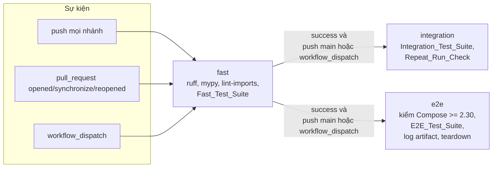
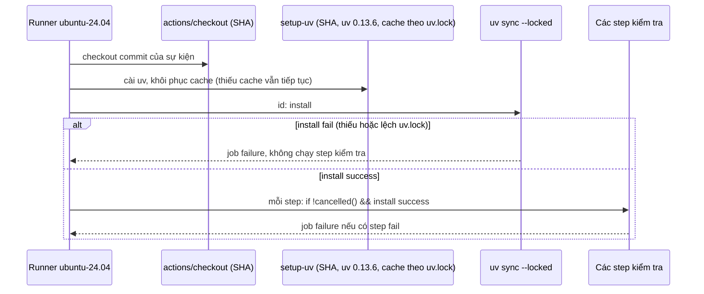
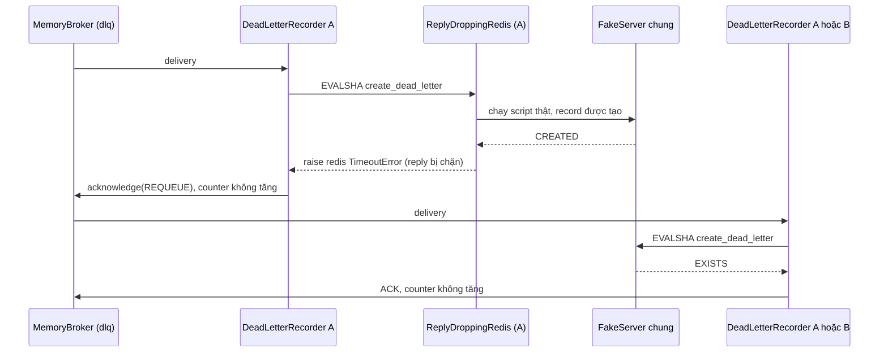
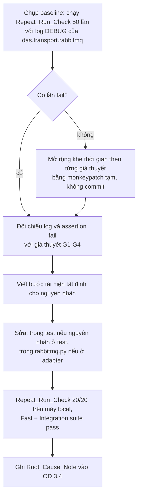

# Design Document: DAS Hardening và CI (Phase 3)

## Overview

Tài liệu này thiết kế Phase 3 của DAS trên nền Phase 1 (`.kiro/specs/distributed-agent-system/design.md`) và Phase 2 (`.kiro/specs/das-observability-operations/design.md`) đã triển khai. Phase 3 không thêm hành vi runtime. Thay đổi rơi vào bốn nhóm: tài liệu spec, tooling (ruff, mypy), CI trên GitHub Actions, và test (một test mới cho DLQ, sửa Flaky_Test, cơ chế biến skip do thiếu Docker thành failure).

Phạm vi theo nhóm requirement:

| Nhóm | Requirement | Thành phần chính |
|---|---|---|
| Quyết định | 1, 2, 4 | `.kiro/specs/open-decisions.md` (Decision_Record), Phase2_Requirements, Phase2_Design, Phase1_Design, README |
| Test DLQ mất reply | 3 | `tests/unit/test_dlq_lost_reply.py`, `ReplyDroppingRedis` (fakeredis) |
| Lint và kiểu | 5, 6, 11.4-11.5 | `[tool.ruff]`, `[tool.mypy]` trong `pyproject.toml`, sửa code trong `das/` theo danh mục cho phép |
| CI | 7, 8, 9 | `.github/workflows/ci.yml` (Fast_Job, Integration_Job, E2E_Job), hook `DAS_REQUIRE_DOCKER` trong `tests/conftest.py`, `DAS_E2E_LOG_DIR` trong fixture e2e |
| Flaky_Test | 10 | `pytest-repeat`, kế hoạch điều tra, sửa trong test hoặc trong `das/transport/rabbitmq.py` |
| Giữ hành vi | 11 | Baseline snapshot (`tests/fixtures/phase3_baseline/`), property test hiện có |
| Tài liệu | 12 | Mục Development và mục CI của README, `tests/unit/test_ci_workflow_static.py` |

### Nguyên tắc thiết kế

1. **Không đổi hành vi runtime.** Mọi sửa trong `das/` chỉ thuộc bốn loại ở Req 11.4. Sửa nào làm đổi hành vi quan sát được thì phải ghi theo Req 11.5. Baseline được chụp trước sửa đổi đầu tiên.
2. **Lệnh local và lệnh CI là một.** Mỗi step kiểm tra của CI chạy đúng văn bản lệnh có trong README. Một test tĩnh đối chiếu hai nơi (Req 12.1, 12.7).
3. **Cơ chế nằm trong repo, không nằm trong YAML.** Việc biến skip thành failure nằm trong `tests/conftest.py` và được bật bằng biến môi trường. Workflow chỉ đặt biến, không parse output của pytest.
4. **Tái lập được.** Action ghim theo commit SHA, uv ghim `X.Y.Z`, dependency cài bằng `uv sync --locked`, seed Hypothesis được in ra và đưa vào pytest qua `PYTEST_ADDOPTS`.
5. **Sửa theo nguyên nhân gốc.** Flaky_Test chỉ được sửa sau khi tái hiện được nguyên nhân. Không dùng rerun, skip hay xfail.

### Quyết định thiết kế chính

| # | Quyết định | Lý do |
|---|---|---|
| H1 | Một file workflow `.github/workflows/ci.yml` với ba job `fast`, `integration`, `e2e`. `integration` và `e2e` cùng `needs: fast`, không phụ thuộc nhau, có `if:` chỉ đúng cho push lên `main` và `workflow_dispatch`. | GitHub tự đánh dấu job là skipped khi `needs` chưa success hoặc `if:` sai (Req 8.9, 8.10). Một file giúp concurrency group và quyền dùng chung. |
| H2 | Bốn step kiểm tra của Fast_Job dùng `if: ${{ !cancelled() && steps.install.outcome == 'success' }}`. | Mặc định GitHub bỏ qua các step sau step fail. Điều kiện này cho mọi step chạy khi cài dependency thành công (Req 7.3), và không step nào chạy khi cài thất bại (Req 7.6). |
| H3 | Biến `DAS_REQUIRE_DOCKER=1` được đọc bởi hook `pytest_runtest_makereport` trong `tests/conftest.py`. Hook đổi report skip có lý do nhắc tới Docker thành failed. | Giữ nguyên các lời gọi `pytest.skip` hiện có. Developer không có Docker vẫn thấy skip như trước. CI không phải parse output `-rs` (Req 8.6). |
| H4 | Repeat_Run_Check dùng `pytest-repeat` (`--count 20`) trong cùng một phiên pytest. Thêm `-v` để mỗi lần chạy có một dòng PASSED/FAILED với ID `[k-20]`. | `--count` tạo 20 test item trong một phiên, dùng chung fixture `broker` scope module, đúng định nghĩa Repeat_Run_Check. pytest kết thúc với exit code 1 khi có item fail và liệt kê từng item fail trong short summary (Req 10.5, 10.8). |
| H5 | Seed Hypothesis được sinh trong step Fast_Test_Suite, in ra log, rồi đưa vào pytest qua `PYTEST_ADDOPTS="--hypothesis-seed=<seed>"`. CI dùng profile `default`, không dùng profile `ci`. | `get_random_for_wrapped_test` của Hypothesis ưu tiên `derandomize` hơn `--hypothesis-seed`. Profile `ci` hiện có đặt `derandomize=True`, nên seed sẽ không có tác dụng. `PYTEST_ADDOPTS` giữ văn bản lệnh `uv run pytest tests/unit tests/property` giống hệt README (Req 9.8, 12.1). |
| H6 | Fault injection cho test mất reply nằm ở client Redis: `ReplyDroppingRedis` (lớp con của `fakeredis.aioredis.FakeRedis`) chạy thật `EVALSHA` của `create_dead_letter.lua` rồi ném `redis.exceptions.TimeoutError`. | Lỗi được chèn ở đúng chỗ xảy ra ngoài thực tế: lệnh đã chạy trên server, reply không về. Toàn bộ đường đi `DeadLetterRecorder.handle` → `StateStore.create_dead_letter` → `StateStore._run` được kiểm, không chỉ một wrapper của StateStore (Req 3.1). |
| H7 | Ruff dùng `line-length = 120`, `extend-exclude = ["das/transport/proto"]` và `force-exclude = true`. | Chạy thử `ruff 0.17.3` với `select = ["E", "F"]`: line-length 100 cho 189 vi phạm E501, 110 cho 19, 120 cho 4 (đều trong `tests/`). 120 nằm trong khoảng cho phép (Req 5.2) và giảm số dòng phải sửa. `force-exclude` giữ Generated_Code bị loại cả khi đường dẫn được truyền tường minh. |
| H8 | Mypy dùng `ignore_errors = true` cho `das.transport.proto.*` thay vì `exclude`. | `das/transport/grpc_rpc.py` import `das_pb2` và `das_pb2_grpc`. `exclude` chỉ ảnh hưởng việc tìm file; mypy vẫn đi theo import và báo lỗi trong module đó (ví dụ `import-not-found` cho `grpc._utilities`). `ignore_errors` tắt lỗi mà vẫn giữ kiểu cho module dùng nó (Req 6.3). |
| H9 | Fixture e2e ghi log Compose vào `DAS_E2E_LOG_DIR` khi biến này được đặt. Workflow thêm hai step `if: always()` dùng label `com.docker.compose.project` để lấy log và dọn stack khi pytest bị dừng giữa chừng. | Fixture hiện ghi log vào thư mục tạm rồi `down -v`, nên sau khi pytest kết thúc thì container đã mất. Khi step bị dừng do timeout, `finally` của fixture không chạy, nên cần step dự phòng (Req 8.8, 8.11). |
| H10 | Step pytest của Integration_Job và E2E_Job có `timeout-minutes` riêng nhỏ hơn 30 phút của job. | Khi step vượt giới hạn của chính nó, các step `if: always()` phía sau còn thời gian để lưu log và dọn stack trước khi job chạm 30 phút (Req 8.7, 8.8, 8.11). |
| H11 | Baseline cho Req 11 được chụp thành file JSON trong `tests/fixtures/phase3_baseline/` trước sửa đổi đầu tiên: corpus bytes của Message_Codec, catalog metric, schema Agent_Config, route HTTP, exit code. Hai test so sánh hiện tại với baseline. | Không có bản build baseline để chạy song song. Snapshot là cách duy nhất để kiểm "giống hệt baseline" sau khi mypy buộc sửa `das/codec/envelope.py` và `das/codec/message_codec.py`. |

### Kết quả nghiên cứu ảnh hưởng tới thiết kế

- **Phiên bản công cụ** (PyPI, kiểm khi viết design): `ruff 0.17.3`, `mypy 2.4.0`, `pytest-repeat 0.9.4`, `types-PyYAML 6.0.12.20260906`, `types-grpcio 1.84.0.20261021`, `types-protobuf 7.35.1.20260906`, `types-aioboto3 15.5.0` (khớp `aioboto3==15.5.0`, kéo theo `types-aiobotocore`, `types-s3transfer`, `botocore-stubs`). `uv` mới nhất là `0.13.6`; máy local hiện dùng `0.8.4`. `uv.lock` đang ở `revision = 3`.
- **Thư viện có type hint sẵn** (`py.typed`): `aio_pika`, `aiormq`, `redis`, `structlog`, `prometheus_client`, `httpx`, `fastapi`, `starlette`, `pydantic`, `uvicorn`, `openai`, `anthropic`, các package `opentelemetry` mà `das/` dùng (`trace`, `sdk`, `exporter.otlp.proto.grpc`, `exporter.otlp.proto.http`). **Không có**: `yaml`, `grpc`, `google.protobuf`, `aioboto3`, `botocore`; cả năm có stub package phát hành riêng. Vì vậy hiện không cần override `ignore_missing_imports` nào (Req 6.4).
- **Chạy thử mypy 2.4.0** trên `das/` với các stub trên, `warn_unused_ignores` và `ignore-without-code`: 42 lỗi trong 18 file, 1 lỗi trong Generated_Code (`grpc._utilities`). Các nhóm lỗi: Literal của trạng thái agent bị nới thành `str` hoặc thành union rộng hơn (`registry.py`, `worker.py`, `manager/agent.py`); `Optional` chưa thu hẹp (`cli.py`, `manager/driver.py`); `**dict[str, object]` truyền vào constructor của `prometheus_client` (`observability/metrics.py`, 13 lỗi); keyword `payload` của `_EnvelopeFields` (`codec/envelope.py`, `codec/message_codec.py`); overload `Session.client` của `types-aioboto3` (`llm/adapters/bedrock.py`); 3 `# type: ignore` không còn cần (`gateway/admin.py`, `manager/driver.py`); 3 lambda không suy ra được kiểu. Tất cả đều sửa được bằng annotation, thu hẹp kiểu hoặc xóa ignore thừa. Hai lỗi cần đọc kỹ vì có thể là lỗi thật: `manager/planner.py` gọi `CompletionClient.complete(operation=...)` mà protocol không khai báo `operation`, và `bedrock.py` `await` một giá trị có thể là `None`.
- **Hypothesis 6.170.8**: `derandomize=True` thắng `--hypothesis-seed` (`hypothesis/core.py`, `get_random_for_wrapped_test`). Không test nào trong `tests/` dùng `@seed`, `derandomize` hay `database=` riêng. `.hypothesis/` đã có trong `.gitignore`, nên checkout mới trên CI không có example database.
- **astral-sh/setup-uv v10.3.2** (`action.yml`): input `version` nhận `X.Y.Z`; `enable-cache`, `cache-dependency-glob` điều khiển cache; cache key gồm platform và hash của file khớp glob; `python-version` đặt `UV_PYTHON`. Bước lưu cache có `post-if: success()`, còn thiếu cache chỉ làm `cache-hit=false`, không làm step fail.
- **Tag và SHA của action** (`git ls-remote`, khi viết design): `actions/checkout v7.0.1` = `3d3c42e5aac5ba805825da76410c181273ba90b1`; `astral-sh/setup-uv v10.3.2` = `07a047e608db84b3d8c06cd9a7c7dcc9c355c18e`. SHA của `actions/upload-artifact` (bản mới nhất) được lấy lúc hiện thực bằng `git ls-remote --tags https://github.com/actions/upload-artifact`. Khi hiện thực, mọi SHA phải được kiểm lại vì tag có thể đã có bản mới.
- **GitHub Actions**: `concurrency` với `cancel-in-progress: true` hủy lần chạy cũ cùng group và đặt trạng thái cancelled. Job có `needs` mà job trước không success thì bị skipped. Hàm `always()` và `!cancelled()` cho step chạy sau step fail ([Workflow syntax](https://docs.github.com/actions/using-workflows/workflow-syntax-for-github-actions), [Expressions](https://docs.github.com/actions/learn-github-actions/expressions)).

Content was rephrased for compliance with licensing restrictions.

## Architecture

### Job graph của CI_Pipeline



`integration` và `e2e` không có `needs` lẫn nhau, nên failure của job này không hủy job kia (Req 8.3).

### Luồng step trong một job



### Fault injection cho Dead_Letter_Record mất reply



Trường hợp (a): X là A. Trường hợp (b): A ngừng subscribe trước khi REQUEUE, X là B dùng client Redis khác trên cùng `FakeServer`.

### Kế hoạch điều tra Flaky_Test



### Thay đổi file

```
.github/workflows/ci.yml                       mới: Fast_Job, Integration_Job, E2E_Job
pyproject.toml                                 thêm ruff, mypy, stub, pytest-repeat; [tool.ruff], [tool.mypy]
uv.lock                                        tạo lại bằng uv 0.13.6
.gitignore                                     thêm .mypy_cache/, .ruff_cache/
README.md                                      mục Development, mục Continuous integration
tests/conftest.py                              hook DAS_REQUIRE_DOCKER
tests/unit/test_dlq_lost_reply.py              mới (Req 3)
tests/unit/test_ci_workflow_static.py          mới (Req 7-9, 12)
tests/unit/test_lint_config.py                 mới (Req 5.3, 5.7, 5.8)
tests/unit/test_require_docker_hook.py         mới (Req 8.6, dùng pytester)
tests/unit/test_phase3_baseline.py             mới (Req 11.1-11.3)
tests/property/test_codec_baseline_bytes.py    mới (Req 11.2)
tests/fixtures/phase3_baseline/                mới: capture.py và các file JSON baseline
tests/integration/test_rabbitmq_broker.py      sửa theo nguyên nhân gốc (nếu ở test)
tests/integration/e2e/test_compose_e2e.py      DAS_E2E_LOG_DIR
tests/integration/e2e/test_observability_e2e.py DAS_E2E_LOG_DIR
das/transport/rabbitmq.py                      sửa theo nguyên nhân gốc (nếu ở adapter)
das/**                                         sửa tối thiểu để qua ruff và mypy (Req 11.4)
.kiro/specs/open-decisions.md                  Decision_Record cho 16 mục
.kiro/specs/das-observability-operations/{requirements,design}.md   sửa theo OD 1.x, 3.5
.kiro/specs/distributed-agent-system/design.md                       đoạn về Redis primary (OD 4.1)
.kiro/specs/das-hardening-ci/baseline.md       mới: số test thu thập, skip, max_examples ở baseline
```

## Components and Interfaces

### 1. Decision_Log (`.kiro/specs/open-decisions.md`) (Req 1)

Với mỗi mục OD 1.1–1.8, 2.1, 3.1–3.5, 4.1, 4.2:

- Tiêu đề: chỉ đổi `[ ]` thành `[x]`. Phần Hiện trạng, Lựa chọn, Đề xuất và toàn bộ phần 5 giữ nguyên từng ký tự (Req 1.6).
- Ngay sau bullet cuối của mục (trước dòng trống và tiêu đề `###` kế tiếp, hoặc trước `---` ở mục cuối của một phần), thêm đúng một Decision_Record theo mẫu:

```markdown
- **Quyết định:** (a) Sửa Req 18.12 và design theo API v3.
  - **Ngày:** YYYY-MM-DD
  - **Áp dụng tại:** v2 Req 18.12; Phase2_Design mục "Integration và smoke test"; `tests/integration/e2e/test_observability_e2e.py`
```

Ba dòng có nhãn cố định (`**Quyết định:**`, `**Ngày:**`, `**Áp dụng tại:**`) để kiểm bằng grep: mỗi mục có đúng một dòng `**Quyết định:**` (Req 1.7). Riêng OD 3.4 có thêm các dòng con `**Nguyên nhân gốc:**`, `**Cách sửa:**`, `**Repeat_Run_Check:**` (Req 1.4, 10.1-10.3).

Nội dung quyết định và tham chiếu tối thiểu (Req 1.2, 1.3, 1.5, 1.8):

| OD | Quyết định | Áp dụng tại (tối thiểu) |
|---|---|---|
| 1.1 | (a) Sửa Req 18.12 và design theo API v3. | v2 Req 18.12; Phase2_Design "Integration và smoke test" |
| 1.2 | (a) Bổ sung `parameter:"body"` vào Req 17.15. | v2 Req 17.15; Phase2_Design bảng endpoint của Gateway_API |
| 1.3 | (a) Xác nhận `stale_attempt` và ghi vào Req 13.7. | v2 Req 13.7; Phase2_Design §14 (`decide_replay`) |
| 1.4 | (a) Chấp nhận và ghi rõ trong requirements. | v2 Req 12.12 (tiêu chí mới cuối Requirement 12) hoặc 12.2; Phase2_Design D6 |
| 1.5 | (a) Chấp nhận: counter là "≤ số record", và ghi điều này vào Req 3.8. | v2 Req 3.8; `tests/unit/test_dlq_lost_reply.py`; Phase2_Design Property 18 |
| 1.6 | (a) Chấp nhận (chỉ ảnh hưởng một lần, trong lúc nâng cấp). | v2 Req 3.3; Phase2_Design §6 (`acquire_lease.lua`) |
| 1.7 | (a) Sửa Req 2.7: chỉ áp dụng cho transition do Manager ghi. | v2 Req 2.7; Phase2_Design "Unit và example test" |
| 1.8 | (a) Xác nhận cách hiện tại. Operator dùng `das drain --wait` để chờ `drained=true`. | v2 Req 17.5; Phase2_Design §8 (Drain) |
| 2.1 | (a) Giữ dòng này. | `deploy/docker-compose.yml`; `deploy/.env.example` |
| 3.1 | (b) Chỉ bật E/F. | `pyproject.toml` (`[tool.ruff]`) |
| 3.2 | Đưa mypy vào dependency group `dev` và Fast_Job, cấu hình cơ bản (không `strict`), chỉ cho package `das/`. | `pyproject.toml` (`[tool.mypy]`); `.github/workflows/ci.yml` |
| 3.3 | (a) Loại `das/transport/proto/` khỏi lint. | `pyproject.toml` (`extend-exclude`, override mypy) |
| 3.4 | Root_Cause_Note, cách sửa, kết quả 20/20 (Requirement 10). | `tests/integration/test_rabbitmq_broker.py` (và `das/transport/rabbitmq.py` nếu sửa ở adapter) |
| 3.5 | (a) Cập nhật bảng trong design theo tên file thực tế. | Phase2_Design bảng "Property tests" |
| 4.1 | Giữ giả định một Redis primary. | Phase1_Design mục Redis Lua scripts |
| 4.2 | (a) Giữ việc đồng bộ thủ công. | `tests/unit/test_deploy_static.py::test_delivery_limit_matches_manager_max_attempts`; README mục Configuration |

Mẫu cho OD 3.4:

```markdown
- **Quyết định:** Tìm nguyên nhân gốc và sửa; theo dõi bằng Repeat_Run_Check (20 lần) trong Integration_Job.
  - **Ngày:** YYYY-MM-DD
  - **Nguyên nhân gốc:** <file>::<hàm>. <chuỗi sự kiện dẫn tới fail>. Bằng chứng: <đoạn log hoặc các bước tái hiện>.
  - **Cách sửa:** <file đã sửa>: <thay đổi>, loại bỏ nguyên nhân ở trên vì <lý do>.
  - **Repeat_Run_Check:** 20/20 pass, YYYY-MM-DD, máy local của Developer (<OS>, Docker <phiên bản>).
  - **Áp dụng tại:** `tests/integration/test_rabbitmq_broker.py`; README mục Development
```

### 2. Sửa spec Phase 2 (Req 2)

Phase2_Requirements chỉ được sửa nội dung trong tiêu chí hiện có hoặc thêm tiêu chí mới vào cuối Requirement. Không đánh lại số (Req 2.11).

| Tiêu chí | Nội dung mới (tóm tắt, viết theo EARS khi sửa) |
|---|---|
| v2 Req 18.12 | Trace được kiểm qua API v3 của trace backend: `GET /api/v3/traces?query.service_name=das-gateway`. Xóa chuỗi `/api/traces?service=das-gateway`. |
| v2 Req 17.15 | Hai trường hợp 400 `invalid_request`, không gửi command: `parameter:"body"` khi body không parse được thành JSON hoặc là JSON nhưng không phải object (ví dụ `[]`); `parameter:"release_leases"` khi body là object có `release_leases` không phải boolean. Body rỗng vẫn có nghĩa `release_leases=false` như code hiện tại (`das/gateway/admin.py`). Phần về Worker_Agent của tiêu chí giữ nguyên. |
| v2 Req 13.7 | Thêm: attempt number của record lớn hơn attempt count hiện tại của Job → 409 `stale_attempt`, không đổi state, cùng vị trí trong thứ tự kiểm tra với trường hợp nhỏ hơn (khớp `das/ops/replay.py` và `replay_dead_letter.lua`). |
| v2 Req 12.12 (mới) | Hai Message có Dead_Letter_Reason `malformed` và body giống hệt từng byte tạo đúng một Dead_Letter_Record, kể cả khi được publish riêng biệt. Chọn thêm tiêu chí mới thay vì sửa 12.2 vì 12.2 là property "đúng một record cho mỗi Message"; ghép thêm ngoại lệ vào đó làm property khó đọc. |
| v2 Req 3.8 | Thay mệnh đề "tổng counter ... bằng số Dead_Letter_Record đã tạo" bằng: tổng `das_dlq_records_created_total` trên Manager_Group ≤ số Dead_Letter_Record đã tạo, và bằng số đó khi mọi reply của lệnh ghi tạo record tới được Manager_Agent. |
| v2 Req 3.3 | Thêm: lần acquire đầu tiên trên Lease không có trường `last_owner` (Lease do agent v1 ghi) được đếm `kind="initial"`, kể cả khi owner trước khác Manager_Agent đang acquire. |
| v2 Req 2.7 | Observation chỉ được ghi cho transition do lệnh ghi State_Store của Manager_Agent tạo ra. Bỏ cụm "hoặc Cancelled trước khi được dispatch" khỏi trường hợp observation bằng 0, giữ trường hợp Skipped. Thêm: Job bị Cancelled trước dispatch qua cancel của Gateway_API không tạo observation nào. |
| v2 Req 17.5 | Thêm: với `release_leases=true`, Manager_Agent reply sau khi yêu cầu mọi driver nhả Lease, không chờ nhả xong. Giới hạn 5 giây kể từ khi nhận Drain_Command cho việc release vẫn giữ. Operator dùng `das drain --wait` để chờ `drained=true`. |

Phase2_Design được sửa ở mọi đoạn mô tả cùng hành vi (Req 2.10):

| Đoạn trong Phase2_Design | Sửa |
|---|---|
| D6 | Thêm tham chiếu tới v2 Req 12.12. |
| §6 bảng "Script thay đổi" (`acquire_lease.lua`) | Ghi rõ Lease không có `last_owner` → `initial` (v2 Req 3.3). |
| §8 Drain | Ghi rõ reply không chờ việc nhả Lease, `das drain --wait` (v2 Req 17.5). |
| §10 bảng endpoint, dòng drain | `400 invalid_request{parameter:"body"\|"release_leases"}`. |
| §14 ghi chú `decide_replay` | Bỏ "(requirement không nêu)", tham chiếu v2 Req 13.7. |
| Property 18 | "Tổng counter bằng số record" thành "tổng counter ≤ số record; bằng khi mọi reply tới được Manager. Test của property chỉ chèn lỗi trước khi ghi, nên mọi reply đều về và vế bằng được kiểm. Trường hợp mất reply được kiểm ở `tests/unit/test_dlq_lost_reply.py`". |
| Bảng "Property tests" | Property 1 → `test_job_transition_count.py`; 24 → `test_retention_safety.py`; 25 → `test_prop_retention_liveness.py`. Các dòng còn lại cũng được đổi sang tên file thật, xác định bằng tag `# Feature: das-observability-operations, Property N` trong `tests/property/` (ví dụ 18 → `test_dead_letter_record_once.py`, 19 → `test_dlq_pagination.py`). Đây là phạm vi của OD 3.5 (a) "cập nhật bảng theo tên file thực tế". |
| "Unit và example test", dòng "Điểm ghi metric" | `das_job_attempts` = 0 chỉ cho Skipped; Cancelled trước dispatch qua Gateway không có observation. |
| "Unit và example test", dòng "Drain" | `400 body` và `400 release_leases`. |
| "Integration và smoke test", dòng e2e | `/api/v3/traces?query.service_name=das-gateway`. |
| Đoạn cuối Testing Strategy | Bỏ hai ví dụ "đang xử lý là `stale_attempt`" và "D6" vì đã được quyết. |

Kiểm sau khi sửa (grep, chạy trong task): `/api/traces?service=das-gateway` không còn trong hai file; `test_prop_transition_metrics.py` và `test_prop_retention.py` không còn trong Phase2_Design; số tiêu chí của mỗi Requirement trong Phase2_Requirements không giảm và tiêu chí cũ giữ số.

### 3. Phase1_Design và deploy (Req 4)

- **Phase1_Design** (viết tiếng Anh như phần còn lại của file): thêm ngay sau bullet "Redis Lua scripts" ở dòng 25 một đoạn "Redis deployment scope" nêu (a) chỉ hỗ trợ đúng một Redis primary; (b) Redis Sentinel và Redis Cluster nằm ngoài phạm vi vì các Lua script truy cập nhiều key không cùng hash slot; (c) HA cho Redis cần một phase riêng.
- **`deploy/docker-compose.yml`, `deploy/.env.example`**: không đổi. Đã có `DAS__ADMIN_API_KEYS:` truyền theo tên ở service `gateway` và giá trị rỗng trong `.env.example`. `tests/unit/test_deploy_static.py` được bổ sung một assertion cho hai điều này (giữ hành vi, chặn hồi quy).
- **README**: câu về `delivery-limit` đã có ở mục Configuration, giữ nguyên.
- **`test_delivery_limit_matches_manager_max_attempts`**: đã có, không skip hay xfail. Fast_Job chạy nó trong Fast_Test_Suite, nên lệch `delivery-limit` làm Fast_Job fail (Req 4.5, 4.6).

### 4. Test mất reply cho DLQ (`tests/unit/test_dlq_lost_reply.py`) (Req 3)

Test nằm trong `tests/unit`, dùng `fakeredis[lua]` chạy `create_dead_letter.lua` thật và `MemoryBroker`/`MemoryTransport` của `tests/fakes/memory_transport.py`. Không cần Docker.

```python
class ReplyDroppingRedis(FakeRedis):
    """FakeRedis chạy thật EVALSHA của một script rồi ném TimeoutError (reply bị mất)."""

    def __init__(self, *, server: FakeServer, target_sha: str,
                 on_drop: Callable[[], Awaitable[None]] | None = None, **kw: Any) -> None: ...
    armed: bool            # True cho tới lần chặn đầu tiên
    executed: int          # số lần EVALSHA target đã chạy trên server
    dropped: int           # số reply đã chặn

    async def evalsha(self, sha: str, numkeys: int, *keys_and_args: Any) -> Any:
        result = await super().evalsha(sha, numkeys, *keys_and_args)
        if sha == self.target_sha:
            self.executed += 1
            if self.armed:
                self.armed = False
                self.dropped += 1
                if self.on_drop is not None:
                    await self.on_drop()
                raise redis.exceptions.TimeoutError("injected: reply lost after execution")
        return result
```

`target_sha` lấy từ `StateStore(client)._scripts["create_dead_letter"].sha` (redis-py `AsyncScript`). Khi hiện thực cần xác nhận `AsyncScript.__call__` đi qua `client.evalsha`; nếu không, override `execute_command` và so tên lệnh `EVALSHA` cùng SHA.

Ba trường hợp, mỗi trường hợp dùng một `FakeServer` mới và một Message `dispatch` hợp lệ với header `x-death-reason: delivery_limit`:

| Trường hợp | Thiết lập | Lần giao lại tới |
|---|---|---|
| (a) cùng Manager | Recorder A với `ReplyDroppingRedis`, một subscriber trên `dlq` | A (REQUEUE trả Message về và A là consumer duy nhất) |
| (b) Manager khác | A như trên, `on_drop` gọi `recorder_a.stop()` (ngừng subscribe). Sau khi A REQUEUE, khởi động recorder B với `FakeRedis` thường trên cùng server | B |
| đối chứng | Recorder A với `FakeRedis` thường | không có giao lại |

Assertion:

- **Fault có hiệu lực** (Req 3.1): `client.executed >= 1` và `client.dropped == 1`; record tồn tại trong fakeredis ngay sau lần chặn (`get_dead_letter(dlid) is not None`); log `dead_letter_record_failed` có `error="TimeoutError"` (bắt bằng `structlog.testing.capture_logs`). Nếu `dropped == 0` hoặc `executed == 0` thì test fail với thông báo "fault injection had no effect".
- **Lần giao lại đã được xử lý xong**: chờ `broker.settle()`, rồi `broker.pending("dlq") == []` và `broker.unacked_count("dlq") == 0`. Ở (b), thêm: B đã gọi script một lần (client của B được bọc bộ đếm đơn giản, hoặc kiểm log `dead_letter_record_exists` từ B).
- **Số record** (Req 3.2): `list_dead_letters(limit=100)` trả đúng 1 record với `dead_letter_id == dlid`.
- **Counter** (Req 3.3): tổng `das_dlq_records_created_total` (parse `MetricsRecorder.render()` như Property 18) trên mọi recorder tham gia ≤ 1, đọc sau bước settle.
- **Đối chứng** (Req 3.6): đúng 1 record và tổng counter == 1.

Mỗi trường hợp bọc trong `asyncio.timeout(3)`; ba trường hợp cùng chạy dưới 10 giây (Req 3.4). Hàm đọc counter được tách vào `tests/fixtures/metrics.py` nếu Property 18 dùng chung; nếu không thì giữ cục bộ để không sửa Property 18.

### 5. Ruff (Req 5)

```toml
[dependency-groups]
dev = [
    # ... hiện có ...
    "ruff==0.17.3",
]

[tool.ruff]
target-version = "py312"
line-length = 120
extend-exclude = ["das/transport/proto"]   # Generated_Code (OD 3.3)
force-exclude = true

[tool.ruff.lint]
select = ["E", "F"]
```

- Không có `ignore`, không có `per-file-ignores` (Req 5.6). Không bật `fix`.
- Thư mục mặc định ruff loại trừ (`.venv`, `.git`, ...) giữ nguyên. Chạy tại gốc repo, ruff kiểm `das/`, `tests/` và mọi `.py` khác (hiện không có file `.py` nào ngoài hai thư mục này).
- Sửa cần làm: 4 dòng E501 trong `tests/` (`test_compose_e2e.py:154`, `test_observability_e2e.py:20`, `test_metrics_cardinality.py:180`, `test_manager_summarizer.py:21`), xuống dòng hoặc tách chuỗi. Không dòng nào trong `das/` cần sửa ở `line-length = 120`.
- `# noqa` không mã: hiện không có. Các `# noqa: ANN201`, `# noqa: BLE001` hiện có vẫn hợp lệ với Req 5.5 vì có mã rule; ruff không báo vì `RUF100` không được chọn.

### 6. Mypy (Req 6)

```toml
[dependency-groups]
dev = [
    # ... hiện có ...
    "mypy==2.4.0",
    "types-PyYAML==6.0.12.20260906",
    "types-grpcio==1.84.0.20261021",
    "types-protobuf==7.35.1.20260906",
    "types-aioboto3==15.5.0",
    "botocore-stubs==<bản 1.40.x mới nhất, khớp botocore 1.40.61>",
]

[tool.mypy]
python_version = "3.12"
files = ["das"]
plugins = ["pydantic.mypy"]
warn_unused_ignores = true
enable_error_code = ["ignore-without-code"]

[[tool.mypy.overrides]]
module = ["das.transport.proto", "das.transport.proto.*"]   # Generated_Code (OD 3.3)
ignore_errors = true
```

- Không đặt `strict`, `ignore_missing_imports` toàn cục, `follow_imports` toàn cục (Req 6.2, 6.4, 6.8).
- `pydantic.mypy` plugin có sẵn trong package `pydantic` đã ghim, không thêm dependency. Plugin cho mypy chữ ký `__init__` đúng của model (kể cả alias và strict field), nhờ đó lỗi `Unexpected keyword argument "payload" for "_EnvelopeFields"` được đánh giá đúng thay vì báo sai. Nếu khi hiện thực plugin làm tăng lỗi sai hoặc đổi kết quả theo cách khó giải thích, bỏ plugin và ghi lý do vào task.
- `botocore-stubs` được ghim ở top level vì `das/llm/adapters/bedrock.py` import thẳng `botocore`. `types-aiobotocore` và `types-s3transfer` là phụ thuộc bắc cầu của `types-aioboto3`, được ghim trong `uv.lock`.
- Stub chọn theo thư viện mà `das/` import trực tiếp: `yaml` (`das/config/loader.py`), `grpc`, `grpc.aio` (`das/transport/grpc_rpc.py`), `google.protobuf` (qua `das_pb2.pyi`), `aioboto3`, `botocore` (`bedrock.py`). Hiện không có thư viện nào thiếu cả type hint lẫn stub, nên không có override `ignore_missing_imports`. Nếu khi hiện thực xuất hiện thư viện như vậy, thêm một mục `[[tool.mypy.overrides]]` chỉ cho module đó.
- `.mypy_cache/` và `.ruff_cache/` thêm vào `.gitignore`.

**Chính sách sửa lỗi kiểu** (Req 11.4, 11.5). Thứ tự ưu tiên khi sửa một lỗi:

1. Sửa annotation cho đúng kiểu thật (ví dụ Literal trạng thái agent, `dict[str, Any]` cho kwargs của constructor `prometheus_client`).
2. Thu hẹp kiểu bằng `isinstance`, so sánh `None` hoặc `assert` khi giá trị chắc chắn không `None` theo luồng hiện tại.
3. Xóa `# type: ignore` thừa.
4. `# type: ignore[<mã>]` có mã, kèm comment lý do, khi stub sai hoặc thiếu (ví dụ overload `Session.client` của `types-aioboto3` không nhận `botocore.config.Config`).

Mỗi sửa đổi trong `das/` được ghi trong mô tả task. Nếu một sửa đổi làm đổi hành vi quan sát được (ví dụ `planner.py` thật sự truyền `operation` mà adapter không nhận), task ghi đường dẫn, số dòng, mã lỗi, hành vi trước và sau (Req 11.5). Phải dừng và hỏi lại nếu sửa đó làm đổi route, status code, mã lỗi, body, bytes của codec, metric, config, biến `DAS__` hoặc exit code (Req 11.1-11.3).

### 7. Cơ chế "thiếu Docker là failure" (`tests/conftest.py`) (Req 8.6)

```python
REQUIRE_DOCKER_ENV = "DAS_REQUIRE_DOCKER"
_DOCKER_SKIP = re.compile(r"\bdocker\b", re.IGNORECASE)

@pytest.hookimpl(hookwrapper=True)
def pytest_runtest_makereport(item, call):
    outcome = yield
    report = outcome.get_result()
    if os.environ.get(REQUIRE_DOCKER_ENV) != "1" or not report.skipped:
        return
    reason = _skip_reason(report)          # longrepr của skip là (path, lineno, "Skipped: ...")
    if reason is not None and _DOCKER_SKIP.search(reason):
        report.outcome = "failed"
        report.longrepr = f"{REQUIRE_DOCKER_ENV}=1 but the test was skipped: {reason}"
```

- Các lý do skip hiện có đều chứa "Docker": `test_rabbitmq_broker.py`, `test_rabbitmq_operations.py` ("Docker is not available; ..."), `test_compose_e2e.py`, `test_observability_e2e.py` ("Docker / docker compose not available; ..."). Skip do cổng 9090/3000/16686 bận ("127.0.0.1 ports ... already in use") không chứa "docker", vẫn là skip.
- Skip trong fixture scope module tạo report skip ở phase `setup` cho từng test; hook đổi từng report thành failed, pytest báo ERROR và exit code 1.
- Skip ở mức module (`pytest.skip(..., allow_module_level=True)`) tạo `CollectReport`, không qua hook này. Hiện không có trường hợp nào. Hook thứ hai `pytest_collectreport` không được thêm (YAGNI); test tĩnh ở mục 10 kiểm rằng `tests/integration` không dùng `allow_module_level=True`.
- Integration_Job và E2E_Job đặt `DAS_REQUIRE_DOCKER: "1"` ở mức job. Fast_Job không đặt.

### 8. Repeat_Run_Check (Req 10.4, 10.5, 10.8)

- Thêm `pytest-repeat==0.9.4` vào dependency group `dev`. Bản này phát hành 04/2025, trước pytest 9.1.1. Task đầu tiên của Requirement 10 kiểm tương thích bằng `--count 2`. Nếu không tương thích, thay bằng option `--das-repeat N` tự định nghĩa trong `tests/conftest.py` qua `pytest_generate_tests` (parametrize một fixture ẩn), giữ cùng ID dạng `[k-N]`.
- Lệnh (giống hệt trong README và CI):

```bash
uv run pytest "tests/integration/test_rabbitmq_broker.py::test_reconnect_restores_subscriptions" --count 20 -v
```

- 20 item dùng chung fixture `broker` scope module: một container RabbitMQ cho cả 20 lần, đúng "cùng một phiên pytest và cùng một môi trường". Mỗi lần tạo transport và Capability mới (`cap()` dùng UUID), nên các lần không chia queue.
- Với `-v`, log có dòng `...test_reconnect_restores_subscriptions[k-20] PASSED|FAILED` cho từng lần, và short summary liệt kê `FAILED ...[k-20]`. Không dùng `-x`, để cả 20 lần đều chạy. Exit code khác 0 khi có ít nhất một lần fail.

### 9. Điều tra và sửa Flaky_Test (Req 10)

Hiện trạng ghi nhận: test fail một lần ở đầu một lần chạy, các lần sau pass. Nguyên nhân gốc chỉ được kết luận khi hiện thực. Dưới đây là các giả thuyết rút ra từ code của `tests/integration/test_rabbitmq_broker.py` và `das/transport/rabbitmq.py`, mỗi giả thuyết có dấu hiệu nhận biết, cách tái hiện và hướng sửa.

| # | Giả thuyết | Vị trí | Dấu hiệu khi fail | Cách tái hiện tất định | Hướng sửa |
|---|---|---|---|---|---|
| G1 | **ACK của "before" chưa tới broker khi connection bị xóa.** `Inbox.__call__` append delivery rồi mới `await acknowledge`. `wait_for(inbox.job_ids() == ["before"])` pass ngay khi append, nên `drop_connections` có thể xóa connection trước khi `basic.ack` được gửi. Broker requeue "before", và sau reconnect "before" được giao lần nữa. | test: `test_reconnect_restores_subscriptions`, `Inbox.__call__` | `assert sorted(inbox.job_ids()) == [...]` fail với "before" xuất hiện hai lần | Monkeypatch tạm `Inbox.__call__` để `await asyncio.sleep(1)` giữa append và acknowledge | Test chờ `worker.in_flight() == 0` (ACK đã settle) trước mỗi lần drop. Không đổi assertion. |
| G2 | **Management API còn liệt kê connection đã đóng.** Ở lần drop thứ hai, `/api/connections` có thể còn trả connection cũ (stats cập nhật mỗi 500 ms). `DELETE` trên connection đã đóng trả 404, và `assert r.status_code in (200, 204)` fail. Hoặc helper chỉ xóa entry cũ rồi return, connection mới không bị đóng, và `wait_for(not worker.connected)` hết 15 s. | test: `drop_connections` | `AssertionError` từ `assert r.status_code in (200, 204)` với body 404, hoặc "timed out waiting for second drop detected" | Gọi `drop_connections` hai lần liên tiếp không chờ, hoặc tăng `collect_statistics_interval` | `drop_connections` coi 404 là "đã đóng", chỉ xóa connection có `state == "running"`, và lặp tới khi một connection đang chạy bị xóa. Hàm này cũng được `test_rabbitmq_operations.py` import nên phải giữ chữ ký. |
| G3 | **Poll task chết khi connection bị đóng giữa `basic.get`.** `_poll_loop` không có guard. `poll_once` bắt `Exception` quanh `queue.get` nhưng không bắt `asyncio.CancelledError`; nếu aiormq hủy future của RPC đang chờ khi connection đóng, `CancelledError` thoát khỏi `_poll_loop` và task kết thúc. Sau reconnect, `_ensure_poller()` chỉ được gọi trong `subscribe`, nên không còn ai poll. | adapter: `RabbitMQTransport._poll_loop`, `poll_once`, `_reconnect` | "timed out waiting for delivery after reconnect" dù `worker.connected` là True; `worker._poll_task.done()` là True | Monkeypatch `queue.get` để raise `asyncio.CancelledError` một lần sau drop | Trong `_reconnect`, gọi `self._ensure_poller()` sau `registry.restore`; trong `_poll_loop`, bắt lỗi của một vòng (trừ khi `_closing`) rồi `_idle()`. Interface công khai không đổi (Req 10.7). |
| G4 | **Khởi động lạnh của broker.** "Fail ở đầu lần chạy" có thể do broker vừa start: quorum queue đầu tiên khai báo chậm hoặc management API chưa liệt kê connection, làm một `wait_for` 15 s hết hạn. | test: fixture `broker`, `_wait_ready` | Timeout ở `wait_for` đầu tiên của test chạy đầu tiên sau khi container start | Chạy riêng Flaky_Test (không có test khác khởi động broker trước) nhiều lần với container mới mỗi lần | `_wait_ready` chờ thêm điều kiện quorum queue sẵn sàng (khai báo và xóa một quorum queue thử). Không tăng timeout của assertion. |

Quy trình:

1. Chạy Repeat_Run_Check với `--count 50 -o log_cli=true --log-cli-level=DEBUG` cho logger `das.transport.rabbitmq` và `aio_pika`, ghi log ra file. Thêm instrumentation tạm (không commit): in `worker._poll_task`, `inbox.job_ids()`, JSON của `/api/connections` tại mỗi lần drop.
2. Chạy thêm Flaky_Test như test đầu tiên trên container mới (cho G4) bằng cách chạy riêng node ID 10 lần, mỗi lần một phiên pytest.
3. Nếu chưa thấy fail, áp từng monkeypatch tái hiện ở bảng trên. Giả thuyết nào làm test fail với đúng dấu hiệu đã ghi nhận thì giữ làm ứng viên.
4. Đối chiếu với dấu hiệu của lần fail gốc. Root_Cause_Note phải có vị trí (file và hàm), chuỗi sự kiện, và bằng chứng (đoạn log hoặc bước tái hiện).
5. Sửa ở đúng vị trí của nguyên nhân. Có thể có nhiều nguyên nhân; mỗi nguyên nhân có bằng chứng riêng thì sửa riêng và ghi riêng.
6. Chạy Repeat_Run_Check 20 lần trên máy local, Fast_Test_Suite và Integration_Test_Suite, rồi ghi kết quả vào OD 3.4.

Ràng buộc (Req 10.6): giữ ba subscription và mọi assertion hiện có; không thêm `pytest-rerunfailures`, `flaky`, skip hay xfail; không tăng timeout để che race. Sửa ở adapter (G3) thì kèm một unit test trong `tests/unit/test_rabbitmq_transport.py` dùng connect giả, kiểm rằng sau một lần poll gặp lỗi rồi reconnect, delivery vẫn tiếp tục.

### 10. CI_Pipeline (`.github/workflows/ci.yml`) (Req 7, 8, 9)

```yaml
name: CI

on:
  push:
    branches: ["**"]            # mọi nhánh; không chạy cho tag
  pull_request:
    types: [opened, synchronize, reopened]
  workflow_dispatch:

permissions:
  contents: read

concurrency:
  group: ci-${{ github.event_name }}-${{ github.head_ref || github.ref }}
  cancel-in-progress: true

env:
  UV_VERSION: "0.13.6"
  PYTHON_VERSION: "3.12"

jobs:
  fast:
    name: Fast_Job
    runs-on: ubuntu-24.04
    timeout-minutes: 15
    steps:
      - uses: actions/checkout@3d3c42e5aac5ba805825da76410c181273ba90b1  # v7.0.1
      - uses: astral-sh/setup-uv@07a047e608db84b3d8c06cd9a7c7dcc9c355c18e  # v10.3.2
        with:
          version: ${{ env.UV_VERSION }}
          python-version: ${{ env.PYTHON_VERSION }}
          enable-cache: true
          cache-dependency-glob: uv.lock
      - name: uv sync --locked
        id: install
        run: uv sync --locked
      - name: uv run ruff check
        if: ${{ !cancelled() && steps.install.outcome == 'success' }}
        run: uv run ruff check
      - name: uv run mypy
        if: ${{ !cancelled() && steps.install.outcome == 'success' }}
        run: uv run mypy
      - name: uv run lint-imports
        if: ${{ !cancelled() && steps.install.outcome == 'success' }}
        run: uv run lint-imports
      - name: uv run pytest tests/unit tests/property
        if: ${{ !cancelled() && steps.install.outcome == 'success' }}
        run: |
          HYPOTHESIS_SEED="$(python3 -c 'import secrets; print(secrets.randbelow(2**32))')"
          echo "Hypothesis seed: ${HYPOTHESIS_SEED}"
          echo "Reproduce locally: uv run pytest tests/unit tests/property --hypothesis-seed=${HYPOTHESIS_SEED}"
          export PYTEST_ADDOPTS="--hypothesis-seed=${HYPOTHESIS_SEED}"
          uv run pytest tests/unit tests/property

  integration:
    name: Integration_Job
    needs: fast
    if: ${{ github.event_name == 'workflow_dispatch' || (github.event_name == 'push' && github.ref == 'refs/heads/main') }}
    runs-on: ubuntu-24.04
    timeout-minutes: 30
    env:
      DAS_REQUIRE_DOCKER: "1"
    steps:
      - checkout, setup-uv (như fast)
      - name: uv sync --locked
        id: install
        run: uv sync --locked
      - name: uv run pytest tests/integration --ignore=tests/integration/e2e
        timeout-minutes: 15
        run: uv run pytest tests/integration --ignore=tests/integration/e2e
      - name: Repeat_Run_Check (test_reconnect_restores_subscriptions x20)
        if: ${{ !cancelled() && steps.install.outcome == 'success' }}
        timeout-minutes: 12
        run: uv run pytest "tests/integration/test_rabbitmq_broker.py::test_reconnect_restores_subscriptions" --count 20 -v

  e2e:
    name: E2E_Job
    needs: fast
    if: (cùng điều kiện như integration)
    runs-on: ubuntu-24.04
    timeout-minutes: 30
    env:
      DAS_REQUIRE_DOCKER: "1"
      DAS_E2E_LOG_DIR: ${{ runner.temp }}/e2e-logs
    steps:
      - checkout, setup-uv (như fast)
      - name: uv sync --locked
        id: install
        run: uv sync --locked
      - name: Check Docker Compose >= 2.30
        run: |
          found="$(docker compose version --short 2>/dev/null || true)"
          found="${found#v}"
          echo "Docker Compose version found: ${found:-unknown}"
          if [ -z "$found" ] || [ "$(printf '%s\n' 2.30.0 "$found" | sort -V | head -n1)" != "2.30.0" ]; then
            echo "::error::Docker Compose >= 2.30 is required (found: ${found:-unknown})"
            exit 1
          fi
      - name: uv run pytest tests/integration/e2e
        timeout-minutes: 24
        run: uv run pytest tests/integration/e2e
      - name: Collect container logs
        if: ${{ failure() || cancelled() }}
        run: (xem bên dưới)
      - name: Upload container logs
        if: ${{ failure() || cancelled() }}
        uses: actions/upload-artifact@<SHA 40 ký tự>  # v<X.Y.Z>
        with:
          name: e2e-logs-${{ github.run_id }}-${{ github.run_attempt }}
          path: ${{ runner.temp }}/e2e-logs
          if-no-files-found: warn
      - name: Tear down Compose stacks
        if: ${{ always() }}
        run: (xem bên dưới)
```

Ghi chú:

- `if:` của job không có hàm trạng thái, nên GitHub ngầm thêm `success()`: job chỉ chạy khi `fast` success (Req 8.3, 8.10). Pull request và push lên nhánh khác `main` làm `if:` sai, job báo skipped (Req 8.9).
- Step `uv sync --locked` thất bại khi `uv.lock` thiếu hoặc lệch `pyproject.toml`, và `--locked` không ghi lại `uv.lock` (Req 7.6). Trong `integration` và `e2e`, các step sau không có `if:` nên mặc định không chạy khi install fail.
- Concurrency group chứa `event_name` và nhánh (`head_ref` cho pull request, `ref` cho push và dispatch). Commit mới trên cùng nhánh với cùng loại sự kiện hủy lần chạy cũ (Req 7.8). Push và pull request của cùng nhánh ở hai group khác nhau nên không hủy nhau.
- Tên step chứa văn bản lệnh (Req 7.2). Mỗi job là một status check trên commit và pull request (Req 7.9); không cần cấu hình thêm.
- Không tham chiếu `secrets.*` nào (Req 9.6). Credential giả của e2e (`e2e-rabbit-password`, `API_KEY`) nằm sẵn trong file test (Req 9.7). LLM là `llm_stub.py` trong `docker-compose.e2e.yml`.
- `setup-uv` khôi phục cache với key gồm platform và hash của `uv.lock` (Req 9.3). Cache miss chỉ làm `uv sync` tải lại (Req 9.4). Thư mục `.hypothesis` không được cache hay khôi phục (Req 9.8).
- Python 3.12.x do uv chọn theo `UV_PYTHON=3.12` và `requires-python = ">=3.12,<3.13"` (Req 7.5).
- `uv.lock` phải được tạo lại bằng đúng `uv 0.13.6` khi thêm dependency mới, để `--locked` trên CI không báo lệch do khác phiên bản uv. README ghi phiên bản uv này.

**Collect container logs** (chạy khi step pytest fail hoặc bị dừng):

```bash
mkdir -p "$DAS_E2E_LOG_DIR"
for project in das-e2e das-e2e-obs; do
  for id in $(docker ps -aq --filter "label=com.docker.compose.project=${project}"); do
    name="$(docker inspect --format '{{.Name}}' "$id" | tr -d '/')"
    docker logs --timestamps "$id" > "$DAS_E2E_LOG_DIR/${project}-${name}.log" 2>&1 || true
  done
done
ls -la "$DAS_E2E_LOG_DIR"
```

`docker ps -a` gồm cả container đã dừng. Khi fixture đã chạy xong `finally`, container không còn, và log nằm ở file do fixture ghi vào `DAS_E2E_LOG_DIR` (mục 11).

**Tear down Compose stacks** (`if: always()`):

```bash
for project in das-e2e das-e2e-obs; do
  docker compose -p "$project" down -v --remove-orphans || true
  docker volume ls -q --filter "label=com.docker.compose.project=${project}" | xargs -r docker volume rm || true
done
```

`docker compose -p <project> down` chạy được mà không cần file Compose. Lệnh xóa volume theo label là lớp dự phòng.

**Test tĩnh `tests/unit/test_ci_workflow_static.py`** (parse YAML bằng `yaml.safe_load`, chạy trong Fast_Test_Suite):

- Mọi `uses:` khớp `^[\w.-]+/[\w.-]+@[0-9a-f]{40}$` và dòng có comment `# vX.Y.Z` (Req 9.1).
- `UV_VERSION` khớp `^\d+\.\d+\.\d+$` và mọi `setup-uv` dùng `${{ env.UV_VERSION }}` (Req 9.2).
- `permissions == {"contents": "read"}` ở mức workflow, không job nào có `permissions` khác (Req 9.5); không chuỗi `secrets.` trong file (Req 9.6).
- `timeout-minutes` 15/30/30; `needs` và `if:` của `integration`, `e2e`; `concurrency.cancel-in-progress` true; trigger đúng (Req 7.1, 7.7, 7.8, 8.1-8.3, 8.7, 8.9).
- Thứ tự và tên bốn step của `fast` (Req 7.2); mỗi step kiểm tra có `if` chứa `!cancelled()` và `steps.install.outcome == 'success'` (Req 7.3).
- Lệnh `run` của mỗi step kiểm tra (dòng `uv run ...` cuối, kể cả Repeat_Run_Check) xuất hiện nguyên văn trong một code block của mục Development trong README, và mọi lệnh `uv run ruff|mypy|lint-imports|pytest` trong mục đó có trong workflow (Req 12.1, 12.7).
- `tests/integration/**` không có `allow_module_level=True` (mục 7).

Test này không thay thế lần chạy thật trên GitHub. Hành vi chỉ kiểm được trên GitHub (cancel, skipped, status check, artifact) được kiểm bằng tay một lần khi repository lên GitHub (mục Testing Strategy).

### 11. Fixture e2e: `DAS_E2E_LOG_DIR` (Req 8.8)

Trong `test_compose_e2e.py` và `test_observability_e2e.py`, đường dẫn file log trong `finally` của fixture `stack` được chọn như sau: nếu có `DAS_E2E_LOG_DIR` thì `Path(DAS_E2E_LOG_DIR) / f"{PROJECT}.log"` (tạo thư mục nếu chưa có), ngược lại giữ `tmp_path_factory` như hiện tại. Lệnh `compose logs --no-color --timestamps` hiện có đã gồm container đã dừng. Không đổi gì khác trong fixture.

### 12. Baseline cho Req 11 (`tests/fixtures/phase3_baseline/`)

Chụp một lần, trước sửa đổi đầu tiên trong `das/`, bằng script `tests/fixtures/phase3_baseline/capture.py` (chạy tay, `uv run python -m tests.fixtures.phase3_baseline.capture`):

| File | Nội dung | Nguồn |
|---|---|---|
| `codec_corpus.jsonl` | Mỗi dòng: `type`, `message` (JSON của model, chế độ `python` → `json`), `bytes_b64` do `MessageCodec().encode` tạo. 300 Message, sinh bằng strategy hiện có trong `tests/strategies.py` với seed cố định, phủ mọi message type, có và không có Trace_Context (Envelope_V2 và v1) | `das.codec` |
| `contract.json` | `metrics`: (tên, type, label) từ catalog `das.observability.metrics`; `config_schema`: `AgentConfig.model_json_schema()`; `env_vars`: danh sách `DAS__...` do loader chấp nhận; `routes`: (method, path) của app Gateway (gồm Admin_API) và Ops server; `exit_codes`: giá trị số và tên trong `das/errors.py` | `das.*` |

Script ghi file theo thứ tự xác định (sort key) để diff đọc được. Sau khi chụp, file baseline chỉ được tạo lại nếu Developer xác nhận thay đổi là cố ý; Phase 3 không có thay đổi như vậy.

Ngoài ra `.kiro/specs/das-hardening-ci/baseline.md` ghi tay ở cùng thời điểm: số test thu thập và số skip/xfail của Fast_Test_Suite, Integration_Test_Suite, E2E_Test_Suite (`--collect-only -q` và một lần chạy đầy đủ), cùng danh sách `max_examples` theo file trong `tests/property/` (77 chỗ đặt `max_examples` khi viết design) và tên các property test. Dùng để kiểm Req 11.6, 11.7 khi kết thúc.

### 13. README (Req 12)

Mục **Development** được viết lại, mỗi lệnh một code block:

```bash
uv sync --locked
```
```bash
uv run ruff check
```
```bash
uv run mypy
```
```bash
uv run lint-imports
```
```bash
uv run pytest tests/unit tests/property
```
```bash
uv run pytest tests/integration --ignore=tests/integration/e2e
```
```bash
uv run pytest tests/integration/e2e
```
```bash
uv run pytest "tests/integration/test_rabbitmq_broker.py::test_reconnect_restores_subscriptions" --count 20 -v
```

Kèm theo:

- Yêu cầu: Python 3.12, uv `0.13.6` (cùng phiên bản CI), Docker cho Integration_Test_Suite, E2E_Test_Suite, Repeat_Run_Check; Docker Compose ≥ 2.30 cho E2E_Test_Suite; bốn lệnh kiểm tra đầu không cần Docker (Req 12.2).
- `DAS_REQUIRE_DOCKER=1` biến skip do thiếu Docker thành failure; mặc định test vẫn skip như trước.
- Chạy lại với seed của CI: tìm dòng `Hypothesis seed: <n>` trong log step `uv run pytest tests/unit tests/property` của Fast_Job, rồi chạy `uv run pytest tests/unit tests/property --hypothesis-seed=<n>` (Req 12.6).
- Generated_Code (`das/transport/proto/`) được loại khỏi ruff và mypy; lệnh sinh lại, giữ import tương đối như ghi chú trong `CLAUDE.md` (Req 12.5):

```bash
uv run python -m grpc_tools.protoc -I das/transport/proto --python_out=das/transport/proto --pyi_out=das/transport/proto --grpc_python_out=das/transport/proto das/transport/proto/das.proto
# sau đó sửa trong das_pb2_grpc.py: "import das_pb2 as das__pb2" thành "from . import das_pb2 as das__pb2"
```

Mục mới **Continuous integration**: mô tả ba job (lệnh, sự kiện kích hoạt, Integration_Job và E2E_Job chỉ chạy sau khi Fast_Job success), và các bước Manual_Trigger: tab **Actions** → chọn workflow **CI** → **Run workflow** → chọn nhánh trong danh sách **Use workflow from** → **Run workflow** (Req 12.3, 12.4).

Câu cũ "Integration and e2e tests skip when Docker is unavailable" được giữ và bổ sung ý về `DAS_REQUIRE_DOCKER`. Lệnh cũ `uv sync` và `uv run pytest tests/integration/e2e -s` được thay bằng lệnh mới để không còn lệnh kiểm tra nào lệch với CI (Req 12.7).

## Data Models

Phase 3 không thêm hay đổi model runtime nào. Các cấu trúc dữ liệu mới đều thuộc test, tài liệu hoặc CI.

### Decision_Record

| Trường | Dạng | Bắt buộc |
|---|---|---|
| Quyết định | `- **Quyết định:** <ký hiệu> <nội dung lựa chọn như trong Decision_Log>` | mọi mục |
| Ngày | `  - **Ngày:** YYYY-MM-DD` | mọi mục |
| Áp dụng tại | `  - **Áp dụng tại:** <tham chiếu>; <tham chiếu>` với tham chiếu dạng `v2 Req X.Y`, tên mục của Phase1/Phase2_Design, hoặc đường dẫn trong backtick | mọi mục |
| Nguyên nhân gốc, Cách sửa, Repeat_Run_Check | dòng con như mẫu ở mục 1 | chỉ OD 3.4 |

### Baseline corpus của Message_Codec (`codec_corpus.jsonl`)

```json
{"type": "job_dispatch", "message": { "...": "JSON của TypedMessage" }, "bytes_b64": "..."}
```

`message` được dựng lại bằng `TypeAdapter(TypedMessage).validate_python(...)`. Test so `MessageCodec().encode(message)` với `base64.b64decode(bytes_b64)` và `MessageCodec().decode(bytes)` với `message`.

### Baseline contract (`contract.json`)

```json
{
  "metrics": [{"name": "das_dlq_records_created_total", "type": "counter", "labels": ["reason"]}],
  "config_schema": {"...": "AgentConfig.model_json_schema()"},
  "env_vars": ["DAS__ADMIN_API_KEYS", "..."],
  "routes": [["POST", "/v1/requests"], ["POST", "/v1/admin/agents/{agent_id}/drain"]],
  "exit_codes": {"CONFIG_ERROR": 2}
}
```

Giá trị trong ví dụ chỉ minh họa; nội dung thật do `capture.py` sinh từ code baseline.

### Biến môi trường mới (chỉ cho test)

| Biến | Đọc bởi | Ý nghĩa |
|---|---|---|
| `DAS_REQUIRE_DOCKER` | `tests/conftest.py` | `1`: skip có lý do nhắc tới Docker thành failed |
| `DAS_E2E_LOG_DIR` | fixture `stack` của hai module e2e | thư mục ghi log Compose |
| `PYTEST_ADDOPTS` | pytest | CI dùng để truyền `--hypothesis-seed` |

Không biến nào có tiền tố `DAS__`, nên không đụng tới config loader (Req 11.3).

## Correctness Properties

*A property is a characteristic or behavior that should hold true across all valid executions of a system-essentially, a formal statement about what the system should do. Properties serve as the bridge between human-readable specifications and machine-verifiable correctness guarantees.*

Phase 3 không thêm logic thuần mới, nên phần lớn tiêu chí là kiểm tra cấu hình, tài liệu hoặc hành vi của GitHub Actions và được kiểm bằng smoke test, example test hoặc chạy thật (xem Testing Strategy). Test mất reply ở Requirement 3 là example test có fault injection, đúng như phần giới thiệu của requirements. Chỉ Requirement 11 có phát biểu "với mọi đầu vào" thật sự: hành vi phải giữ nguyên với mọi Message và mọi property đã có.

Sau bước reflection, hai property còn lại. Property về route, metric, config và exit code (Req 11.1, 11.3) không phụ thuộc đầu vào nên được kiểm bằng so sánh snapshot, không viết thành property.

### Property 1: Bytes của Message_Codec giữ nguyên so với baseline

*For any* Message trong corpus baseline (sinh bằng các strategy Message hiện có, phủ mọi message type, có và không có Trace_Context), `MessageCodec().encode(message)` sau Phase 3 bằng từng byte với bytes đã ghi ở baseline, và `MessageCodec().decode(bytes baseline)` trả về Message bằng với Message đã ghi.

**Validates: Requirements 11.2**

### Property 2: Mọi property của Phase 1 và Phase 2 vẫn đúng

*For all* property test có trong `tests/property/` ở baseline, sau mọi sửa đổi của Phase 3, test đó vẫn tồn tại, vẫn pass, và có `max_examples` lớn hơn hoặc bằng giá trị ở baseline. Property này dùng lại các property test hiện có (ví dụ round-trip codec, đúng một Dead_Letter_Record, lease fencing, reconnect schedule) làm bằng chứng rằng sửa đổi để qua ruff và mypy không đổi hành vi.

**Validates: Requirements 11.4, 11.6, 10.7**

## Error Handling

| Tình huống | Hành vi | Requirement |
|---|---|---|
| `uv.lock` thiếu hoặc lệch `pyproject.toml` | `uv sync --locked` exit khác 0; step `install` fail; bốn step kiểm tra của Fast_Job bị bỏ qua vì `steps.install.outcome != 'success'`; `uv.lock` không bị ghi | 7.6 |
| Một step kiểm tra của Fast_Job fail | Các step kiểm tra còn lại vẫn chạy (`!cancelled()`); job kết thúc failure; Integration_Job và E2E_Job skipped | 7.3, 7.4, 8.10 |
| Fast_Job vượt 15 phút | GitHub dừng job, trạng thái không phải success, job phía sau skipped | 7.7, 8.10 |
| Commit mới trên cùng nhánh và cùng loại sự kiện | Lần chạy cũ bị hủy (cancelled), lần mới tiếp tục | 7.8 |
| Cache uv không có hoặc khôi phục lỗi | `setup-uv` báo `cache-hit=false` và tiếp tục; `uv sync --locked` tải dependency từ đầu | 9.4 |
| Runner không có Docker | Hook `DAS_REQUIRE_DOCKER` đổi skip thành failed; job failure với thông báo nêu lý do skip gốc | 8.6 |
| Docker Compose < 2.30 hoặc không xác định | Step kiểm phiên bản in phiên bản tìm thấy, `::error::`, exit 1 trước khi chạy E2E_Test_Suite | 8.5 |
| Step pytest e2e vượt `timeout-minutes` của step (24 phút) | Step bị dừng; step thu log (`failure() \|\| cancelled()`) và step teardown (`always()`) chạy trong 6 phút còn lại của job | 8.7, 8.8, 8.11 |
| Cả job e2e bị hủy (cancel thủ công hoặc concurrency) | Step `if: always()` vẫn chạy teardown; thu log chạy vì `cancelled()` | 8.11 |
| Repeat_Run_Check có lần fail | pytest exit 1; log có dòng `FAILED ...[k-20]` cho từng lần fail; Integration_Job failure | 10.5 |
| Property test fail trong Fast_Job | Log step có dòng `Hypothesis seed: <n>`, tên test fail và `Falsifying example:` do Hypothesis in | 9.9 |
| Fault injection của test DLQ không có hiệu lực (script không chạy hoặc reply không bị chặn) | Test fail với thông báo "fault injection had no effect", không pass âm thầm | 3.1 |
| `pytest-repeat` không tương thích pytest 9.1.1 | Thay bằng option `--das-repeat` trong `tests/conftest.py`, giữ ID `[k-N]`; lệnh trong README và CI đổi cùng một thay đổi | 10.8, 12.7 |
| Sửa lỗi mypy làm đổi hành vi quan sát được | Ghi vào mô tả task theo Req 11.5; nếu đổi contract ở Req 11.1-11.3 thì dừng và hỏi lại | 11.4, 11.5 |
| Không tìm được nguyên nhân gốc của Flaky_Test sau quy trình ở mục 9 | Không sửa mò; báo lại với log đã thu và các giả thuyết đã loại, và hỏi Developer trước khi làm tiếp | 10.1 |

## Testing Strategy

### Công cụ

- **pytest 9.1.1**, `pytest-asyncio 1.4.0` (đã ghim). Thêm `pytest-repeat 0.9.4` cho Repeat_Run_Check.
- **Hypothesis 6.170.8** (đã ghim). Phase 3 không thêm property test dùng `@given`. Property 2 dùng lại các property test hiện có; Property 1 duyệt toàn bộ corpus baseline thay vì lấy mẫu, vì corpus đã được Hypothesis sinh ở baseline và bản codec baseline không có lúc chạy test. Không tự hiện thực PBT.
- **fakeredis[lua] 2.40.0** cho test mất reply, `tests/fakes/memory_transport.py` cho broker.
- **ruff, mypy** gọi qua subprocess trong test cấu hình lint.
- **pytester** (plugin có sẵn của pytest) cho test hook `DAS_REQUIRE_DOCKER`.

### Property tests

| Property | File | Kỹ thuật |
|---|---|---|
| 1 | `tests/property/test_codec_baseline_bytes.py` | Duyệt mọi dòng của `tests/fixtures/phase3_baseline/codec_corpus.jsonl` (300 Message sinh bằng `tests/strategies.py` với seed cố định ở baseline); so bytes và so Message sau decode |
| 2 | các file hiện có trong `tests/property/` | Chạy Fast_Test_Suite; so danh sách file và `max_examples` với `.kiro/specs/das-hardening-ci/baseline.md` |

Test của Property 1 có comment tag:

```python
# Feature: das-hardening-ci, Property 1: Bytes của Message_Codec giữ nguyên so với baseline
```

Corpus có ít nhất 300 mục, nhiều hơn mức tối thiểu 100 lần lặp. Property 2 không có file test riêng; nó được kiểm bằng lần chạy Fast_Test_Suite cuối cùng và bước đối chiếu với baseline trong task cuối.

### Unit và example test

- **`test_dlq_lost_reply.py`** (Req 3): ba trường hợp (a), (b), đối chứng như mục 4 của Components. Mỗi trường hợp có assertion "fault có hiệu lực" trước assertion về record và counter.
- **`test_require_docker_hook.py`** (Req 8.6): dùng `pytester` chạy một file test giả gọi `pytest.skip("Docker is not available; ...")` trong fixture scope module. Ba ví dụ: có `DAS_REQUIRE_DOCKER=1` thì kết quả là error/failed và exit code 1; không có biến thì skipped và exit code 0; có biến nhưng lý do skip không nhắc Docker (ví dụ cổng bận) thì vẫn skipped.
- **`test_lint_config.py`** (Req 5.3, 5.7, 5.8): `ruff check --stdin-filename das/transport/proto/_probe.py -` với đoạn có `import os` không dùng → exit 0, không báo gì; `--stdin-filename das/_probe.py` với tên chưa định nghĩa → exit khác 0, output có `das/_probe.py:<dòng>:` và `F821`; với lỗi cú pháp → exit khác 0, output có đường dẫn và số dòng. Không ghi file nào vào repo.
- **`test_ci_workflow_static.py`** (Req 7, 8, 9, 12.1, 12.7): như mục 10 của Components.
- **`test_phase3_baseline.py`** (Req 11.1, 11.3): so `contract.json` với giá trị lấy từ code hiện tại (metric catalog, `AgentConfig.model_json_schema()`, biến `DAS__`, route của Gateway/Admin_API và Ops server, exit code). Khác biệt in ra dạng diff.
- **`test_deploy_static.py`** (Req 4.1, 4.2): thêm assertion `DAS__ADMIN_API_KEYS` truyền theo tên trong service `gateway` và giá trị rỗng trong `deploy/.env.example`. Test `test_delivery_limit_matches_manager_max_attempts` giữ nguyên.
- **Unit test cho adapter** (chỉ khi nguyên nhân gốc là G3 hoặc nằm trong adapter): `tests/unit/test_rabbitmq_transport.py`, connect giả, kiểm rằng delivery tiếp tục sau một vòng poll lỗi và reconnect.

### Integration test

- **Integration_Test_Suite** và **Repeat_Run_Check** trong Integration_Job, với `DAS_REQUIRE_DOCKER=1`.
- **E2E_Test_Suite** trong E2E_Job, với kiểm phiên bản Compose, `DAS_E2E_LOG_DIR`, thu log khi fail và teardown.

### Kiểm tra một lần (ghi kết quả vào task)

Các tiêu chí sau không có test tự động vì là nội dung tài liệu, hành vi của GitHub, hoặc thao tác tạm trên code:

- **Decision_Log và spec** (Req 1, 2, 4.3): grep `### [0-9].[0-9] \[ \]` trong phần 1-4 không còn kết quả; mỗi mục có đúng một `**Quyết định:**`; `diff` giữa bản cũ và bản mới của `open-decisions.md` chỉ có dòng thêm và đổi `[ ]`→`[x]`; mọi đường dẫn trong `**Áp dụng tại:**` tồn tại; các chuỗi bị cấm ở Req 2.1, 2.9, 2.10 không còn; số tiêu chí mỗi Requirement của Phase2_Requirements không giảm.
- **Mypy âm tính** (Req 6.6, 6.7): thêm tạm một `# type: ignore` không mã và một lỗi kiểu vào một module trong `das/`, chạy `uv run mypy`, xác nhận exit khác 0 và output có `file:line` và mã lỗi, rồi hoàn tác.
- **`delivery-limit` lệch** (Req 4.6): sửa tạm `delivery-limit` trong `deploy/rabbitmq/definitions.json`, xác nhận test fail, rồi hoàn tác.
- **Trên GitHub** (Req 7.1, 7.8, 7.9, 8.1-8.3, 8.8-8.11, 9.3, 9.4, 9.6, 9.8, 9.9), khi repository đã lên GitHub: push một nhánh (chỉ Fast_Job, hai job kia skipped); mở pull request (Fast_Job, status check trên PR); push hai commit liên tiếp (lần cũ cancelled); chạy Manual_Trigger (đủ ba job); làm một property test fail tạm trên nhánh thử và chạy lại local với seed lấy từ log; làm e2e fail tạm để thấy artifact log và stack đã được dọn. Workspace hiện chưa là git repository, nên bước này chỉ làm được sau khi repository được tạo.
- **Baseline** (Req 11.6, 11.7, 11.8): so số test thu thập, số skip/xfail, danh sách property test và `max_examples` với `baseline.md`; `diff` mục `[tool.importlinter]` của `pyproject.toml` với baseline.

### Thứ tự thực hiện gợi ý

1. Chụp baseline (mục 12) trước mọi sửa đổi trong `das/`.
2. Thêm dependency, tạo lại `uv.lock` bằng uv 0.13.6, cấu hình ruff và mypy, sửa code cho tới khi cả hai pass.
3. Hook `DAS_REQUIRE_DOCKER`, `DAS_E2E_LOG_DIR`, test mất reply, test tĩnh.
4. Điều tra và sửa Flaky_Test.
5. Workflow, README.
6. Decision_Log và sửa spec (cần kết quả của bước 4 cho OD 3.4).
7. Đối chiếu baseline và kiểm tra một lần.

Nếu khi hiện thực phát hiện requirement nào thiếu hoặc mâu thuẫn, ví dụ `pytest-repeat` không dùng được hoặc một lỗi mypy chỉ sửa được bằng cách đổi contract, cần quay lại làm rõ requirements trước khi đổi thiết kế.
