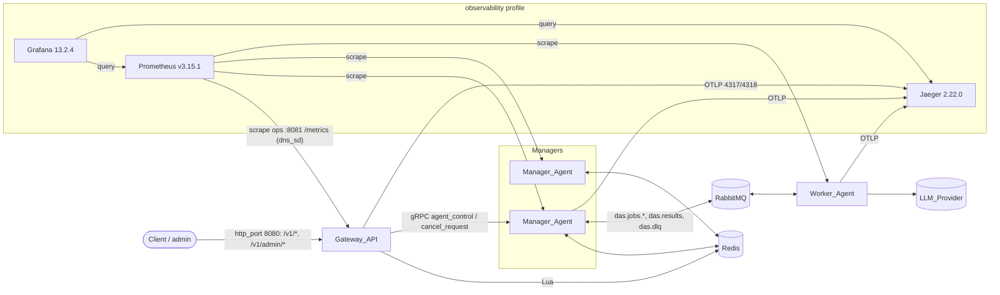
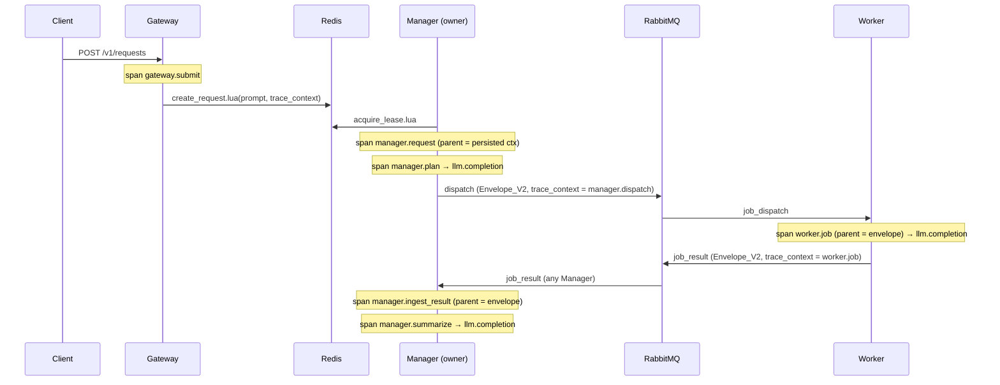

# Design Document: DAS Observability & Operations (Phase 2)

## Overview

Tài liệu này thiết kế Phase 2 của DAS trên nền DAS v1 đã triển khai (`.kiro/specs/distributed-agent-system/design.md`). Phase 2 không thêm role mới. Nó mở rộng các module hiện có (`das/observability`, `das/codec`, `das/state` + `das/state/lua`, `das/manager`, `das/worker`, `das/gateway`, `das/health`, `das/registry`, `das/config`, `das/llm`, `das/cli.py`, `deploy/`) và thêm một package pure core mới `das/ops`.

Phạm vi theo nhóm requirement:

| Nhóm | Requirement | Thành phần chính |
|---|---|---|
| Metrics | 1-5 | `das.observability.metrics` (catalog, `LabelBounder`, `MetricsRecorder`, facade theo role), Ops server `/metrics` |
| Tracing | 6-8 | `das.observability.tracing` (`Tracer`, `BoundedExportProcessor`), Envelope_V2 trong `MessageCodec`, processor log `add_trace_ids` |
| Token & chi phí | 9-10 | `das.ops.usage`, `das.ops.cost`, Usage_Record trong State_Store, `token_usage` / `estimated_cost` trong response |
| Admin & DLQ | 11-13 | `das.gateway.admin`, `DeadLetterRecorder` (Manager), Lua `create_dead_letter` / `replay_dead_letter` / `discard_dead_letter`, event `ReplayRequested` trong RequestMachine |
| Retention & listing | 14-15, 19.8-19.9 | `RetentionSweeper`, Request_Index, Lua `purge_*` / `list_index`, `das.ops.cursor`, `das.ops.retention` |
| Vận hành | 16-17 | `das.health.ops` (`/livez`, `/readyz`), `LoopSupervisor`, trạng thái Draining, message `agent_control`, CLI `das drain` / `das undrain` |
| Deploy | 18 | Compose profile `observability` (Prometheus, Grafana, Jaeger) |
| Ràng buộc | 19-20 | Mở rộng config schema, import-linter, tương thích v1 |

### Nguyên tắc thiết kế giữ từ v1

1. **Pure core, thin I/O shell.** Giới hạn label, tổng hợp Token_Usage_Summary, tính Estimated_Cost, điều kiện retention, Page_Cursor, quyết định Replay, phân loại khóa và mã hóa Envelope_V2 là hàm thuần (Req 19.5). Mỗi hàm nhận thời gian qua tham số (giá trị lấy từ `Clock` hoặc Redis `TIME` ở shell), không đọc đồng hồ, không I/O, không random.
2. **Redis là source of truth.** Mọi thay đổi state mới (Usage_Record, Finished_At, Request_Index, Dead_Letter_Record, Replay, retention) đi qua Lua script atomic. Script do Manager gọi vẫn kiểm tra `(owner, epoch)` và trả `LEASE_LOST` / `REQUEST_TERMINAL`.
3. **At-least-once, xử lý idempotent.** Usage_Record của Job chỉ được ghi khi `HSETNX` của Job_Result tương ứng thành công. Dead_Letter_Record có ID tất định từ danh tính Message. Mỗi Request bị retention xóa được đếm bởi đúng script đã xóa nó.
4. **Network chỉ qua Transport và MessageCodec.** `das.manager` và `das.worker` truy cập metrics và tracing chỉ qua `das.observability`. Import-linter cấm thêm `prometheus_client` và `opentelemetry` (Req 19.4).
5. **Secret chỉ từ env hoặc `secrets_file`.** Admin_API_Key, OTLP header và `cursor_secret` là `SecretStr`. Redactor được nạp thêm các giá trị này (Req 11.9, 19.3).

### Quyết định thiết kế chính

| # | Quyết định | Lý do |
|---|---|---|
| D1 | Envelope_V2 chỉ được dùng khi Message mang Trace_Context. Message không có Trace_Context được serialize ở schema version 1, giống hệt từng byte v1. | Agent v1 từ chối field lạ và `schema_version` khác 1 (`MessageCodec.decode` bước 3 và 5). Khi tắt tracing, mixed fleet hoạt động bình thường (Req 7.2, 19.7). |
| D2 | Provider/model của Job_Result đi trong header Transport `x-llm-provider` / `x-llm-model`, không thêm field vào `JobResultPayload`. | Thêm field vào payload sẽ làm Manager v1 (pydantic `extra="forbid"`, strict) dead-letter Job_Result dưới dạng `malformed`, vi phạm Req 19.7. Header không thuộc bytes của codec. Thiếu header (Worker v1) thì ghi `provider="unknown"`, `model="unknown"`, và cặp này trở thành Unpriced_Model. |
| D3 | Drain/undrain dùng message type mới `agent_control` (request-reply trên RPC_Transport) và reply `agent_control_reply`, không mở rộng `ControlPayload`. | Thêm field `release_leases` vào `ControlPayload` sẽ đổi bytes của `cancel_job` / `cancel_request` (pydantic dump cả giá trị `None`). Type mới chỉ được gửi tới agent đích của thao tác admin. |
| D4 | Manager tiêu thụ trực tiếp queue `das.dlq` (competing consumers) và ACK sau khi Dead_Letter_Record đã commit. Record chứa envelope/payload hoặc raw bytes, nên Message không cần nằm lại trong queue. | Giữ Message unacked tới khi operator xử lý sẽ đụng consumer timeout của RabbitMQ. Sau khi record được tạo, Message đã rời `das.dlq`, nên Req 13.14 luôn thỏa. Req 12.11 được thỏa bằng `REQUEUE` khi ghi thất bại. |
| D5 | `das.dlq` có policy `das-dlq` với `delivery-limit: -1`. | Từ RabbitMQ 4.0, quorum queue có delivery limit mặc định 20. Không có policy này, Message bị requeue lặp lại khi Redis lỗi sẽ bị hủy vì `das.dlq` không có DLX ([RabbitMQ 4.0 quorum queues](https://www.rabbitmq.com/blog/2024/08/28/quorum-queues-in-4.0)). |
| D6 | Dead_Letter_ID = 32 ký tự hex đầu của `sha256(identity)`. `identity` là `msg:<message_id>` khi parse được envelope, ngược lại là `raw:<sha256(body)>`. | Lần giao lại cho bất kỳ Manager nào sinh cùng ID, nên `create_dead_letter.lua` (kiểm tra `EXISTS`) bảo đảm đúng một record (Req 12.2). Hai Message malformed giống hệt từng byte không phân biệt được và được coi là cùng một Message, nên chỉ tạo đúng một record kể cả khi được publish riêng biệt (Req 12.13). |
| D7 | Replay cho Request Running đi qua inbox (`replay` event) và chỉ Lease owner áp dụng. Replay cho Request Failed mở lại Request về Pending trong một script, kèm `replay` event trong inbox. | Giữ quy tắc v1: chỉ Lease owner ghi Job transition, có fencing (Req 13.3, 13.4). Lease owner mới gặp Request "Pending có plan" sẽ chạy `reopen_request.lua` thay vì planning. |
| D8 | Request có tập `das:req:{rid}:pending_replays`. `finalize.lua` trả `REPLAY_PENDING` khi tập không rỗng. `cancel_request.lua` đưa các record trong tập về `Pending`. | Đóng race giữa lúc Gateway chấp nhận Replay và lúc owner finalize hoặc Request bị cancel. Nếu không có cơ chế này, record có thể kẹt ở `Replayed` (Req 13.15). |
| D9 | Request_Index dùng zset với score = `created_at` (ms) và member = Request_ID. Redis sắp các member cùng score theo thứ tự từ điển, nên `REV` cho đúng thứ tự (created_at giảm dần, Request_ID giảm dần) mà không cần key phụ. | Đạt p95 500 ms với 100.000 Request: `ZRANGE … BYSCORE REV LIMIT` có độ phức tạp O(log N + M) (Req 15.1). |
| D10 | Page_Cursor = base64url(JSON chuẩn tắc) + `.` + base64url(HMAC-SHA256 cắt 16 byte). Khóa HMAC lấy từ `gateway.cursor_secret`; nếu không cấu hình, Gateway dùng khóa ngẫu nhiên 32 byte lưu ở `das:gateway:cursor_key` (`SET NX`), chung cho mọi replica. | Chỉ MAC mới bảo đảm từ chối cursor "không do Gateway tạo ra" (Req 19.9). Hàm encode/decode thuần nhận khóa làm tham số. |
| D11 | Dùng `CollectorRegistry` riêng không có collector mặc định và tắt `_created` series. | Collector `process_*` / `python_*` mặc định và series `_created` vi phạm tiền tố `das_` và quy tắc một HELP/TYPE cho mỗi tên metric (Req 1.4, 5.1). |
| D12 | Tự viết `BoundedExportProcessor` thay cho `BatchSpanProcessor` của SDK. | Req 8.7 yêu cầu giữ Span chưa export khi export thất bại (tới `max_queue_size`) và đếm số Span bị bỏ. `BatchSpanProcessor` bỏ cả batch export lỗi và không cho biết số Span bị bỏ. |
| D13 | Token usage được chuẩn hóa ở biên adapter (`normalize_usage`) trước khi tạo `Completion` hay `JobResultPayload`. | `JobResultPayload.usage` là strict `ge=0`. Một Job_Result mang số âm vẫn là malformed theo v1 Req 9.4. Chuẩn hóa tại nguồn bảo đảm Worker tuân thủ không bao giờ phát giá trị đó (Req 9.6, 9.7). |
| D14 | Prometheus dùng `dns_sd_configs` (A record của service Compose) để tìm replica. | Replica mới được scrape ở chu kỳ refresh kế tiếp mà không cần sửa cấu hình (Req 18.10). |

### Kết quả nghiên cứu ảnh hưởng tới thiết kế

- **prometheus_client 0.26.0** (PyPI, 07/2026). `generate_latest(registry)` tạo text exposition format 0.0.4. Counter tự thêm hậu tố `_total`. `disable_created_metrics()` tắt series `_created`. `Gauge.set_function` cho phép tính gauge tại thời điểm scrape, dùng cho `das_worker_jobs_in_flight` và `das_leases_held`.
- **OpenTelemetry Python 1.45.1** (`opentelemetry-api`, `-sdk`, `-exporter-otlp-proto-grpc`, `-exporter-otlp-proto-http`, 10/2026). Exporter gRPC yêu cầu `grpcio>=1.63.2,<2` khi Python < 3.13, tương thích với `grpcio==1.84.1` đang ghim. `ParentBased(TraceIdRatioBased(r))` hiện thực đúng quy tắc lấy mẫu của Req 8.4. Khi sampler loại một Span gốc, SDK vẫn tạo `NonRecordingSpan` với SpanContext hợp lệ (cờ sampled = 0). Vì vậy `traceparent` vẫn được persist và lan truyền khi Span không được lấy mẫu (Req 6.1, 6.4).
- **W3C Trace Context**: `traceparent` = `version-traceid-parentid-flags`. Version `ff` không hợp lệ. Trace-id và parent-id không được toàn số 0. `tracestate` có tối đa 32 list-member và tối đa 512 ký tự ([W3C Trace Context](https://www.w3.org/TR/trace-context/)).
- **Images ghim**: `prom/prometheus:v3.15.1`, `grafana/grafana:13.2.4`, `jaegertracing/jaeger:2.22.0`. Jaeger v2 all-in-one nhận OTLP gRPC ở cổng 4317 và OTLP HTTP ở 4318, UI ở 16686 ([Jaeger getting started](https://www.jaegertracing.io/docs/2.22/getting-started/)). Grafana có datasource Jaeger sẵn có.
- **Redis sorted set**: các member cùng score được sắp theo thứ tự từ điển. `ZRANGE key max min BYSCORE REV LIMIT off n` duyệt giảm dần cả score lẫn member ([ZRANGE](https://redis.io/docs/latest/commands/zrange/)). D9 và Page_Cursor dựa trên tính chất này.

Content was rephrased for compliance with licensing restrictions.

## Architecture

### Deployment view (profile `observability`)



Mỗi agent có Ops_Port (`health_port`, mặc định 8081) phục vụ `/metrics`, `/livez`, `/readyz`, cùng `/healthz` v1 trên Manager_Agent và Worker_Agent. Với Gateway_API, `/healthz` vẫn ở `http_port` (Req 16.8). `/metrics`, `/livez`, `/readyz` chỉ có trên Ops_Port, nên trên `http_port` chúng trả 404 (Req 1.2).

### Lan truyền trace



`manager.request` được tạo lại sau mỗi lần acquire Lease (kể cả takeover) với parent là Trace_Context đã persist, nên mọi Span của một Request có chung trace ID (Req 6.2). Span của `manager.request` kết thúc khi `RequestDriver.run` trả về, bất kể `DriverOutcome` là gì.

### Luồng Replay

```mermaid
sequenceDiagram
    participant A as Admin
    participant G as Gateway
    participant R as Redis
    participant M as Manager
    A->>G: POST /v1/admin/dlq/{id}/replay
    G->>R: replay_dead_letter.lua(id)
    alt Request Running
        R-->>R: record→Replayed, XADD inbox, SADD pending_replays
    else Request Failed and no live Lease
        R-->>R: record→Replayed, status Failed→Pending, history entry,<br/>Finished_At cleared, index updated, ZADD pending, XADD inbox{replay}
    end
    G-->>A: 202 {dead_letter_id, request_id, job_id, attempt}
    M->>R: acquire_lease (Failed-replay only) + reopen_request.lua (Pending→Running)
    M->>M: step(ReplayRequested) → Job Ready (attempt+1, limit += max_attempts), reset Skipped
    M->>R: apply_transition.lua (fenced; SREM pending_replays; transitions tagged dead_letter_id)
    M->>M: dispatch / results / summarize as v1
```

### Các vòng lặp mới của Manager_Agent

| Loop | Chu kỳ | Trách nhiệm | Req |
|---|---|---|---|
| `DeadLetterRecorder` | push (`dlq`) | Tạo Dead_Letter_Record bằng `create_dead_letter.lua`, rồi ACK; lỗi Redis thì `REQUEUE` | 12.1-12.3, 12.11, 3.8 |
| `QueueDepthSampler` | `metrics.queue_sample_interval` (15 s) | `ready_count` cho `results`, `dlq` và `jobs/<cap>` của mọi Capability được quảng bá, timeout 5 s cho mỗi queue | 3.1, 3.2 |
| `RegistryGauges` | `heartbeat_interval` | Đọc snapshot registry, cập nhật `das_registry_agents`, `das_capability_workers` | 3.6, 3.7, 3.10 |
| `RetentionSweeper` | `retention.sweep_interval` | `purge_request`, `purge_inbox`, `purge_dead_letter` theo lô | 14 |
| `IndexBackfill` | một lần khi khởi động (lock) | Thêm Request v1 vào Request_Index, đặt Finished_At còn thiếu, đặt `das:requests:index:ready` | 15.10, 14.9 |
| `EventLoopWatchdog` | 1 s | Ghi `last_tick` cho Liveness_Probe | 16.2 |

`DeadLetterIngest` (v1, tiêu thụ `dlq-events`) giữ nguyên. Hai consumer độc lập: `DeadLetterRecorder` cho operator và `DeadLetterIngest` cho phản ứng của reducer (v1 Req 6.6). `LoopSupervisor` đăng ký mọi Critical_Loop: ClaimLoop, ResultIngest, DeadLetterIngest, RegistrySweeper, Heartbeat. Phase 2 bổ sung `DeadLetterRecorder` vào nhóm này. `RetentionSweeper`, `QueueDepthSampler` và `RegistryGauges` không phải Critical_Loop: lỗi của chúng chỉ được log và vòng lặp tự chạy lại (Req 14.13).

### Package layout (phần thêm và thay đổi)

```
das/
  ops/                   # NEW pure core (Req 19.5)
    usage.py             # UsageRecord helpers, summarize_usage, normalize_usage
    cost.py              # PriceTable, estimate_cost, format_amount
    cursor.py            # PageCursor encode/decode (HMAC)
    retention.py         # retention_decision
    replay.py            # decide_replay, decide_discard, skipped_to_reset
    dlq.py               # dead_letter_identity, dead_letter_id, classify_reason, build_record
    keys.py              # classify_key, key_fingerprint
    iso4217.py           # tập mã tiền tệ ISO 4217
  observability/
    metrics.py           # NEW catalog, MetricsRecorder, NoopRecorder, role facades
    labels.py            # NEW LabelBounder (pure)
    tracing.py           # NEW Tracer facade, TraceContext, BoundedExportProcessor
    logging.py           # + add_trace_ids processor
    redaction.py         # unchanged; more secrets registered
  codec/                 # envelope.py (+trace_context), message_codec.py (v1|v2),
                         #   + AgentControlMessage / AgentControlReplyMessage
  state/                 # keys.py (+keys), store.py (+methods), lua/*.lua (+8 scripts, 8 changed)
  manager/               # machine.py (+ReplayRequested), driver.py, ingest.py (+DeadLetterRecorder),
                         #   agent.py (+drain, samplers), retention.py (NEW shell), claim.py (pause)
  worker/                # worker.py (+drain, metrics, tracing), executor.py (+usage headers)
  gateway/               # app.py (+list, token_usage, estimated_cost, HTTP metrics),
                         #   auth.py (+classify), admin.py (NEW), audit.py (NEW)
  health/                # server.py (+OpsServer: /metrics /livez /readyz), supervisor.py (NEW)
  registry/              # registry.py (+Draining, in_flight)
  config/                # schema.py (+metrics, tracing, pricing, retention, admin keys, gateway)
  llm/                   # retry.py (+operation, LLMCallObserver), errors.py (+RateLimitedLLMError)
  cli.py                 # + drain / undrain subcommands, ops server wiring
deploy/                  # docker-compose.yml (+observability profile), prometheus/, grafana/, rabbitmq/
```

## Components and Interfaces

### 1. Cấu hình (Req 1.8, 2.11-2.12, 3.11, 5.8, 8.1-8.6, 10.1-10.2, 11.1, 11.10-11.11, 14.1, 19.1-19.2)

Các section mới trong `AgentConfig` (pydantic v2, `extra="forbid"`). Thứ tự precedence vẫn là env `DAS__` > file > default. Mọi lỗi được gom lại và hiển thị trong một `ConfigError` (exit code 2, trước khi mở bất kỳ kết nối nào).

```yaml
metrics:
  enabled: true
  queue_sample_interval: 15          # 5..300 s (Req 3.1, 3.11)
  label_limits: { capability: 50, queue: 50, provider: 50, model: 50 }   # 1..500 (Req 5.3, 5.8)
  buckets:
    http:     [0.005, 0.01, 0.025, 0.05, 0.1, 0.25, 0.5, 1, 2.5, 5, 10]
    duration: [0.1, 0.5, 1, 2.5, 5, 10, 30, 60, 120, 300, 600]   # Request, Job, LLM
    attempts: [1, 2, 3, 5, 10, 20]
tracing:
  enabled: false
  otlp_endpoint: null                # bắt buộc khi enabled; http(s) URL tuyệt đối
  otlp_protocol: grpc                # grpc | http/protobuf
  sample_ratio: 1.0                  # 0.0..1.0
  service_name: null                 # mặc định das-<role>, 1..255 ký tự
  max_queue_size: 2048               # 1..100000
  # otlp_headers: SecretStr, chỉ từ DAS__TRACING__OTLP_HEADERS hoặc secrets_file ("k=v,k2=v2")
pricing:                             # vắng mặt = không có Price_Table (Req 10.7)
  currency: USD
  models:
    - { provider: anthropic, model: claude-sonnet-4, input_per_million: "3", output_per_million: "15" }
retention:
  enabled: false
  terminal_request_ttl: 604800       # giây; 3600..31536000
  inbox_ttl: 3600                    # 60..604800
  dlq_record_ttl: 2592000            # 3600..31536000
  sweep_interval: 60                 # 10..3600
  batch_size: 500                    # 1..10000
gateway:
  # cursor_secret: SecretStr, chỉ từ env/secrets_file (D10)
health_port: 8081                    # Gateway: Ops_Port, khác http_port (Req 1.8)
# admin_api_keys: list[SecretStr], chỉ từ DAS__ADMIN_API_KEYS hoặc secrets_file (Req 11.1)
```

Kiểm tra bổ sung trong `cross_field_errors` (pure):

- Danh sách bucket: không rỗng, tối đa 50 giá trị, mọi giá trị > 0, tăng ngặt (Req 2.12).
- `tracing.enabled` và `otlp_endpoint` thiếu hoặc rỗng, hoặc không phải URL tuyệt đối `http`/`https` có host → lỗi tại `tracing.otlp_endpoint` (Req 8.3).
- Price_Table: mỗi entry đủ trường; provider dài 1-64, model dài 1-128; giá trong khoảng 0..1.000.000 với tối đa 6 chữ số thập phân; không trùng cặp; tối đa 200 entry; `currency` thuộc `ISO_4217_CODES` (Req 10.2). Lỗi được báo theo chỉ số entry, ví dụ `pricing.models[3].input_per_million`. Giá được đọc thành `Decimal`. YAML float được chuyển qua `Decimal(repr(x))` (biểu diễn ngắn nhất), nên `0.1` thành `Decimal("0.1")`. Chuỗi được khuyến nghị trong tài liệu.
- Admin_API_Key: tối đa 32 khóa, mỗi khóa dài 16-256 ký tự ASCII in được (0x21-0x7E), không trùng API_Key. Lỗi nêu `admin_api_keys[i]` và không chứa giá trị khóa (Req 11.10).
- Gateway: `health_port != http_port` (Req 1.8).
- Các secret mới (`admin_api_keys`, `tracing.otlp_headers`, `gateway.cursor_secret`) đi qua cơ chế "secret field in file" có sẵn của v1: có trong YAML thì báo lỗi nêu tên trường và không in giá trị (Req 8.6, 11.10). Secrets file thiếu hoặc không đọc được thì báo lỗi nêu tham chiếu (Req 11.11).

`AgentConfig.secret_values()` trả thêm Admin_API_Key, giá trị OTLP header và `cursor_secret`. CLI nạp danh sách này vào Redactor trước khi log dòng đầu tiên (Req 11.9, 19.3).

### 2. Metrics (`das.observability.metrics`, `das.observability.labels`) (Req 1-5)

#### Catalog

Catalog là một bảng `MetricSpec(name, kind, help, labels, buckets_key)` khai báo tĩnh mọi metric ở Req 2, 3, 4 và 14. Bảng này là nguồn duy nhất cho tên metric, tên label và tập Bounded_Label_Value. Kiểm tra dashboard ở Req 18.6 đối chiếu với chính bảng này.

| Metric | Kind | Labels | Agent |
|---|---|---|---|
| `das_requests_submitted_total` | counter | — | gateway |
| `das_requests_finished_total` | counter | status | manager, gateway (Cancelled) |
| `das_request_duration_seconds` | histogram (duration) | status | manager, gateway |
| `das_job_transitions_total` | counter | capability, state | manager |
| `das_job_attempts` | histogram (attempts) | capability | manager |
| `das_job_execution_seconds` | histogram (duration) | capability, status | worker |
| `das_worker_jobs_in_flight`, `das_worker_concurrency_limit` | gauge | — | worker |
| `das_http_requests_total` | counter | route, method, status_code | gateway |
| `das_http_request_duration_seconds` | histogram (http) | route, method | gateway |
| `das_queue_depth` | gauge | queue | manager |
| `das_queue_depth_sample_errors_total` | counter | queue | manager |
| `das_lease_acquisitions_total` | counter | kind | manager |
| `das_lease_losses_total` | counter | reason | manager |
| `das_leases_held` | gauge | — | manager |
| `das_registry_agents` | gauge | role, status | manager |
| `das_capability_workers` | gauge | capability | manager |
| `das_registry_sample_errors_total` | counter | — | manager |
| `das_dlq_records_created_total` | counter | reason | manager |
| `das_dlq_admin_actions_total` | counter | action, outcome | gateway |
| `das_llm_calls_total` | counter | provider, model, operation, outcome | manager, worker |
| `das_llm_call_duration_seconds` | histogram (duration) | provider, model, operation | manager, worker |
| `das_llm_retries_total` | counter | provider, model, operation | manager, worker |
| `das_llm_tokens_total` | counter | provider, model, operation, direction | manager, worker |
| `das_llm_estimated_cost_total` | counter | provider, model, currency | manager, worker |
| `das_retention_deleted_total` | counter | kind | manager |

Tập Bounded_Label_Value (Req 5.2): `status` ∈ Request_Status ∪ Job_Result status; `state` ∈ Job_State; `outcome` ∈ {success, rate_limited, transient_error, timeout, non_transient_error, accepted, not_found, record_not_pending, not_replayable, request_state, request_gone, job_state, stale_attempt, lease_held, service_unavailable}. Mỗi metric có tập riêng: `das_llm_calls_total` chỉ dùng 5 giá trị đầu, `das_dlq_admin_actions_total` dùng phần còn lại. Các tập khác: `operation` ∈ {plan, summarize, job}; `direction` ∈ {input, output}; `kind` ∈ {initial, takeover} cho lease, {request, inbox, dlq_record} cho retention; `reason` ∈ {held_by_other, store_unreachable} cho lease loss, Dead_Letter_Reason cho DLQ; `role` ∈ {manager, worker}; `action` ∈ {replay, discard}; `method` ∈ {GET, POST, PUT, PATCH, DELETE, HEAD, OPTIONS, _other}; `route` ∈ route template đã đăng ký ∪ {`_unmatched`}; `status_code` ∈ 100..599; `currency` ∈ {mã của Price_Table}.

#### `LabelBounder` (pure)

```python
@dataclass(frozen=True)
class LabelPolicy:
    enumerated: Mapping[str, frozenset[str]]   # label -> allowed values (criterion 2 labels)
    dynamic_limits: Mapping[str, int]          # capability/queue/provider/model -> limit

@dataclass
class LabelBounder:
    policy: LabelPolicy
    seen: dict[tuple[str, str], set[str]]      # (metric, label) -> distinct values recorded
    def bound(self, metric: str, labels: Mapping[str, str]) -> BoundResult
        # BoundResult(labels: dict[str, str], overflowed: tuple[str, ...])
```

- Label thuộc nhóm enumerated: giá trị hợp lệ thì giữ nguyên, ngoài tập thì thay bằng `_other` (Req 5.7).
- Label động: giá trị đã có trong `seen` thì giữ nguyên. Giá trị mới khi `len(seen) < limit` thì được thêm vào `seen`. Còn lại thì thay bằng `_other` và không thêm vào `seen` (Req 5.3).
- `overflowed` cho shell biết cặp `(metric, label)` nào vừa overflow. `MetricsRecorder` giữ `warned: set[(metric, label)]` và chỉ log warning ở lần overflow đầu tiên của mỗi cặp (Req 5.4).
- `seen` chỉ tăng, không bao giờ reset trong vòng đời tiến trình.

#### `MetricsRecorder`

```python
class MetricsRecorder:
    def __init__(self, catalog: Sequence[MetricSpec], buckets: BucketConfig,
                 policy: LabelPolicy, clock: Clock, log: BoundLogger): ...
    def inc(self, name: str, labels: Mapping[str, str] = {}, amount: float = 1.0) -> None
    def observe(self, name: str, labels: Mapping[str, str], value: float) -> None
    def set(self, name: str, labels: Mapping[str, str], value: float) -> None
    def set_function(self, name: str, fn: Callable[[], float]) -> None
    def render(self) -> tuple[bytes, str]      # (body, content type); raises RenderError
class NoopRecorder(MetricsRecorder): ...       # metrics.enabled = false
```

- Recorder dùng `prometheus_client.CollectorRegistry(auto_describe=False)` riêng, không đăng ký collector mặc định, và gọi `disable_created_metrics()` trước khi tạo metric (D11). `render()` dùng `generate_latest(registry)` với content type `text/plain; version=0.0.4; charset=utf-8` (Req 1.1, 1.4).
- Mỗi lần ghi được bọc `try/except Exception`. Khi lỗi, observation bị bỏ và recorder log warning qua `RateLimitedLog(key=metric, period=60 s, clock)`. Lỗi không bao giờ lan ra ngoài, nên luồng nghiệp vụ không đổi (Req 1.6).
- Các facade có kiểu cho từng role (`GatewayMetrics`, `ManagerMetrics`, `WorkerMetrics`, `LLMMetrics`) chỉ nhận dữ liệu có cấu trúc như `JobState`, Capability hoặc `RequestStatus`, không nhận chuỗi tùy ý. Chúng không có tham số nào cho Request_ID, Job_ID hay nội dung. Giá trị label chỉ có thể là enum hoặc tên Capability/queue/provider/model (Req 1.5, 5.1).
- Lỗi khi render: Ops server trả 500 và log warning tối đa một lần mỗi 60 giây. Critical_Loop và probe không bị ảnh hưởng (Req 1.9).

#### Điểm ghi metric (shell)

| Metric | Nơi ghi | Điều kiện đúng |
|---|---|---|
| submitted | `gateway.app.submit` sau khi `create_request` trả `OK` | Từ chối 401/400/503 không tăng (Req 2.1) |
| finished/duration (Completed, Failed) | `RequestDriver._write_final` khi `finalize` trả `OK` | Duration = `max(0, finished_at_ms − created_at_ms)/1000`, cả hai giá trị do script trả về (Req 2.2) |
| finished/duration (Cancelled) | `gateway.cancel` khi `cancel_request` trả `OK` | `TERMINAL` → không đổi (Req 2.3, 2.13) |
| job transitions, attempts | `RequestDriver._run_events` / `_plan`, chỉ khi `WriteResult.ok`, đọc từ `Decision.changes` (hoặc danh sách Job Waiting của `commit_plan`) | `LEASE_LOST`, `REQUEST_TERMINAL`, exception hoặc timeout → không ghi (Req 2.4, 2.5, 2.7). `das_job_attempts` chỉ ghi cho transition do lệnh ghi của Manager tạo ra; Job bị Cancelled trước dispatch qua cancel của Gateway không có observation (Req 2.7). Script ghi đúng một entry cho mỗi change (v1 Req 13.7), nên số đếm ≤ số entry (Req 2.6) |
| execution seconds | `Worker._execute` khi tạo `JobResultPayload` (đo bằng `clock.monotonic`) | Publish lại không ghi thêm (Req 2.8) |
| lease acquisitions | `ClaimLoop._try_acquire` khi `acquire_lease` trả `OK` | `kind` do script trả về (Req 3.3) |
| lease losses | `LeaseKeeper._mark_lost` (chỉ chạy một lần cho mỗi Lease) | `LeaseEnd.REJECTED`/`LEASE_LOST` → `held_by_other`; `LeaseEnd.UNREACHABLE` → `store_unreachable` (Req 3.4) |
| dlq created | `DeadLetterRecorder` khi `create_dead_letter` trả `CREATED` (không tính `EXISTS`) | Reply mất sau khi ghi thì record có mà counter không tăng, nên tổng counter ≤ số record, bằng khi mọi reply tới được Manager (Req 3.8) |
| dlq admin | middleware của router admin, theo `outcome` của handler; 401/403 không ghi | Req 3.9 |
| LLM | `LLMMetricsObserver` gắn vào `LLMProvider` | §5 |
| retention | `RetentionSweeper` cộng số reply `DELETED` | Req 14.10 |

### 3. Tracing (`das.observability.tracing`) (Req 6, 8)

```python
@dataclass(frozen=True)
class TraceContext:
    traceparent: str
    tracestate: str | None = None
    @staticmethod
    def parse(traceparent: object, tracestate: object = None) -> TraceContext | None  # pure, W3C rules
    @property
    def sampled(self) -> bool

ALLOWED_ATTRIBUTES: Final = frozenset({"das.request_id", "das.job_id", "das.attempt", "das.capability",
    "das.agent_id", "das.role", "llm.provider", "llm.model", "llm.operation",
    "llm.input_tokens", "llm.output_tokens", "error.type"})

class Tracer(Protocol):
    enabled: bool
    def span(self, name: str, *, parent: TraceContext | None = None,
             attributes: Mapping[str, str | int] = {}) -> ContextManager[SpanHandle]
    def current_context(self) -> TraceContext | None     # Trace_Context của Span đang active
    async def shutdown(self, timeout: float) -> int       # trả số Span bị bỏ

class SpanHandle(Protocol):
    def set_attributes(self, attrs: Mapping[str, str | int]) -> None   # chỉ giữ ALLOWED_ATTRIBUTES
    def add_event(self, name: str, attrs: Mapping[str, str | int] = {}) -> None
    def fail(self, error_type: str) -> None   # status ERROR + error.type
```

- `build_tracer(config, role, agent_id, clock)` trả `NoopTracer` khi `tracing.enabled=false`. `NoopTracer` không tạo Span, không mở kết nối, và `current_context()` luôn trả `None` (Req 6.13, 8.2). Khi enabled, nó tạo `TracerProvider` với `Resource(service.name)`, sampler `ParentBased(TraceIdRatioBased(sample_ratio))` (Req 8.4) và `BoundedExportProcessor` bọc `OTLPSpanExporter` theo `otlp_protocol` (gRPC hoặc HTTP), có header từ `otlp_headers`.
- Context manager `span(...)` tự đặt status error khi có exception chưa xử lý và gắn `error.type = type(exc).__name__`. Kết quả thất bại không phải exception (`LEASE_LOST`, `REQUEST_TERMINAL`, `PlanRejected`, Job_Result Failed) được báo bằng `handle.fail(code)`. Span thành công không có `error.type` (Req 6.10).
- `set_attributes` / `add_event` loại mọi key ngoài `ALLOWED_ATTRIBUTES`. Value chỉ là `str`/`int` lấy từ ID, enum hoặc số đếm, không bao giờ là nội dung (Req 6.9, 19.3).
- **`BoundedExportProcessor`** (D12): `on_end` chỉ thêm `ReadableSpan` đã lấy mẫu vào `deque` có khóa, O(1), không I/O. Khi deque đầy, Span bị bỏ và `dropped += 1`. Một thread nền export lô tối đa 512 Span mỗi 5 giây hoặc khi đủ lô. Nếu export trả `FAILURE` hoặc ném lỗi, lô được đưa lại đầu deque (giới hạn bởi `max_queue_size`, phần dư bị bỏ và đếm) và lần thử sau dùng backoff 1→30 giây. Warning "spans dropped" được log tối đa một lần mỗi 60 giây kèm số Span đã bỏ (Req 8.7). `shutdown(timeout)` flush trong `min(5, remaining_shutdown)` giây rồi bỏ phần còn lại, log warning kèm số Span bị bỏ và không đổi exit code (Req 8.8). Độ trễ thêm của mỗi Span kết thúc chỉ gồm một lần lấy khóa và append (Req 8.7, ≤ 10 ms).
- Exporter khởi tạo lười, nên OTLP endpoint không truy cập được lúc khởi động không chặn startup và không ảnh hưởng probe. Lần export thất bại đầu tiên log warning `otlp_endpoint_unreachable` (Req 8.12).

**Điểm tạo Span** (Req 6.1-6.8):

| Span | Nơi tạo | Parent | Ghi chú |
|---|---|---|---|
| `gateway.submit` | `gateway.app.submit` | none | `traceparent` của Span (kể cả khi không lấy mẫu) được truyền vào `create_request.lua` |
| `manager.request` | `RequestDriver.run` | `stored.trace_context` hoặc none (Span gốc mới, không ghi lại vào Request, Req 6.12) | Kết thúc khi `run` trả về (terminal, mất hoặc release Lease) |
| `manager.plan` | mỗi planning attempt trong `Planner.plan` (qua hook `on_attempt`) | `manager.request` | |
| `manager.dispatch` | `_publish_dispatch` | `manager.request` | `trace_context` của envelope = context của Span này |
| `manager.summarize` | mỗi Summarizer attempt | `manager.request` | |
| `manager.ingest_result` | `ResultIngest.handle` | `message.trace_context` hoặc none | |
| `worker.job` | `Worker._execute` | `message.trace_context` hoặc none | Job_Result mang context của Span này với mọi status |
| `llm.completion` | `LLMProvider.complete` | Span đang active | Mỗi lần retry thêm một event `retry` (`attempt`, `error.type`) |

Control command gắn với Request (`cancel_job`, `cancel_request`) lấy `trace_context = tracer.current_context()` (Req 6.8). Message nhận được có `trace_context` vắng mặt hoặc không hợp lệ (codec đã bỏ, §4) được xử lý như Message không có context. Codec ghi log debug khi bỏ một context sai định dạng (Req 6.11). Khi tắt tracing, `new_message` không bao giờ điền `trace_context` và mọi context nhận được đều bị bỏ qua (Req 6.13).

**Tương quan log** (Req 8.9-8.11): processor `add_trace_ids` chạy trước `drop_content_fields`. Processor đọc Span hiện tại của OpenTelemetry. Chỉ khi `span_context.is_valid` và `trace_flags.sampled`, nó thêm `trace_id = format(trace_id, "032x")` và `span_id = format(span_id, "016x")`. Trong mọi trường hợp khác, processor xóa hai key này nếu caller tự truyền vào. `das.observability.logging` được phép import `opentelemetry` vì contract chỉ cấm `das.manager` và `das.worker` import trực tiếp.

### 4. Message_Codec với Envelope_V2 (Req 7, 19.7)

Thay đổi trong `das/codec/envelope.py`:

```python
class _EnvelopeFields(DasModel):
    schema_version: PositiveInt          # chuẩn hóa: 2 nếu trace_context, ngược lại 1
    message_id: str; correlation_id: str = ""; timestamp: datetime
    trace_context: TraceContextModel | None = None     # NEW, không có trong output v1

    @model_validator(mode="after")
    def _normalize_version(self): object.__setattr__(self, "schema_version",
                                    2 if self.trace_context else 1); return self

class TraceContextModel(DasModel):
    traceparent: str                     # validated by TraceContext.parse
    tracestate: str | None = None

MessageType = Literal["job_dispatch", "job_result", "heartbeat", "control",
                      "agent_control", "agent_control_reply"]          # D3
```

`MessageCodec.SUPPORTED_VERSIONS = {1, 2}`.

- **encode**: `obj = message.model_dump(mode="json", exclude={"trace_context"})`. Nếu `message.trace_context` có giá trị thì đặt `obj["schema_version"] = 2`, `obj["trace_context"] = {"traceparent": …}` và thêm `"tracestate"` chỉ khi có. Ngược lại `schema_version = 1`. Sau đó dùng đúng thủ tục canonical JSON của v1 (sort keys, compact separators, `ensure_ascii=False`). Message không có context cho bytes giống hệt v1 (Req 7.2, 7.3). Đầu ra chỉ phụ thuộc vào Message, nên giống nhau trên mọi Transport (Req 7.6).
- **decode**: bước 3 (field set) và bước 5 (version) đổi thành:
  1. `version ∉ {1, 2}` → `ParseError(field="schema_version")` (Req 7.10). Bước kiểm tra version được đưa lên trước bước kiểm tra field set, vì field set phụ thuộc version.
  2. Version 1: field set phải đúng như v1. Một field `trace_context` trong bytes v1 là `unknown envelope field`, giữ hành vi v1 (Req 7.9).
  3. Version 2: field set = v1 ∪ {`trace_context`} (tùy chọn). `parse_trace_context(raw)` trả `TraceContextModel | None`: không phải object, thiếu `traceparent` hoặc `traceparent` sai → `None` cộng log debug. `tracestate` không phải chuỗi hoặc sai → giữ `traceparent`, bỏ `tracestate` (Req 7.7, 7.8). Không bao giờ sinh `ParseError` vì `trace_context`.
- Payload model và mọi kiểm tra khác giữ nguyên.
- `new_message(payload, *, trace_context=None, …)` nhận context tùy chọn. Shell truyền vào `tracer.current_context()` (luôn là `None` khi tắt tracing).

### 5. LLM instrumentation và token usage (Req 4, 9.6-9.7)

```python
LLMOperation = Literal["plan", "summarize", "job"]

class LLMCallObserver(Protocol):
    def on_retry_scheduled(self, operation: LLMOperation) -> None
    def on_finished(self, operation: LLMOperation, outcome: LLMOutcome,
                    duration: float, usage: TokenUsage | None) -> None

class LLMProvider:
    def __init__(..., sleep: Sleep = asyncio.sleep, clock: Clock | None = None,
                 observer: LLMCallObserver | None = None, tracer: Tracer | None = None): ...
    async def complete(self, system, messages, *, operation: LLMOperation) -> Completion
```

- `outcome` lấy từ lỗi của attempt cuối: `RateLimitedLLMError` (lớp con mới của `TransientLLMError`, adapter ném lỗi này khi gặp HTTP 429 hoặc throttling) → `rate_limited`; `TransientLLMError` khác → `transient_error`; `TimeoutError` → `timeout`; `PermanentLLMError` → `non_transient_error`; completion → `success` (Req 4.1).
- Duration đo bằng `clock.monotonic()`, từ đầu attempt 1 tới cuối attempt cuối, tính cả thời gian backoff (Req 4.2). `on_retry_scheduled` chạy ngay trước `sleep(retry_delay(k))` (Req 4.3).
- `asyncio.CancelledError` (Request bị cancel, mất Lease, shutdown) được re-raise mà không gọi `on_finished`. Các lần retry đã ghi trước đó vẫn giữ (Req 4.7).
- `LLMMetricsObserver` (trong `das.observability.metrics`) ghi `das_llm_calls_total`, `das_llm_call_duration_seconds`, `das_llm_retries_total`. Nó chỉ cộng `das_llm_tokens_total` khi `outcome == success` và `completion.usage_reported`. Khi Price_Table của agent có cặp provider/model, nó cộng thêm `das_llm_estimated_cost_total += estimate_call_cost(...)` (Decimal chưa làm tròn được đổi sang float) (Req 4.4-4.6).
- `Completion` có thêm `usage_reported: bool = True`. Adapter gọi `normalize_usage(raw_input, raw_output, raw_total) -> NormalizedUsage(usage, reported, problems)` (pure, `das.ops.usage`): giá trị thiếu, âm hoặc không phải số nguyên thành 0; total thiếu thì bằng input + output. `problems` không rỗng thì caller log warning kèm Request_ID và operation (Req 9.6, 9.7). Trường hợp provider hoàn toàn không trả usage thì `reported=False`.

### 6. State_Store: key mới và Lua script

#### Key mới

| Key | Type | Nội dung | Req |
|---|---|---|---|
| `das:req:{rid}` (field mới) | hash | `trace_context` (JSON), `finished_at` (ms), `job_count`, `usage_input`, `usage_output`, `usage_total`, `replay_history` (JSON list) | 6.1, 14.2, 15.3, 13.2 |
| `das:req:{rid}:usage` | list | `UsageRecord` JSON, append-only | 9 |
| `das:req:{rid}:pending_replays` | set | Dead_Letter_ID đã Replay nhưng owner chưa áp dụng (D8) | 13.3, 13.15 |
| `das:lease:{rid}` (field mới) | hash | `last_owner` (agent ID của lần acquire gần nhất, không bị xóa khi release) | 3.3 |
| `das:requests:index` | zset | rid, score = created_at ms | 15 |
| `das:requests:by_status:{status}` | zset | rid theo status hiện tại, score = created_at ms | 15.2, 15.11 |
| `das:requests:index:ready` | string | `1` khi backfill xong | 15.10 |
| `das:requests:index:backfill_lock` | string | `SET NX PX` lock của `IndexBackfill` | 15.10 |
| `das:requests:finished` | zset | rid terminal, score = finished_at ms | 14.3 |
| `das:requests:inbox_purge` | zset | rid terminal còn inbox, score = finished_at ms | 14.7 |
| `das:dlq:{dlid}` | hash | Các field của Dead_Letter_Record (§Data Models) | 12 |
| `das:dlq:index` | zset | dlid, score = dead_lettered_at ms | 12.4 |
| `das:dlq:by_status:{status}` | zset | dlid theo Record_Status | 12.4 |
| `das:dlq:by_reason:{reason}` | zset | dlid theo Dead_Letter_Reason | 12.4 |
| `das:dlq:terminal` | zset | dlid Replayed/Discarded, score = status_changed_at ms | 14.8 |
| `das:gateway:cursor_key` | string | Khóa HMAC ngẫu nhiên của Page_Cursor (D10) | 19.9 |
| `das:agent:{id}` (field mới) | hash | `status` có thêm `Draining`, `in_flight` | 17 |

`keys.request_keys(rid)` có thêm `usage` và `pending_replays`. Phase 2 chỉ hỗ trợ một Redis instance (Req 20.7). Mọi script vẫn khai báo mọi key qua `KEYS`. Các key DLQ động (ví dụ record cần đưa về `Pending`) được shell đọc trước rồi truyền vào, và script xác nhận lại theo kiểu compare-and-set như `cancel_request.lua` v1.

#### Script thay đổi

| Script | Thay đổi | Req |
|---|---|---|
| `_common.lua` | Thêm helper `index_move(rid, from, to, score)`; `put_job` nhận thêm `tag` (Dead_Letter_ID), nếu có thì ghi `dead_letter_id` vào entry; `mark_finished(rid, ms)` (đặt `finished_at`, ZADD `finished` + `inbox_purge`); `append_usage(list, req_hash, records_json)` (RPUSH + HINCRBY 3 tổng) | 14.2, 13.4, 9 |
| `create_request.lua` | ARGV[3] `trace_context` JSON hoặc `''`; ZADD `index` và `by_status:Pending` cùng score `created_at` ms | 6.1, 15.11 |
| `acquire_lease.lua` | Trả `{'OK', epoch, expires, kind}`, `kind = 'takeover'` khi `last_owner` tồn tại và khác `ARGV[2]`, ngược lại `'initial'`. Lease không có field `last_owner` (do agent v1 ghi) cho `'initial'` ở lần acquire đầu tiên, kể cả khi owner trước khác agent đang acquire; HSET `last_owner` | 3.3 |
| `commit_plan.lua` | ARGV[5] = mảng JSON UsageRecord (planning); job pair dời sang ARGV[6..]; `index_move(Pending→Running)`; HSET `job_count`; `append_usage` | 9.1, 15.3 |
| `apply_transition.lua` | Batch thêm `usage` = `[[result_field, usage_json]…]`: chỉ RPUSH khi HSETNX của result cùng field trả 1. Thêm `tag` (Dead_Letter_ID cho mọi entry của batch), `replays_applied` (SREM `pending_replays`), `dead_letter_reverts` (`Replayed→Pending` + chuyển index) và `job_count`. KEYS thêm `usage`, `pending_replays` và các key DLQ được liệt kê | 9.2, 9.5, 13.4, 13.15 |
| `finalize.lua` | `pending_replays` không rỗng → `{'REPLAY_PENDING'}`. ARGV[7] = UsageRecord JSON (summarize và/hoặc planning khi Failed). `mark_finished`; `index_move(Running/Pending → target)`; trả `{'OK', finished_at_ms, created_at_ms}` | 9.1, 9.3, 14.2, 2.2 |
| `cancel_request.lua` | `mark_finished`; `index_move(→Cancelled)`. Mỗi dlid trong `pending_replays` (shell truyền key; khác nội dung set → `CONFLICT`) chuyển `Replayed→Pending`, rồi DEL set. Trả `{'OK', at, finished_at_ms, created_at_ms}` | 2.3, 13.15 |
| `record_inbox.lua` | ARGV[3] tùy chọn `meta` JSON (provider/model của Job_Result từ header, D2), ghi thành field `meta` của stream entry. Manager v1 bỏ qua field này | 9.2 |

#### Script mới

| Script | KEYS / ARGV chính | Hành vi | Trả về |
|---|---|---|---|
| `create_dead_letter.lua` | record, index, by_status:Pending, by_reason:{r} / dlid, record JSON fields | `EXISTS` → `EXISTS`; ngược lại HSET mọi field, `dead_lettered_at = TIME ms`, `status = Pending`, ZADD 3 index | `{'CREATED', at}` \| `{'EXISTS'}` |
| `replay_dead_letter.lua` | record, request, jobs, lease, inbox, transitions, pending_replays, pending zset, leases expiry, index/by_status (5), finished, inbox_purge, dlq index (by_status Pending/Replayed, terminal) / dlid | Kiểm tra theo thứ tự `decide_replay` (§14): `NOT_FOUND`, `RECORD_NOT_PENDING`, `NOT_REPLAYABLE`, `REQUEST_GONE`, `REQUEST_STATE`, `JOB_STATE`, `STALE_ATTEMPT`, `LEASE_HELD` (chỉ với Failed). Running: XADD inbox `replay`, SADD `pending_replays`. Failed: status→Pending, RPUSH request transition `Failed→Pending` (kèm dlid), đẩy `{error, final_result, finished_at, dead_letter_id, at}` vào `replay_history`, HDEL `error`/`final_result`/`finished_at`, `index_move(Failed→Pending)`, ZREM `finished`/`inbox_purge`, ZADD `pending`, XADD inbox `replay`, SADD `pending_replays`. Cả hai nhánh: record→Replayed, `status_changed_at`, chuyển index, ZADD `terminal` | `{'ACCEPTED', request_status_before, new_attempt}` \| `{code, current_state}` |
| `discard_dead_letter.lua` | record, by_status Pending/Discarded, terminal / dlid | Pending → Discarded + `discarded_at`; Discarded → `{'ALREADY', discarded_at}`; Replayed → `RECORD_NOT_PENDING` | `{'OK', at}` \| `{'ALREADY', at}` \| `{'RECORD_NOT_PENDING', status}` \| `{'NOT_FOUND'}` |
| `reopen_request.lua` | request, lease, transitions, by_status Pending/Running / rid, owner, epoch | Kiểm tra lease; status phải là Pending và `plan` tồn tại; status→Running; request transition `Pending→Running`; `index_move` | `{'OK'}` \| `LEASE_LOST` \| `INVALID_STATE` |
| `purge_request.lua` | mọi per-request key, index, by_status:{s}, finished, inbox_purge, pending, leases expiry / rid, ttl_ms | `now = TIME`; gọi `retention_decision` dạng Lua: status non-terminal hoặc vắng mặt → `KEEP` (ZREM `finished`); `finished_at` thiếu → HSET `finished_at = now`, ZADD `finished` → `STAMPED`; `finished_at + ttl > now` → `KEEP`; ngược lại DEL mọi key và ZREM mọi index | `{'DELETED'}` \| `{'KEEP'}` \| `{'STAMPED'}` |
| `purge_inbox.lua` | request, inbox, inbox_purge / rid, ttl_ms | Terminal và `finished_at + ttl ≤ now` → DEL inbox, ZREM `inbox_purge` | `{'DELETED'}` \| `{'KEEP'}` |
| `purge_dead_letter.lua` | record, index, by_status, by_reason, terminal / dlid, ttl_ms | Chỉ Replayed/Discarded với `status_changed_at + ttl ≤ now`; Pending không bao giờ bị xóa | `{'DELETED'}` \| `{'KEEP'}` |
| `index_request.lua` | request, index, by_status (5), finished, inbox_purge / rid | Đọc status, ZADD `index` và `by_status:{status}`, ZREM 4 set còn lại; terminal mà thiếu `finished_at` → đặt `= now`, ZADD `finished` và `inbox_purge` | `{'OK'}` \| `{'NOT_FOUND'}` |
| `list_index.lua` | 1-5 zset nguồn / after_score, after_member, min_score, max_score (exclusive flag), n | Với mỗi zset: lấy các member có `score == after_score` và `member < after_member`, cộng tối đa n member có `score < after_score` (`BYSCORE REV LIMIT`). Gộp k-way theo (score giảm dần, member giảm dần), cắt n | `[member, score, …]` |
| `list_dead_letters.lua` | zset nguồn (by_status, by_reason hoặc index) / cursor, filters, n | Duyệt giảm dần từ cursor, HMGET `reason`, `request_id`, `capabilities` và lọc tới khi đủ n hoặc hết zset | `[dlid, score, …]` |

Registry Lua (`das/registry/registry.py`):

- `_HEARTBEAT` nhận ARGV[3] `desired_status` (`Available`|`Draining`, mặc định `Available`) và ARGV[4] `in_flight`.
- `_SWEEP` đánh dấu Unavailable với cả agent đang `Available` lẫn `Draining`.
- `_SET_STATUS` (mới) chuyển trạng thái của chính agent đó (agent gọi khi xử lý drain/undrain).

`StateStore` có thêm các method tương ứng: `create_dead_letter`, `get_dead_letter`, `list_dead_letters`, `replay_dead_letter`, `discard_dead_letter`, `reopen_request`, `purge_request`, `purge_inbox`, `purge_dead_letter`, `index_request`, `list_requests`, `load_usage`, `finished_candidates`, `inbox_candidates`, `dlq_terminal_candidates`, `index_ready`. Mọi method đọc của Gateway dùng `_bounded()` v1 (socket timeout 2 s, tổng 4,5 s → 503) (Req 9.12, 12.12, 15.13).

### 7. RequestMachine (Req 9.2, 9.5, 13.4, 13.5, 13.10, 13.15)

Thay đổi trong `das/manager/machine.py`, vẫn là reducer thuần:

- `JobRecord.attempt_limit: int | None = None`. Giới hạn hiệu lực là `limit(record) = record.attempt_limit or cfg.max_attempts`. `_on_result` thay `result.attempt >= w.cfg.max_attempts` bằng `result.attempt >= limit(record)`.
- Event mới `ReplayRequested(dead_letter_id: str, job_id: str, attempt: int)`, được driver tạo từ inbox entry `kind == "replay"`.
- Handler `_on_replay(w, ev)`:
  1. `record = w.jobs.get(ev.job_id)`. Nếu `record` là None, `record.state is not FAILED`, `record.attempt != ev.attempt` hoặc Job đang có timer `retry` (nghĩa là chưa terminal), handler ghi `w.dead_letter_reverts.append(ev.dead_letter_id)` và `w.warnings.append(...)`, không đổi Job nào (Req 13.15).
  2. Ngược lại, handler đặt `w.tag = ev.dead_letter_id` và `w.update(job, attempt_limit=record.attempt + cfg.max_attempts, publish_failures=0, reason=None)` rồi `w.enter_ready(job, record.attempt + 1)` (thử dispatch hoặc bắt đầu capability wait như v1). Với mỗi `j in skipped_to_reset(plan, jobs, ev.job_id)`: `w.update(j, state=WAITING, reason=None)` (Req 13.4).
  3. Cả hai nhánh đều ghi `w.replays_applied.append(ev.dead_letter_id)`.
- `_settle` chạy sau như mọi event khác. Job reset về Waiting chỉ chuyển sang Ready sau khi dependency Succeeded. Khi mọi Job terminal, reducer phát `RunSummarizer` / `FinalizeFailed` như v1 Req 7 (Req 13.5).
- `_on_result` thêm UsageRecord vào `w.new_usage` cho mỗi Job_Result được chấp nhận (không phải bản trùng lặp hay attempt cũ). Provider và model lấy từ `meta` của inbox entry, được truyền qua `JobResultReceived(result, llm_meta)`. Job_Result bị loại không sinh usage (Req 9.5, 13.10). Kiểm tra `result.attempt != record.attempt` giữ nguyên, nên kết quả attempt cũ trước Replay vẫn bị loại sau Replay (Req 13.10).
- `Decision.updates: TransitionBatch` có thêm `usage`, `tag`, `replays_applied`, `dead_letter_reverts`. `apply_decision` mô hình hóa đúng `apply_transition.lua` (usage chỉ được thêm khi result là mới).

`skipped_to_reset(plan, jobs, replayed)` (pure, `das.ops.replay`): Job `j` ở trạng thái Skipped được reset khi tập "nguyên nhân gốc" của nó bằng đúng `{replayed}`. Nguyên nhân gốc là các tổ tiên (theo `depends_on`, bắc cầu) ở trạng thái Failed hoặc Cancelled, sau khi coi tổ tiên Skipped là trung gian.

Driver (`das/manager/driver.py`):

- `_inbox_event` hiểu thêm `kind == "replay"`.
- `_plan`: khi status là Pending và snapshot đã có plan (Request mở lại), driver gọi `reopen_request` rồi `_start_events([], resume(...))`, không gọi Planner (D7).
- `_write_final`: reply `REPLAY_PENDING` dẫn tới `self._finish = None` và một vòng `_drain_inbox` mới.
- `_plan` / `_finalize` truyền UsageRecord của Planner/Summarizer vào `commit_plan` / `finalize`. `PlanOutcome` có thêm `usages: tuple[UsageRecord, ...]` cho mọi attempt đã trả completion. `Planner` bắt `LLMCallFailed` và trả `PlanLLMFailed(error, usages)` để giữ usage của các attempt trước. `SummarizationFailed` có thêm `usages` (Req 9.1, 9.3). Lệnh ghi trả `LEASE_LOST` / `REQUEST_TERMINAL` thì các UsageRecord đó bị bỏ cùng output (Req 9.4).

### 8. Các thành phần khác của Manager

**`DeadLetterRecorder`** (`das/manager/ingest.py`) tiêu thụ destination `dlq`:

1. `identity = dead_letter_identity(delivery.message, delivery.body)` và `dlid = dead_letter_id(identity)` (D6).
2. `reason = classify_reason(headers)`: `x-death-reason == "max_attempts"` → `retries_exhausted`; `"delivery_limit"` → `delivery_limit`; ngược lại → `malformed`.
3. `record = build_record(dlid, reason, delivery, max_bytes)` (pure). Hàm điền Request_ID, Job_ID, attempt, Capabilities yêu cầu và last error (header `x-last-error`; với `delivery_limit` là `repeated unacknowledged delivery`; với malformed là lý do parse). Mỗi trường null khi không lấy được; last error cắt còn 4096 ký tự. Với malformed: `parse_reason`, `parse_field` (`None` khi là `$`), `original_size`, `raw_b64` (cắt còn `max_message_bytes`), `truncated` (Req 12.1, 12.3).
4. `create_dead_letter`: `CREATED` → tăng counter, log (chỉ dlid, reason, request_id, job_id; Req 12.10), ACK. `EXISTS` → ACK. Exception → log warning (reason, message_id), `REQUEUE` (Req 12.11).

Độ trễ từ lúc Message vào `das.dlq` tới khi có record bằng độ trễ consume cộng một lần gọi script, dưới 5 giây khi có ít nhất một Manager chạy (Req 12.1).

**`QueueDepthSampler`**: Transport có thêm protocol tùy chọn `QueueInspector.ready_count(destination) -> int`. RabbitMQ adapter hiện thực bằng passive `queue_declare` và lấy `message_count` (số message ready). Mỗi queue có timeout 5 giây riêng. Lỗi chỉ ảnh hưởng queue đó (Req 3.2).

**`RetentionSweeper`** (`das/manager/retention.py`): mỗi interval, vòng lặp đọc `now = store.server_time()` để chọn ứng viên rồi gọi script tương ứng cho từng ứng viên:

- `ZRANGE finished -inf (now_ms − ttl_ms) BYSCORE LIMIT 0 batch` cho ra thứ tự Finished_At tăng dần rồi Request_ID tăng dần, rồi gọi `purge_request`.
- Tương tự với `inbox_purge` (`purge_inbox`) và `das:dlq:terminal` (`purge_dead_letter`).

Script tự kiểm tra lại bằng `TIME` của chính nó, nên điều kiện an toàn không phụ thuộc vào `now` của shell (Req 14.4, 14.5). Lỗi Redis khiến vòng lặp bỏ phần còn lại của lần sweep, log warning tối đa một lần mỗi 60 giây và thử lại ở interval kế tiếp (Req 14.13). Mọi Manager có `retention.enabled` đều sweep, kể cả khi đang Draining. Hai Manager cùng sweep một rid thì chỉ một script nhận `DELETED` (Req 14.10).

**`IndexBackfill`**: `SET das:requests:index:backfill_lock <agent> NX PX 60000` (gia hạn mỗi 20 giây), `SCAN MATCH das:req:* TYPE hash` và bỏ qua key có hậu tố. Với mỗi key, vòng lặp gọi `index_request`. Khi xong, nó `SET das:requests:index:ready 1`. Gateway mới vẫn ghi index ngay từ lúc tạo Request, nên backfill chạy song song là an toàn (Req 15.10).

**Drain** (`das/manager/agent.py`): `ManagerAgent.drain(release_leases)` / `undrain()`:

- Drain: `ClaimLoop.pause()`, rồi `registry.set_status(Draining)` trong vòng 1 giây; heartbeat gửi `desired_status=Draining`, `in_flight=len(drivers.owned)` (Req 17.4).
- `release_leases=True`: mỗi driver nhận `request_release()`. Driver dừng ở ranh giới event kế tiếp (sau khi lệnh ghi đang chạy hoàn tất), rồi `keeper.release()` (`release_lease.lua`, có fencing) trong vòng 5 giây kể từ khi nhận Drain_Command (Req 17.5). Manager_Agent trả reply cho Drain_Command ngay sau khi đã gửi `request_release()` tới mọi driver, không chờ việc nhả Lease hoàn tất. Operator dùng `das drain --wait` để chờ `drained=true` (Req 17.5).
- Undrain: `ClaimLoop.resume()`, đặt lại `Available` (Req 17.8).

### 9. Worker_Agent

- `worker.job`, `das_job_execution_seconds`, `das_worker_jobs_in_flight` (`set_function(lambda: self.in_flight)`) và `das_worker_concurrency_limit`.
- Publish Job_Result kèm header `x-llm-provider` và `x-llm-model` (D2), cùng `trace_context` của `worker.job`.
- `drain()` dừng poll loop của mọi Capability trong vòng 1 giây. Dispatch đã nhận nhưng chưa vào `JobExecutor` (đang chờ guard hoặc pause) được `acknowledge(REQUEUE)` và không publish Job_Result (Req 17.2). Job đang chạy tiếp tục tới khi xong hoặc hết `job_timeout`, heartbeat vẫn chạy với `Draining` (Req 17.3). `undrain()` mở lại poll loop.
- Graceful shutdown giữ nguyên v1 (Req 17.13). Khởi động lại thì đăng ký lại với trạng thái Available (Req 17.16).

### 10. Gateway_API

#### Xác thực và phân quyền (Req 11)

```python
class KeyClass(Enum): NONE = 0; API = 1; ADMIN = 2
def classify_key(candidate: str | None, api: Sequence[bytes], admin: Sequence[bytes]
                 ) -> tuple[KeyClass, int | None]       # pure; index of matched key
def key_fingerprint(key: bytes) -> str                   # sha256(key).hexdigest()[:8]
```

`classify_key` so sánh `hmac.compare_digest` với **mọi** khóa của cả hai danh sách, không thoát sớm, và gộp kết quả bằng phép OR, nên thời gian không phụ thuộc vào prefix trùng hay vị trí của khóa khớp (Req 11.7). Header được đọc qua `APIKeyHeader` (không phân biệt hoa thường).

- Router `/v1` (v1): chấp nhận `API` hoặc `ADMIN`, cùng response (Req 11.6, 15.1).
- Router `/v1/admin`:

| Kết quả | HTTP | Mã lỗi |
|---|---|---|
| `NONE` | 401 | `unauthorized` (Req 11.3) |
| `API` khi có Admin_API_Key | 403 | `forbidden` (Req 11.4) |
| `API` khi không có Admin_API_Key | 403 | `admin_disabled` (Req 11.5) |
| `ADMIN` | gọi handler (Req 11.2) | |

  Dependency phân quyền chạy trước handler, nên khi từ chối không có thao tác Redis hay command nào được gửi.
- `AuditMiddleware` (`das/gateway/audit.py`) bọc router admin. Sau khi handler (hoặc dependency) tạo response và trước khi gửi, middleware phát đúng một log `audit` mức info: `at`, `action` (`"<METHOD> <route template>"`), `target` (dlid/agent_id/null), `http_status`, `error_code`, `key_fingerprint` (chỉ khi `KeyClass != NONE`) (Req 11.8).

#### Endpoint mới và thay đổi

| Method & path | Thành công | Lỗi |
|---|---|---|
| `GET /v1/requests` (mới) | 200 `{items:[{request_id,status,created_at,finished_at,job_count,token_usage:{input,output,total}}], next_cursor?}` | 400 `invalid_query{parameter}`, 401, 503 `index_not_ready` \| `service_unavailable` |
| `GET /v1/requests/{id}` (thêm field) | `token_usage` (Token_Usage_Summary), `estimated_cost` (object hoặc null), `replay_history`, request transition entry (`scope:"request"`) | 503 khi không đọc đủ usage (Req 9.12) |
| `GET /v1/agents` (thêm field) | mỗi agent thêm `status` có giá trị Draining, `in_flight`, `drained` | |
| `GET /v1/admin/dlq` | 200 `{items:[record summary], next_cursor?}` | 400 `invalid_query`, 401/403, 503 |
| `GET /v1/admin/dlq/{id}` | 200 record + `message` (envelope/payload) hoặc `raw_b64` + `truncated`, `request_status`, `job_state`, `job_attempt`, `request_exists` | 404 `not_found`, 503 |
| `POST /v1/admin/dlq/{id}/replay` | 202 `{dead_letter_id, request_id, job_id, attempt}` | 404, 409 `record_not_pending`\|`not_replayable`\|`request_gone`\|`request_state`\|`job_state`\|`stale_attempt`\|`lease_held` kèm `current_state`, 503 |
| `POST /v1/admin/dlq/{id}/discard` | 200 `{dead_letter_id, status:"Discarded", discarded_at}` | 404, 409 `record_not_pending`, 503 |
| `POST /v1/admin/agents/{id}/drain` body `{release_leases?: bool}` | 202 `{agent_id, status}` | 400 `invalid_request{parameter:"body"\|"release_leases"}` (Req 17.15), 404, 409 `agent_state{status}`, 504 `agent_timeout`, 503 |
| `POST /v1/admin/agents/{id}/undrain` | 202 `{agent_id, status}` | 404, 409, 504, 503 |

- `token_usage` = `summarize_usage(load_usage(rid), plan_job_ids)`. `estimated_cost` = `estimate_cost(records, price_table)` hoặc `null` khi không có Price_Table (Req 9.8-9.9, 10.3-10.7). Mọi field v1 giữ nguyên tên, kiểu và nghĩa (Req 9.13, 19.6).
- Danh sách Request: `parse_list_query` (pure) kiểm tra `status` (1-5 giá trị, khử trùng), `created_after`/`created_before` (ISO 8601 có múi giờ → UTC ms, after < before), `limit`, rồi `decode_cursor(endpoint="requests", filters)`. Gateway kiểm tra `index_ready` (Req 15.10), gọi `list_index` với `by_status:*` của các status đã chọn (hoặc `index` khi không lọc) và lấy `limit+1` mục, rồi pipeline `HMGET status created_at finished_at job_count usage_*` cho từng rid. Mục đã bị xóa trong khoảng này bị bỏ qua. `next_cursor` = cursor của mục thứ `limit` khi có mục thứ `limit+1` (Req 15.4, 15.7, 15.12).
- DLQ list: zset nguồn là `by_status` khi có `status`, `by_reason` khi có `reason`, ngược lại `index`. Các bộ lọc còn lại được áp trong `list_dead_letters.lua`. Giới hạn độ dài: `request_id` 1-64 ký tự, `capability` theo `CAPABILITY_PATTERN` (Req 12.4, 12.5, 12.9).
- Drain/undrain: agent_id bằng agent ID của chính Gateway → 409 `agent_state`. Không có trong registry → 404. Unavailable hoặc role `gateway` → 409. Ngược lại `control_transport.request_reply(agent_id, AgentControlMessage, timeout=5)`. Hết thời gian → 504 `agent_timeout` (Gateway không ghi gì vào registry và không gửi lại). Gateway không có RPC_Transport → 503 `service_unavailable` (Req 17.1, 17.8-17.12, 17.15).
- `HttpMetricsMiddleware` (ASGI) bọc app trên `http_port`. Sau `call_next`, middleware đọc `scope["route"].path_format` (`_unmatched` khi không có), chuẩn hóa method và đo thời gian bằng `clock.monotonic()` tới khi gửi xong body. Middleware chỉ được gắn vào app `http_port`, không gắn vào Ops server (Req 2.10).

### 11. Ops server (`das/health`) (Req 1, 16)

```python
class LoopSupervisor:
    def register(self, name: str, task: asyncio.Task) -> None
    def ended(self) -> list[str]                  # tên các Critical_Loop đã thoát hoặc ném lỗi
    def mark_shutting_down(self) -> None
class EventLoopWatchdog:                           # tick mỗi 1 s bằng Clock; last_tick
    def stale(self, now: float) -> bool             # now - last_tick > 5
def create_ops_app(*, metrics: MetricsRecorder | None, liveness: LivenessSource,
                   readiness: ReadinessSource, healthz: HealthSource | None) -> Starlette
```

- `GET /metrics`: 404 khi `metrics.enabled=false` (Req 1.7). Ngược lại `render()` → 200, lỗi → 500 (Req 1.9). Endpoint không xác thực, bỏ qua `X-API-Key` (Req 1.3).
- `GET /livez`: 200 khi `not supervisor.ended()` (trừ trường hợp đang shutdown, khi đó loop dừng do shutdown không tính) và `not watchdog.stale(now)`. Ngược lại 503. Body: `{"status":"pass"|"fail","checks":{"loops":{...},"event_loop":"pass"|"fail"}}`. Kết quả không phụ thuộc kết nối Transport, Redis hay LLM (Req 16.2, 16.3, 16.9, 16.10).
- `GET /readyz`: các điều kiện có tên `startup`, `registered_available` (HGET status của chính agent, khác Draining), `transport:<name>`, `state_store` (`PING`), `not_draining`, `not_shutting_down`. Mỗi kiểm tra có timeout 2 giây và chạy song song, cả response bị chặn ở 3 giây. Trường thông tin `llm_provider` lấy từ cache `CachedCheck` của v1 (không gọi completion, Req 16.6). Gateway chỉ có `startup` (đã listen `http_port`) và `state_store` (Req 16.4, 16.5, 16.7).
- `/healthz` v1 giữ nguyên (Req 16.8). Không bind được Ops_Port thì exit 2 kèm số cổng (Req 16.11).

### 12. Message `agent_control` (Req 17)

```python
class AgentControlPayload(DasModel):
    command: Literal["drain", "undrain"]; agent_id: str; release_leases: bool = False
class AgentControlReplyPayload(DasModel):
    agent_id: str; status: Literal["Available", "Draining"]; in_flight: int = Field(ge=0)
```

Manager và Worker đăng ký handler trên RPC destination `agent_id` (đã có từ v1 cho `cancel_*`). Handler gọi `drain` / `undrain` (idempotent: agent đã Draining nhận drain thì chỉ xác nhận, Req 17.9), rồi trả reply qua `Call` của gRPC. Với `release_leases=true`, Manager trả reply sau khi yêu cầu mọi driver nhả Lease, không chờ nhả xong (Req 17.5, §8). Worker bỏ qua `release_leases` (Req 17.15). Trước khi gửi, Gateway kiểm tra body: body rỗng nghĩa là `release_leases=false`; body không parse được thành JSON hoặc không phải JSON object (ví dụ `[]`) → 400 `invalid_request{parameter:"body"}`; `release_leases` không phải boolean → 400 `invalid_request{parameter:"release_leases"}`. Cả hai trường hợp 400 đều không gửi command nào (Req 17.15).

### 13. CLI (`das/cli.py`) (Req 17.14, 17.17)

```
das drain   <gateway_url> <agent_id> [--release-leases] [--wait] [--timeout SECONDS]
das undrain <gateway_url> <agent_id>
```

- Lệnh đọc `DAS_ADMIN_API_KEY` từ env; thiếu thì exit 2 với thông báo nêu tên biến. `--timeout` phải trong 1..86.400 (mặc định 600), ngoài khoảng thì exit 2.
- `httpx` POST tới `/v1/admin/agents/{id}/drain|undrain`: 202 → exit 0. Status khác → exit 1, in HTTP status và mã lỗi.
- `--wait` gọi `GET /v1/agents` mỗi 2 giây (bằng `Clock`). Agent có `drained=true` → exit 0, hết thời gian → exit 1 với thông báo timeout.
- Giá trị khóa không bao giờ được in. Mọi output đi qua Redactor với khóa đã đăng ký.

### 14. Pure core `das/ops` (Req 19.5)

```python
# usage.py
def summarize_usage(records: Iterable[UsageRecord], job_ids: Sequence[str]) -> TokenUsageSummary
def normalize_usage(i: object, o: object, t: object) -> NormalizedUsage
# cost.py
def estimate_cost(records: Iterable[UsageRecord], table: PriceTable) -> CostReport
def record_cost(r: UsageRecord, entry: PriceEntry) -> Decimal      # unrounded
def format_amount(x: Decimal) -> str          # quantize(Decimal("0.000001"), ROUND_HALF_EVEN), "f"
# cursor.py
def encode_cursor(c: PageCursor, key: bytes) -> str
def decode_cursor(s: str, key: bytes, *, endpoint: str, filters: Mapping[str, object]) -> PageCursor
    # raises InvalidCursor
# retention.py
def retention_decision(status: RequestStatus | None, finished_at_ms: int | None,
                       now_ms: int, ttl_ms: int) -> Literal["delete", "keep", "stamp"]
# replay.py
def decide_replay(rec: DeadLetterView | None, req: RequestView | None, job: JobRecord | None,
                  lease_active: bool) -> ReplayDecision        # accepted | code
def decide_discard(rec: DeadLetterView | None) -> DiscardDecision
def skipped_to_reset(plan: JobPlan, jobs: Mapping[str, JobRecord], replayed: str) -> frozenset[str]
# dlq.py
def dead_letter_identity(message: TypedMessage | None, body: bytes) -> str
def dead_letter_id(identity: str) -> str
def classify_reason(headers: Mapping[str, str]) -> DeadLetterReason
def build_record(dlid, reason, message, body, headers, parse_error, max_bytes) -> DeadLetterFields
```

- `estimate_cost` dùng `decimal.localcontext(prec=50)`. Với mỗi Usage_Record khớp chính xác (phân biệt hoa thường) một entry: `input × price_in / 10^6 + output × price_out / 10^6` (Req 10.4, 10.5). Tổng chưa làm tròn = tổng của các số theo cặp chưa làm tròn. Chỉ số được báo ra mới làm tròn. `unpriced_models` được sắp theo (provider, model) (Req 10.6).
- `decide_replay` thể hiện thứ tự kiểm tra của Req 13.7. Lua `replay_dead_letter.lua` hiện thực cùng thứ tự. Property 20 đối chiếu hai bản. Khi `attempt > job.attempt`, kết quả là `stale_attempt`, cùng vị trí trong thứ tự kiểm tra với trường hợp nhỏ hơn (Req 13.7).
- `PageCursor = {v:1, e:"requests"|"dlq", f:{filters chuẩn tắc}, s:score_ms, m:member}`. JSON chuẩn tắc (sort keys, compact), base64url không padding, `.`, rồi `base64url(hmac_sha256(key, body)[:16])`. Giải mã kiểm tra lần lượt: độ dài ≤ 512, ký tự `[A-Za-z0-9_.-]`, MAC (`compare_digest`), `v`, `e == endpoint`, `f == filters` → mọi lỗi là `InvalidCursor` → 400 `invalid_query{parameter:"cursor"}` (Req 19.8, 19.9). Với giới hạn độ dài filter ở §10, cursor dài nhất khoảng 300 ký tự.

### 15. Import-linter và dependency (Req 19.4)

```toml
dependencies = [ …v1…,
    "prometheus-client==0.26.0",
    "opentelemetry-api==1.45.1",
    "opentelemetry-sdk==1.45.1",
    "opentelemetry-exporter-otlp-proto-grpc==1.45.1",
    "opentelemetry-exporter-otlp-proto-http==1.45.1",
]
[[tool.importlinter.contracts]]
forbidden_modules = ["aio_pika", "aiormq", "pamqp", "grpc", "redis", "prometheus_client", "opentelemetry"]
```

Dependency bắc cầu (`opentelemetry-proto`, `opentelemetry-semantic-conventions`, `googleapis-common-protos`, …) được ghim trong `uv.lock`. `das.manager` và `das.worker` chỉ import `das.observability.metrics` / `das.observability.tracing`. Hai module này import thư viện bên ngoài, được phép theo `allow_indirect_imports = true`. Thêm một unit test chạy `lint-imports` trên một module tạm vi phạm và khẳng định exit code khác 0.

### 16. Compose profile `observability` (Req 18)

```
deploy/
  docker-compose.yml          # + prometheus, grafana, jaeger (profiles: [observability])
  prometheus/prometheus.yml   # scrape_interval 15s, scrape_timeout 10s, dns_sd_configs
  grafana/provisioning/datasources/das.yaml   # Prometheus + Jaeger
  grafana/provisioning/dashboards/das.yaml    # file provider
  grafana/dashboards/das-overview.json        # 13 panel ở Req 18.5
  rabbitmq/definitions.json   # + policy das-dlq (delivery-limit -1)  (D5)
  .env.example                # + GRAFANA_ADMIN_USER, GRAFANA_ADMIN_PASSWORD, DAS__TRACING__ENABLED, DAS__ADMIN_API_KEYS
```

- Ba service mới đều có `profiles: [observability]` và image ghim theo tag chính xác (`prom/prometheus:v3.15.1`, `grafana/grafana:13.2.4`, `jaegertracing/jaeger:2.22.0`). Port publish: `127.0.0.1:9090`, `127.0.0.1:3000`, `127.0.0.1:16686`. Không publish OTLP, vì agent tới Jaeger qua mạng `das` (Req 18.1, 18.7). Không bật profile thì tập service giống hệt v1 (Req 18.2).
- Scrape config gồm ba job (`gateway`, `manager`, `worker`). Mỗi job dùng `dns_sd_configs: [{names: [<service>], type: A, port: 8081, refresh_interval: 15s}]`; job worker liệt kê `worker-research` và `worker-review`. Replica mới xuất hiện trong ≤ 15 giây cộng một chu kỳ scrape, dưới 60 giây (Req 18.3, 18.4, 18.10).
- Grafana: `GF_SECURITY_ADMIN_USER=${GRAFANA_ADMIN_USER:-}`, `GF_SECURITY_ADMIN_PASSWORD=${GRAFANA_ADMIN_PASSWORD:-}`, `GF_AUTH_ANONYMOUS_ENABLED=false`. Entrypoint shell kiểm tra hai biến; rỗng thì in `GRAFANA_ADMIN_USER is not set in deploy/.env` (hoặc PASSWORD) và exit 1, nên Grafana không bao giờ khởi động với `admin/admin` (Req 18.7, 18.11). Không dùng `${VAR:?}` vì Compose interpolate mọi service kể cả khi profile tắt, điều đó sẽ làm hỏng stack v1.
- Agent env: `DAS__TRACING__ENABLED: ${DAS__TRACING__ENABLED:-false}`, `DAS__TRACING__OTLP_ENDPOINT: http://jaeger:4317`, `DAS__TRACING__OTLP_PROTOCOL: grpc`. Endpoint chỉ được dùng khi tracing bật. Bật tracing mà không bật profile chỉ sinh warning (Req 8.12, 18.8).
- README (Req 18.9) có thêm các mục: profile observability, Ops_Port, Admin_API, CLI drain, retention, Price_Table.

## Data Models

Mọi model là pydantic v2, `frozen=True`, `extra="forbid"` (theo `DasModel` v1).

```python
LLMOperation = Literal["plan", "summarize", "job"]
DeadLetterReason = Literal["retries_exhausted", "delivery_limit", "malformed"]
RecordStatus = Literal["Pending", "Replayed", "Discarded"]
AgentStatus = Literal["Available", "Unavailable", "Draining"]        # mở rộng v1

class UsageRecord(DasModel):
    operation: LLMOperation
    provider: str = Field(min_length=1); model: str = Field(min_length=1)
    usage: TokenUsage                                   # đã chuẩn hóa (≥ 0, total có giá trị)
    job_id: str | None = None; attempt: int | None = Field(default=None, ge=1)  # chỉ với "job"

class TokenUsageSummary(DasModel):
    total: TokenUsage
    by_operation: dict[LLMOperation, TokenUsage]       # luôn đủ 3 key
    by_model: list[ModelUsage]                         # {provider, model, usage}, sắp theo (provider, model)
    by_job: dict[str, TokenUsage]                      # mọi Job_ID của Job_Plan, 0 khi chưa có

class PriceEntry(DasModel):
    provider: str = Field(min_length=1, max_length=64)
    model: str = Field(min_length=1, max_length=128)
    input_per_million: Decimal; output_per_million: Decimal     # 0..1e6, ≤ 6 chữ số thập phân
class PriceTable(DasModel):
    currency: str = "USD"; models: list[PriceEntry] = Field(default_factory=list, max_length=200)

class CostReport(DasModel):                            # = estimated_cost trong response
    amount: str                                        # "0.000000", 6 chữ số thập phân
    currency: str
    complete: bool
    unpriced_models: list[ProviderModel]
    by_model: list[ModelCost]                          # {provider, model, amount}, chỉ cặp có giá

class DeadLetterRecord(DasModel):
    dead_letter_id: str                                # 32 hex
    status: RecordStatus
    reason: DeadLetterReason
    dead_lettered_at: datetime                         # UTC ms
    status_changed_at: datetime | None = None
    discarded_at: datetime | None = None
    request_id: str | None; job_id: str | None; attempt: int | None
    capabilities: list[str] | None; last_error: str | None = Field(max_length=4096)
    message_id: str | None = None
    # malformed only
    parse_reason: str | None = None; parse_field: str | None = None
    original_size: int | None = None; raw_b64: str | None = None; truncated: bool = False
    # parseable only: canonical JSON of the original envelope (incl. payload)
    envelope_json: str | None = None

class ReplayHistoryEntry(DasModel):
    dead_letter_id: str; at: datetime
    error: str | None; final_result: FinalResult | None; finished_at: datetime | None

class RequestTransitionEntry(DasModel):                # cùng list transitions với TransitionEntry
    scope: Literal["request"] = "request"
    from_status: RequestStatus; to_status: RequestStatus
    dead_letter_id: str | None = None; at: datetime

class TransitionEntry(DasModel):                       # v1 + field tùy chọn
    …v1 fields…; dead_letter_id: str | None = None     # chỉ được serialize khi có giá trị

class JobRecord(DasModel):                             # v1 + field tùy chọn
    …v1 fields…; attempt_limit: int | None = Field(default=None, ge=1)

class AgentRecord(DasModel):                           # v1 + Draining + in_flight
    …v1 fields…; status: AgentStatus; in_flight: int = Field(default=0, ge=0)

class TraceContextModel(DasModel):
    traceparent: str; tracestate: str | None = None

class PageCursor(DasModel):
    v: Literal[1] = 1; e: Literal["requests", "dlq"]
    f: dict[str, str | list[str] | int | None]         # filter đã chuẩn hóa
    s: int                                             # score (ms) của mục cuối trang
    m: str                                             # Request_ID / Dead_Letter_ID của mục cuối
```

Quy ước tương thích: field mới của model persisted (`TransitionEntry.dead_letter_id`, `JobRecord.attempt_limit`) dùng `exclude_none` khi serialize, nên JSON của Request không Replay giống v1. Phần tử `RequestTransitionEntry`, trạng thái `Draining` và inbox kind `replay` chỉ xuất hiện sau thao tác admin. Vì vậy chỉ dùng Replay và drain sau khi mọi Gateway, Manager và Worker đã được nâng cấp. Khi tắt tracing, mọi luồng tự động vẫn tương thích ngược theo Req 19.7.

`StoredRequest` có thêm: `trace_context`, `finished_at`, `job_count`, `usage_totals`, `usage: list[UsageRecord] | None` (chỉ khi được yêu cầu), `replay_history`, `request_transitions`. `InboxEntry` có thêm `meta: str | None`.

Hình dạng record DLQ trong Redis (`das:dlq:{dlid}`): mỗi field của `DeadLetterRecord` là một field hash dạng chuỗi. `capabilities` lưu JSON. Timestamp lưu dạng ms nguyên, và Gateway render chúng thành ISO 8601 UTC ms.

## Correctness Properties

*A property is a characteristic or behavior that should hold true across all valid executions of a system-essentially, a formal statement about what the system should do. Properties serve as the bridge between human-readable specifications and machine-verifiable correctness guarantees.*

Kết quả của bước reflection (gộp các tiêu chí trùng lặp):

- Đếm transition (2.4, 2.5) được gộp vào property đếm tối đa một lần (2.6).
- Mọi tiêu chí metric LLM (4.1-4.7) được gộp vào property nhất quán metrics LLM (4.8).
- Catalog, tập giá trị cho phép, overflow, warning một lần và không lộ secret (1.4, 1.5, 2.10, 5.1-5.4, 5.7) được gộp vào property giới hạn cardinality. Property không mất observation (5.6) giữ riêng vì kiểm tra một bất biến khác (tổng).
- Byte-identity v1 (7.2), độc lập Transport (7.6), mixed fleet (19.7) và tracing tắt (6.13) gộp thành một property về bytes. Round-trip (7.5) gộp 7.3, 7.4, 7.9. Decode khoan dung (7.7) gộp 7.1, 7.8, 7.10, 6.11.
- 9.9 được gộp vào 9.10; 9.2 và 9.5 được gộp vào 9.11; 10.4-10.6 được gộp vào 10.8.
- 12.3 và 3.8 được gộp vào 12.2; 12.4 và 12.5 được gộp vào 12.6.
- Thứ tự kiểm tra Replay/Discard (13.6, 13.7, 13.8, 13.11, 13.13) là một property đối chiếu Lua với hàm thuần. 13.12 được gộp vào property loại trừ (13.9). 13.15 được gộp vào property áp dụng Replay (13.4).
- 14.3, 14.4, 14.7-14.9 được gộp vào an toàn retention; 14.10 được gộp vào liveness retention.
- 15.2 và 15.11 được gộp vào lọc đúng; 15.1, 15.4, 15.7 và 15.12 được gộp vào phân trang đầy đủ.

Các bound thời gian (1 s, 3 s, 5 s, 60 s, 120 s), hành vi của RabbitMQ, Jaeger và Grafana, probe, drain và Compose được kiểm bằng example, integration và smoke test (xem Testing Strategy).

### Property 1: Job transition được đếm tối đa một lần

*For any* 2 đến 10 Manager_Agent và mọi chuỗi xen kẽ của acquire Lease, tiến thời gian (làm Lease hết hạn), commit `commit_plan` / `apply_transition`, và reply bị mất sau khi ghi đã thành công (chạy trên fakeredis[lua]), tổng `das_job_transitions_total` trên mọi Manager nhỏ hơn hoặc bằng số transition entry trong `das:req:{rid}:transitions`. Mỗi entry được đếm tối đa một lần. Lệnh ghi trả `LEASE_LOST`, `REQUEST_TERMINAL`, timeout hoặc lỗi kết nối không làm counter và histogram `das_job_attempts` thay đổi. Mỗi lệnh ghi `OK` tăng counter đúng bằng số entry mà lệnh đó tạo ra.

**Validates: Requirements 2.4, 2.5, 2.6**

### Property 2: Nhất quán metrics LLM

*For any* chuỗi cuộc gọi `LLMProvider.complete` với `FakeAdapter` được lập trình tùy ý: outcome của từng attempt (success, rate limited, transient, timeout, permanent), số retry tới `retry_count`, có hoặc không có token usage, có hoặc không có Price_Table, và hủy task ở một điểm tùy ý (dùng `FakeClock`), trên mỗi tổ hợp `{provider, model, operation}`:

- Tổng `das_llm_calls_total` trên mọi `outcome` = số observation của `das_llm_call_duration_seconds` = số cuộc gọi không bị hủy.
- `outcome` = phân loại lỗi của attempt cuối.
- `das_llm_retries_total` = tổng số retry đã lên lịch, kể cả retry của cuộc gọi bị hủy.
- `das_llm_tokens_total{direction}` = tổng token của các cuộc gọi `success` có usage.
- `das_llm_estimated_cost_total` = tổng `record_cost` chưa làm tròn của các cuộc gọi `success` có giá.

**Validates: Requirements 4.1, 4.2, 4.3, 4.4, 4.5, 4.6, 4.7, 4.8**

### Property 3: Giới hạn cardinality và tuân thủ catalog

*For any* chuỗi observation với giá trị label tùy ý (chuỗi ngẫu nhiên, giá trị hợp lệ, giá trị ngoài tập, `status_code` tùy ý, HTTP method tùy ý) và mọi giới hạn label từ 1 đến 500:

- Label_Cardinality của mỗi metric ≤ tích của (|Bounded_Label_Value| + 1) trên các label enumerated nhân với (limit + 1) trên các label động.
- Giá trị label sau bounding bằng giá trị của một `ReferenceBounder` (mô hình: giá trị đã thấy thì giữ, giá trị mới trong giới hạn thì nhận, còn lại `_other`).
- Mỗi cặp (metric, label) có tối đa một warning overflow.
- Output của `render()` chỉ chứa tên metric trong catalog (tiền tố `das_`), mỗi tên có đúng một dòng HELP và một dòng TYPE, chỉ dùng label trong catalog.
- Output không chứa bất kỳ secret đã cấu hình nào (sinh ngẫu nhiên, dài ≥ 8 ký tự) dưới dạng chuỗi con.

**Validates: Requirements 1.4, 1.5, 2.10, 5.1, 5.2, 5.3, 5.4, 5.5, 5.7**

### Property 4: Không mất observation khi overflow

*For any* chuỗi observation như ở Property 3, với mỗi counter, tổng giá trị trên mọi tổ hợp label (kể cả tổ hợp chứa `_other`) bằng tổng mọi lượng tăng đã áp dụng. Với mỗi histogram, tổng `_count` và tổng `_sum` trên mọi tổ hợp label bằng số observation và tổng giá trị đã ghi. Các giá trị được so sánh trên output đã render và parse lại.

**Validates: Requirements 5.6**

### Property 5: Round-trip envelope có Trace_Context

*For any* Message hợp lệ thuộc mọi type (`job_dispatch`, `job_result`, `heartbeat`, `control`, `agent_control`, `agent_control_reply`), có hoặc không có Trace_Context hợp lệ (có hoặc không có `tracestate`):

- `decode(encode(m)) == m` trên mọi trường envelope, payload và `trace_context`.
- `schema_version` của bytes là 2 khi và chỉ khi `m` có Trace_Context.
- Object `trace_context` trong bytes có key `tracestate` khi và chỉ khi `m` có `tracestate`.
- Bytes v1 (không có Trace_Context) parse ra Message không có Trace_Context.

**Validates: Requirements 7.3, 7.4, 7.5, 7.9**

### Property 6: Bytes độc lập Transport và trùng v1 khi không có Trace_Context

*For any* Message hợp lệ:

- Bytes mà RabbitMQ adapter (fake channel) và gRPC adapter (fake stub) đưa ra wire đều bằng `encode(m)`.
- Với `m` không có Trace_Context, `encode(m)` giống hệt từng byte với `V1ReferenceCodec.encode(m)` (bản sao đóng băng của codec v1 trong `tests/fixtures`). `V1ReferenceCodec.decode` parse được bytes đó mà không lỗi.
- Với `NoopTracer`, mọi Message do `new_message` tạo đều không có Trace_Context.

**Validates: Requirements 6.13, 7.2, 7.6, 19.7**

### Property 7: Decode khoan dung với `trace_context`

*For any* encoding v2 hợp lệ mà trường `trace_context` bị thay bằng một giá trị tùy ý (không phải object, thiếu `traceparent`, `traceparent` đột biến ở version / độ dài / chữ hoa / toàn số 0, `tracestate` không phải chuỗi, quá 512 ký tự hoặc quá 32 member):

- `decode` không ném `ParseError`.
- Mọi trường envelope và payload khác bằng bản gốc.
- `trace_context` của kết quả bằng đúng kết quả của bộ kiểm tra W3C tham chiếu (regex oracle): `traceparent` hợp lệ thì giữ, `tracestate` hợp lệ thì giữ, ngược lại bỏ.

*For any* `schema_version` ∉ {1, 2}, `decode` ném `ParseError(field="schema_version")`.

**Validates: Requirements 6.11, 7.1, 7.7, 7.8, 7.10**

### Property 8: Allowlist attribute của Span

*For any* dict attribute tùy ý (key ngẫu nhiên cộng key trong allowlist, value có thể chứa prompt, instruction, API_Key hoặc Admin_API_Key đã cấu hình) truyền vào `span(...)`, `set_attributes` và `add_event`, mọi Span đã kết thúc (thu bằng `InMemorySpanExporter`) chỉ có key thuộc `ALLOWED_ATTRIBUTES`. Không attribute value hay event attribute nào chứa secret đã cấu hình.

**Validates: Requirements 6.9**

### Property 9: Hạch toán hàng đợi export Span

*For any* `max_queue_size` từ 1 đến 64 và mọi chuỗi xen kẽ giữa Span kết thúc và kết quả export (thành công, `FAILURE`, exception), với `BoundedExportProcessor` và exporter giả:

- Tại mọi thời điểm, độ dài hàng đợi ≤ `max_queue_size`.
- `exported + dropped + queued == ended`.
- Không Span nào được export hai lần.
- Span chỉ bị bỏ khi hàng đợi đầy.

**Validates: Requirements 8.7**

### Property 10: Tương quan log-trace

*For any* cây Span lồng nhau được sinh ngẫu nhiên (độ sâu tới 5), với cờ sampled tùy ý ở gốc và log entry phát ở các vị trí tùy ý (trong hoặc ngoài Span), mỗi log entry phát trong một Span đã lấy mẫu đang active có `trace_id` và `span_id` bằng định danh của Span đó (32 và 16 ký tự hex thường). Log entry phát khi không có Span đã lấy mẫu nào active, kể cả khi dùng `NoopTracer`, không có hai trường này.

**Validates: Requirements 8.9, 8.10, 8.11**

### Property 11: Chuẩn hóa token usage

*For any* bộ ba giá trị tùy ý (int âm hoặc dương, float, bool, chuỗi, `None`) cho input, output và total, `normalize_usage` trả `TokenUsage` có mọi giá trị là int ≥ 0:

- Mỗi giá trị hợp lệ (int không phải bool, ≥ 0) được giữ nguyên, giá trị không hợp lệ thành 0.
- Khi total vắng mặt mà input và output hợp lệ, total = input + output.
- `problems` liệt kê đúng các trường không hợp lệ.

**Validates: Requirements 9.6, 9.7**

### Property 12: Bất biến tổng hợp Token_Usage_Summary

*For any* tập Usage_Record (mọi operation, provider/model, Job_ID và attempt) và mọi danh sách Job_ID của Job_Plan, `summarize_usage` cho:

- `total` = tổng của `by_operation` trên `plan`, `job`, `summarize` = tổng của `by_model`.
- `by_operation["job"]` = tổng của `by_job`.
- `by_operation` luôn có đủ ba key.
- `by_job` có đúng các Job_ID của Job_Plan, với giá trị 0 khi Job chưa có record.
- `by_model` có đúng các cặp xuất hiện trong ít nhất một record.

**Validates: Requirements 9.9, 9.10**

### Property 13: Kế toán idempotent

*For any* Job_Plan và chuỗi giao nhận Job_Result (có bản trùng lặp, attempt cũ, attempt tương lai và kết quả cho Job không tồn tại) được đẩy qua `ResultIngest` → inbox → `RequestMachine.step` → `apply_transition.lua` trên fakeredis, Token_Usage_Summary đọc từ State_Store bằng Token_Usage_Summary tính từ chuỗi đó sau khi đã loại bản trùng lặp và attempt khác attempt hiện tại. Số Usage_Record `job` bằng số Job_Result được ghi vào results hash.

**Validates: Requirements 9.2, 9.5, 9.11**

### Property 14: Tính cộng tính và định dạng của Estimated_Cost

*For any* tập Usage_Record (provider/model gồm cả biến thể khác hoa thường của entry trong bảng) và mọi Price_Table hợp lệ:

- Tổng chưa làm tròn = tổng các số theo cặp chưa làm tròn = tổng Estimated_Cost của các phần trong một phân hoạch ngẫu nhiên của tập record.
- Một record được tính tiền khi và chỉ khi provider và model khớp chính xác một entry.
- `complete` là false khi và chỉ khi có Unpriced_Model.
- `unpriced_models` không trùng lặp và được sắp theo (provider, model).
- Mọi số tiền được báo ra khớp regex `^\d+\.\d{6}$` và bằng `quantize(6, ROUND_HALF_EVEN)` của giá trị chưa làm tròn.

**Validates: Requirements 10.4, 10.5, 10.6, 10.8**

### Property 15: Tính đơn điệu của Estimated_Cost

*For any* tập Usage_Record, mọi Price_Table hợp lệ và mọi Usage_Record bổ sung, tổng Estimated_Cost chưa làm tròn sau khi thêm record lớn hơn hoặc bằng trước khi thêm.

**Validates: Requirements 10.9**

### Property 16: Validator cấu hình mới báo đúng các trường lỗi

*For any* cấu hình được sinh hợp lệ rồi đột biến tùy ý một tập trường mới: bucket list (rỗng, > 50 giá trị, ≤ 0, không tăng ngặt), label limit, chu kỳ lấy mẫu queue, trường retention, entry Price_Table (thiếu trường, độ dài, giá âm hoặc ngoài khoảng, > 6 chữ số thập phân, trùng cặp, > 200 entry, tiền tệ không phải ISO 4217), `validate_config` báo đúng tập đường dẫn trường bị đột biến (với Price_Table có kèm chỉ số entry). Thông báo lỗi không chứa giá trị secret nào. Cấu hình không bị đột biến luôn được chấp nhận.

**Validates: Requirements 2.12, 5.8, 10.2, 19.2**

### Property 17: Phân quyền Admin_API và Audit_Entry

*For any* tập API_Key và Admin_API_Key (kể cả tập Admin_API_Key rỗng), mọi giá trị header (vắng mặt, rỗng, khớp API_Key, khớp Admin_API_Key, chuỗi lạ) và mọi endpoint admin:

- HTTP status và mã lỗi bằng bảng: `NONE` → 401 `unauthorized`; `API` khi có Admin_API_Key → 403 `forbidden`; `API` khi không có → 403 `admin_disabled`; `ADMIN` → handler.
- Mọi cuộc gọi bị từ chối giữ nguyên nội dung fakeredis và không gửi command nào.
- Mỗi cuộc gọi phát đúng một Audit_Entry. `key_fingerprint` của entry bằng `sha256(key)[:8]` khi khóa khớp và null trong trường hợp còn lại.
- `classify_key` gọi `compare_digest` đúng `len(api) + len(admin)` lần.

**Validates: Requirements 11.2, 11.3, 11.4, 11.5, 11.7, 11.8**

### Property 18: Mỗi dead letter đúng một Dead_Letter_Record

*For any* tập Message bị dead-letter (dispatch exhausted, delivery-limit, bytes malformed với kích thước tới 2 × `max_message_bytes`) và mọi chuỗi giao nhận có giao lại, lặp lại và xen kẽ giữa 1 đến 5 `DeadLetterRecorder` dùng chung fakeredis, có lỗi Redis được chèn ngẫu nhiên (dẫn tới `REQUEUE`):

- Khi mọi Message đã được ACK, số Dead_Letter_Record bằng số Message phân biệt.
- Mỗi Message ánh xạ tới đúng một record có `reason` đúng.
- Tổng `das_dlq_records_created_total` trên mọi recorder nhỏ hơn hoặc bằng số record, và bằng số record khi mọi reply của `create_dead_letter` tới được recorder. Test của property này chỉ chèn lỗi Redis trước khi ghi, nên mọi reply đều về và vế "bằng" được kiểm. Trường hợp mất reply sau khi ghi được kiểm ở `tests/unit/test_dlq_lost_reply.py`.
- Với malformed, `len(raw) == min(original_size, max_message_bytes)` và `truncated` là true khi và chỉ khi `original_size > max_message_bytes`.

**Validates: Requirements 3.8, 12.2, 12.3**

### Property 19: Phân trang DLQ đầy đủ

*For any* tập Dead_Letter_Record (tới 300, có trùng `dead_lettered_at`) không đổi trong lúc duyệt, mọi tổ hợp bộ lọc `status` / `reason` / `request_id` / `capability` và mọi `limit` từ 1 đến 100, nối các trang thu được khi lần theo `next_cursor` từ trang đầu cho ra đúng danh sách tham chiếu: lọc rồi sắp theo (dead_lettered_at giảm dần, Dead_Letter_ID giảm dần). Mỗi trang có tối đa `limit` mục. `next_cursor` có mặt khi và chỉ khi còn mục sau trang đó.

**Validates: Requirements 12.4, 12.5, 12.6**

### Property 20: Thứ tự kiểm tra Replay và Discard

*For any* trạng thái được sinh: record (vắng mặt, Pending, Replayed hoặc Discarded, mọi reason), Request (vắng mặt hoặc mọi Request_Status), Job (vắng mặt hoặc mọi Job_State), attempt của record so với attempt count (nhỏ hơn, bằng, lớn hơn), Lease (chưa hết hạn hoặc không có):

- Mã kết quả của `replay_dead_letter.lua` và `discard_dead_letter.lua` trên fakeredis bằng `decide_replay` / `decide_discard`.
- Mọi kết quả từ chối giữ nguyên mọi key.
- Kết quả chấp nhận tạo đúng các thay đổi ở Req 13.1-13.3 hoặc 13.11.

**Validates: Requirements 13.6, 13.7, 13.8, 13.11, 13.13**

### Property 21: Tính loại trừ của Replay và Discard

*For any* 2 đến 20 cuộc gọi Replay và Discard xen kẽ ngẫu nhiên trên cùng một Dead_Letter_Record `Pending` (fakeredis, tuần tự hóa theo thứ tự ngẫu nhiên như Redis thực thi script):

- Tối đa một cuộc gọi được chấp nhận.
- Các cuộc gọi còn lại nhận `record_not_pending`, trừ Discard đến sau một Discard đã chấp nhận, khi đó nhận 200 cùng `discarded_at` ban đầu.
- Khi có một Replay được chấp nhận, inbox có đúng một `replay` event. Sau khi reducer áp dụng, có tối đa một `PublishDispatch` cho attempt mới.

**Validates: Requirements 13.9, 13.12**

### Property 22: Áp dụng Replay trong RequestMachine

*For any* Job_Plan DAG, mọi Job state map và mọi event `ReplayRequested(dlid, job, attempt)`:

- Nếu Job ở Failed (không còn timer `retry`) và `attempt == job.attempt`: Job được replay chuyển sang Ready (hoặc capability wait) với `attempt + 1` và `attempt_limit = attempt + max_attempts`. Đúng các Job thuộc `skipped_to_reset` (bằng một oracle duyệt tổ tiên tham chiếu) chuyển về Waiting. Mọi Job khác giữ nguyên trạng thái, trừ thay đổi do `_settle` gây ra.
- Ngược lại: không Job nào đổi trạng thái và `dead_letter_reverts == [dlid]`.
- Trong cả hai trường hợp, `replays_applied == [dlid]`.

**Validates: Requirements 13.4, 13.15**

### Property 23: Loại bỏ Job_Result cũ sau Replay

*For any* chuỗi xen kẽ giữa Replay của một Job, Job_Result của mọi attempt (kể cả attempt trước Replay đến muộn) và bản giao trùng lặp, mọi Job_Result có attempt nhỏ hơn attempt count hiện tại của Job (tại thời điểm áp dụng) bị loại: không đổi Job state, không ghi result và không sinh Usage_Record. Job được replay chỉ đạt terminal qua kết quả của attempt hiện tại hoặc qua dead-letter khi đạt `attempt_limit`.

**Validates: Requirements 13.10**

### Property 24: An toàn của retention

*For any* chuỗi xen kẽ giữa tạo Request, chuyển trạng thái (commit_plan, finalize, cancel), Replay mở lại Request Failed, tiến đồng hồ Redis, xóa `finished_at` (mô phỏng dữ liệu v1), và chạy `RetentionSweeper` trên 1 đến 10 Manager (fakeredis, `TIME` giả lập):

- Không Request nào ở Pending hoặc Running tại thời điểm `purge_request` chạy bị xóa.
- Không Request terminal nào bị xóa trước `finished_at + terminal_request_ttl`.
- Request bị xóa không còn key nào (`request_keys`, index, finished, inbox_purge, pending, leases expiry).
- Request terminal thiếu `finished_at` được đóng dấu và không bị xóa trong cùng lần sweep.
- Inbox chỉ bị xóa khi Request terminal và đã qua `inbox_ttl`, các key khác của Request vẫn còn.
- Dead_Letter_Record `Pending` không bao giờ bị xóa.

**Validates: Requirements 14.3, 14.4, 14.5, 14.7, 14.8, 14.9**

### Property 25: Liveness của retention và đếm đúng một lần

*For any* trạng thái có N Request terminal đã hết hạn, `batch_size` từ 1 đến 50 và 1 đến 10 Manager cùng sweep (có thể ở trạng thái Draining) với State_Store truy cập được, sau `ceil(N / batch_size) + 1` sweep interval không còn Request hết hạn nào. Tổng `das_retention_deleted_total{kind}` trên mọi Manager bằng số mục thực sự đã bị xóa theo từng `kind`.

**Validates: Requirements 14.6, 14.10**

### Property 26: Lọc đúng danh sách Request và Request_Index nhất quán

*For any* chuỗi thao tác State_Store (create, commit_plan, finalize, cancel, replay reopen, reopen, purge, index backfill), sau mỗi thao tác:

- Mỗi `das:requests:by_status:{s}` chứa đúng các rid có status hiện tại là `s`, và `das:requests:index` chứa đúng các rid còn tồn tại.
- *For any* bộ lọc hợp lệ (`status` 1-5 giá trị, `created_after` / `created_before` tùy ý), mọi Request trả về trong mọi trang thỏa mọi điều kiện lọc tại thời điểm đọc.

**Validates: Requirements 15.2, 15.5, 15.11**

### Property 27: Phân trang danh sách Request đầy đủ

*For any* tập Request (tới 300, có trùng `created_at` ms) có trạng thái và sự tồn tại không đổi trong lúc duyệt, mọi bộ lọc và `limit` hợp lệ:

- Nối các trang theo `next_cursor` cho ra đúng danh sách tham chiếu: lọc rồi sắp theo (created_at giảm dần, Request_ID giảm dần), mỗi mục đúng một lần. `next_cursor` có mặt khi và chỉ khi còn mục sau trang.
- Request được tạo giữa hai trang (created_at mới hơn) không xuất hiện ở các trang sau.
- Khi mục ở vị trí cursor bị xóa giữa hai trang, trang tiếp theo bắt đầu từ mục còn tồn tại kế tiếp và không trả lỗi.

**Validates: Requirements 15.1, 15.4, 15.6, 15.7, 15.12**

### Property 28: Round-trip của Page_Cursor

*For any* `PageCursor` hợp lệ (endpoint `requests` hoặc `dlq`, mọi bộ lọc hợp lệ của endpoint đó, mọi score và member) và mọi khóa HMAC:

- `decode(encode(c)) == c` và `encode(decode(s)) == s`.
- `len(s) ≤ 512` và `s` chỉ gồm ký tự `[A-Za-z0-9_.-]`.

**Validates: Requirements 19.8**

### Property 29: Từ chối Page_Cursor không hợp lệ

*For any* cursor hợp lệ `s`:

- Mọi chuỗi thu được bằng cách sửa một ký tự bất kỳ của `s`, mọi chuỗi ngẫu nhiên, mọi chuỗi dài hơn 512 ký tự, cursor tạo với khóa khác, cursor tạo cho endpoint khác và cursor tạo với bộ lọc khác bộ lọc của cuộc gọi đều bị `decode_cursor` từ chối bằng `InvalidCursor`.
- Endpoint tương ứng trả 400 `invalid_query` với `parameter = "cursor"` và không có mục dữ liệu nào.

**Validates: Requirements 12.9, 15.8, 19.9**

### Property 30: Redaction cho secret mới

*For any* tập Admin_API_Key, giá trị OTLP header và `cursor_secret` được sinh ngẫu nhiên (độ dài 16-256), và mọi log entry, Audit_Entry, thông báo lỗi khởi động hay exception trace chứa các giá trị đó hoặc chuỗi con của chúng, output đã render không chứa chuỗi con nào dài từ 8 ký tự liên tiếp trở lên của bất kỳ secret nào. Property này là property redaction v1 với generator mở rộng.

**Validates: Requirements 11.9, 19.3**

## Error Handling

| Tình huống | Hành vi | Req |
|---|---|---|
| Ghi metric ném lỗi | Bỏ observation, warning tối đa một lần mỗi 60 giây cho mỗi metric, luồng nghiệp vụ không đổi | 1.6 |
| `render()` lỗi | `/metrics` trả 500, warning tối đa một lần mỗi 60 giây; loop và probe không ảnh hưởng | 1.9 |
| Giá trị label ngoài tập hoặc vượt giới hạn | `_other`, đúng một warning cho mỗi cặp (metric, label) | 5.3, 5.4, 5.7 |
| Lấy mẫu độ sâu queue lỗi hoặc > 5 s | Giữ giá trị cũ, `das_queue_depth_sample_errors_total{queue}` + 1, warning tối đa một lần mỗi 60 giây cho mỗi queue, tiếp tục với queue khác | 3.2 |
| Đọc registry lỗi hoặc > 2 s | Giữ gauge, `das_registry_sample_errors_total` + 1, warning tối đa một lần mỗi 60 giây | 3.10 |
| OTLP endpoint không truy cập được hoặc từ chối export | Giữ Span trong hàng đợi tới `max_queue_size`, bỏ phần dư, warning có số Span bị bỏ; khởi động và probe không ảnh hưởng | 8.7, 8.12 |
| Shutdown khi còn Span | Flush trong `min(5, remaining)` giây, bỏ phần còn lại kèm warning, exit code không đổi | 8.8 |
| `trace_context` sai hoặc thiếu | Bỏ context, log debug, trace mới, xử lý Message như thường | 6.11, 7.7, 7.8 |
| `schema_version` ∉ {1, 2} | `ParseError` → Message malformed (REJECT → DLQ) | 7.10 |
| Token usage thiếu hoặc không hợp lệ | Ghi 0 (total = input + output khi chỉ thiếu total), warning kèm Request_ID và operation | 9.6, 9.7 |
| Lệnh ghi có usage trả `LEASE_LOST` / `REQUEST_TERMINAL` | Bỏ Usage_Record cùng output | 9.4 |
| Đọc usage không đầy đủ | 503 `service_unavailable`, không có `token_usage` một phần | 9.12 |
| `finalize` gặp `REPLAY_PENDING` | Driver drain inbox lại rồi đánh giá lại | 13.15 (D8) |
| Tạo Dead_Letter_Record thất bại | `REQUEUE`, warning (reason, message_id); `das-dlq` policy không giới hạn delivery | 12.11 (D5) |
| Replay hoặc Discard vi phạm điều kiện | 409 với đúng một mã theo thứ tự `decide_replay`, kèm `current_state`, không đổi state | 13.6-13.8, 13.13 |
| Replay event không còn áp dụng được khi owner xử lý | Record → `Pending` trong cùng lệnh ghi loại event, warning (dlid, điều kiện) | 13.15 |
| Request bị cancel khi còn replay chưa áp dụng | `cancel_request.lua` đưa các record đó về `Pending` | 13.15 (D8) |
| Redis lỗi hoặc > 2 s trong Replay/Discard/list/inspect | 503 `service_unavailable`; Lua atomic nên state giữ nguyên | 12.12, 13.16, 15.13 |
| Request_Index chưa backfill xong | `GET /v1/requests` → 503 `index_not_ready` | 15.10 |
| Query hoặc cursor không hợp lệ | 400 `invalid_query{parameter}` (`cursor` cho mọi lỗi cursor) | 12.9, 15.8, 19.9 |
| Mục ở vị trí cursor đã bị xóa | Tiếp tục từ mục còn tồn tại kế tiếp | 15.12 |
| Sweep retention lỗi | Bỏ phần còn lại của lần sweep, giữ nguyên dữ liệu đang xử lý, warning tối đa một lần mỗi 60 giây, thử lại ở interval sau; các loop khác tiếp tục | 14.13 |
| Request terminal thiếu `finished_at` | Đóng dấu `now`, không xóa trong lần sweep đó | 14.9 |
| Agent đích không xác nhận drain/undrain trong 5 s | 504 `agent_timeout`, không ghi registry, không gửi lại | 17.12 |
| Gateway không có RPC_Transport | Drain/undrain trả 503 `service_unavailable` | 17.1 |
| Agent ID không tồn tại, Unavailable hoặc là Gateway | 404 `not_found` / 409 `agent_state` | 17.10, 17.11 |
| Critical_Loop kết thúc ngoài shutdown | `/livez` 503 nêu tên loop; orchestrator khởi động lại container | 16.2 |
| Kiểm tra readiness > 2 s | Báo disconnected, response trong 3 s | 16.7 |
| Không bind được Ops_Port | Exit 2 kèm số cổng | 16.11 |
| Cấu hình mới không hợp lệ | Exit 2 trước mọi kết nối, liệt kê mọi trường kèm kiểu hoặc khoảng giá trị, không in secret | 19.2 |
| CLI thiếu `DAS_ADMIN_API_KEY`, timeout ngoài khoảng, HTTP khác 202, chờ quá hạn | Exit khác 0 kèm nguyên nhân (HTTP status, mã lỗi), không in khóa | 17.14, 17.17 |
| Grafana thiếu thông tin đăng nhập | Container exit 1 kèm tên biến thiếu | 18.11 |

Các nguyên tắc chung giữ từ v1: lỗi I/O trong Manager driver dẫn tới `_reload` và resync. Lua không rollback khi có lỗi runtime, nên mọi script mới decode và kiểm tra hết input trước lệnh ghi đầu tiên (theo mẫu `commit_plan.lua`). Thông báo lỗi chỉ chứa tên trường và ID, không bao giờ chứa nội dung hay secret.

## Testing Strategy

### Công cụ

- **Property-based**: Hypothesis 6.170.8 (đã ghim). Profile `default` chạy 100 example, profile `ci` chạy 200. Mỗi property test đặt `@settings(max_examples=...)` ≥ 100 qua profile. Property stateful dùng `hypothesis.stateful.RuleBasedStateMachine`. Không tự hiện thực PBT.
- **Redis**: `fakeredis[lua]` 2.40.0 chạy chính các file `das/state/lua/*.lua` qua `scripts.register_all`. Redis `TIME` được giả lập bằng fixture `FakeRedisTime`, patch lệnh `TIME` của fakeredis theo đồng hồ của test, để property retention và lease điều khiển được thời gian.
- **Tracing**: `opentelemetry.sdk.trace.export.in_memory_span_exporter.InMemorySpanExporter` cho example test. Exporter giả cho Property 9.
- **Metrics**: parse output bằng `prometheus_client.parser.text_string_to_metric_families` (chỉ trong test, test không thuộc phạm vi contract).
- **HTTP**: Starlette/FastAPI `TestClient` cho Gateway và Ops server. `respx` cho CLI.
- **Integration**: testcontainers (RabbitMQ 4.1, Redis 7.4) và e2e Compose `das-e2e` của v1 mở rộng với profile `observability`.

### Property tests

Mỗi correctness property được hiện thực bằng **một** property test duy nhất trong `tests/property/`. Mỗi test có comment tag theo định dạng:

```python
# Feature: das-observability-operations, Property 13: Kế toán idempotent
```

| Property | File (`tests/property/`) | Kỹ thuật |
|---|---|---|
| 1 | `test_job_transition_count.py` | RuleBasedStateMachine, 2-10 Manager, fakeredis, reply-loss injection |
| 2 | `test_llm_metrics_consistency.py` | `FakeAdapter` lập trình được, `FakeClock`, hủy task |
| 3 | `test_metrics_cardinality.py` | `ReferenceBounder`, parse output render |
| 4 | `test_metrics_no_observation_loss.py` | `ReferenceBounder`, parse output render |
| 5 | `test_envelope_trace_roundtrip.py` | strategy Message mọi type; oracle W3C |
| 6 | `test_codec_bytes_transport_v1.py` | strategy Message mọi type; `V1ReferenceCodec` đóng băng |
| 7 | `test_codec_lenient_trace_context.py` | strategy Message mọi type; oracle W3C |
| 8 | `test_span_attribute_allowlist.py` | in-memory exporter |
| 9 | `test_span_export_accounting.py` | fake exporter |
| 10 | `test_log_trace_correlation.py` | structlog capture |
| 11 | `test_usage_normalization.py` | hàm thuần `das.ops` |
| 12 | `test_usage_summary.py` | hàm thuần `das.ops` |
| 13 | `test_usage_idempotent.py` | pipeline ingest → reducer → Lua |
| 14 | `test_cost_additivity.py` | hàm thuần `das.ops` |
| 15 | `test_cost_monotonicity.py` | hàm thuần `das.ops` |
| 16 | `test_config_validator_phase2.py` | đột biến cấu hình |
| 17 | `test_admin_api_authorization.py` | TestClient + fakeredis snapshot |
| 18 | `test_dead_letter_record_once.py` | nhiều recorder, fault injection trước khi ghi |
| 19 | `test_dlq_pagination.py` | tham chiếu sort/filter |
| 20 | `test_replay_discard_check_order.py` | Lua vs `decide_replay` |
| 21 | `test_replay_discard_exclusivity.py` | interleaving |
| 22 | `test_machine_replay.py` | reducer + oracle tổ tiên |
| 23 | `test_stale_result_after_replay.py` | pipeline ingest → reducer → Lua |
| 24 | `test_retention_safety.py` | RuleBasedStateMachine, `FakeRedisTime` |
| 25 | `test_prop_retention_liveness.py` | RuleBasedStateMachine, `FakeRedisTime` |
| 26 | `test_request_index_consistency.py` | RuleBasedStateMachine |
| 27 | `test_request_list_pagination.py` | phân trang tham chiếu |
| 28 | `test_page_cursor_roundtrip.py` | hàm thuần |
| 29 | `test_page_cursor_rejection.py` | hàm thuần + TestClient cho 400 |
| 30 | `test_log_redaction.py` (mở rộng v1) | generator secret mới |

### Unit và example test

Unit test tập trung vào ví dụ cụ thể, điểm tích hợp và edge case mà property không bao phủ:

- **Ops server**: `/metrics` 200/404/500, bỏ qua `X-API-Key`. `/livez` với loop bị kill, event loop quá hạn (FakeClock), trạng thái shutdown và startup. `/readyz` bật hoặc tắt từng điều kiện, timeout 2 s, trường `llm_provider` không gọi completion. `/healthz` v1 không đổi. Gateway trả 404 cho ops path trên `http_port`.
- **Điểm ghi metric**: submit (202, 401, 400, 503), finalize OK và `LEASE_LOST`, cancel OK và `TERMINAL`, duration âm → 0, `das_job_attempts` = 0 chỉ cho Skipped, Job bị Cancelled trước dispatch qua cancel của Gateway không có observation (Req 2.7), Lease không có `last_owner` → `kind="initial"` (Req 3.3), execution seconds không ghi lại khi publish lại, `kind` `initial`/`takeover`/acquire lại bởi chính agent, `reason` lease loss, 6 tổ hợp registry có giá trị 0, gauge Capability = 0, outcome của admin counter, 401/403 không ghi.
- **Tracing**: chuỗi Span gateway → manager (kể cả takeover cùng trace ID) → worker → ingest với `InMemorySpanExporter`; context được persist và lan truyền khi `sample_ratio=0`; Request v1 không có context; event retry của `llm.completion`; status error với `LEASE_LOST`; `NoopTracer` không mở socket (patch exporter constructor).
- **Usage và cost**: Usage_Record planning ghi cùng `commit_plan` và cùng `finalize(Failed)`, summarize ghi cùng `finalize`, `LEASE_LOST` không ghi; `token_usage` với mọi Request_Status; `estimated_cost` null, bảng rỗng, Request không có record (`0.000000`); 503 khi đọc usage lỗi; response v1 giữ đủ key (golden snapshot).
- **DLQ**: trích trường cho ba reason, cắt last error 4096 ký tự, inspect có `request_exists` true/false/null, 404, log không chứa payload, `REQUEUE` khi Redis lỗi, 503.
- **Replay**: Request Failed mở lại (mọi field ở Req 13.2), Running qua inbox, `reopen_request` khi owner mới acquire, Final_Result tạo lại, `REPLAY_PENDING` trong finalize, cancel đưa replay chưa áp dụng về Pending, 503 không đổi state.
- **Retention**: Finished_At bị ghi đè sau Replay, tắt retention thì không xóa gì, 404 sau khi xóa, inspect DLQ sau khi Request bị xóa, lỗi Redis giữa lần sweep.
- **Listing**: field của mục và không có nội dung, 400 cho từng parameter, 401, `index_not_ready`, backfill dữ liệu ghi bởi script v1.
- **Drain**: Worker trả lại dispatch chưa bắt đầu và hoàn tất Job đang chạy; Manager dừng acquire, `release_leases` cho Manager khác acquire; idempotent; 404, 409 (Unavailable, Gateway), 504 không gửi lại, 400 `body` (body không phải JSON hoặc không phải object) và 400 `release_leases` không gửi command (Req 17.15); reply với `release_leases=true` không chờ nhả Lease (Req 17.5); `drained` trong `/v1/agents`; khởi động lại thì Available; CLI exit code và `--wait` với `respx` và FakeClock.
- **Config**: bucket mặc định, các trường secret mới trong YAML → exit 2 không in giá trị, secrets file thiếu, `health_port == http_port`, `DAS__ADMIN_API_KEYS` cắt khoảng trắng và bỏ entry rỗng.
- **Kiến trúc**: `lint-imports` exit 0 trên repo và exit khác 0 trên module vi phạm tạm thời (gồm `prometheus_client` và `opentelemetry`).

### Integration và smoke test

- **testcontainers RabbitMQ**: `ready_count` khớp số message ready; policy `das-dlq` (`delivery-limit -1`) giữ Message sau hơn 20 lần requeue; record DLQ được tạo trong ≤ 5 s và Message rời `das.dlq` (Req 12.1, 13.14); `x-llm-provider` / `x-llm-model` đi qua broker.
- **e2e Compose** (`tests/integration/e2e/`, profile `observability`, `llm_stub.py`): mọi target Prometheus `up` trong 120 s; `--scale worker-research=2` → replica mới `up` trong 60 s; Jaeger API v3 `GET /api/v3/traces?query.service_name=das-gateway` trả đúng một trace cho mỗi Request với đủ Span ở Req 18.12 trong 30 s; Grafana từ chối truy cập anonymous; thiếu `GRAFANA_ADMIN_PASSWORD` thì container exit với thông báo nêu tên biến; không bật profile thì tập service giống v1.
- **Smoke (không cần Docker)**: parse `docker-compose.yml` để kiểm tra tag ghim chính xác (không `latest`, không chỉ major), port bind `127.0.0.1`, `profiles`. Parse `prometheus.yml` (15 s / 10 s, `dns_sd_configs`). Parse dashboard JSON: đủ 13 panel ở Req 18.5, và mọi tên metric trong mọi `expr` (bỏ hậu tố `_bucket`/`_sum`/`_count`) thuộc catalog (Req 18.6). Kiểm tra README có các mục ở Req 18.9. Repo không có Kubernetes manifest hay Helm chart (Req 20.6).

### Ngoài phạm vi kiểm thử tự động

- Tính constant-time ở mức thời gian thực (Req 11.7): chỉ kiểm cấu trúc (mọi khóa đều được so sánh).
- Các phát biểu phạm vi âm (Req 20.2, 20.4, 20.7) và yêu cầu kiến trúc thuần (Req 19.5): bảo đảm qua review và import-linter, không có test riêng.

Nếu khi hiện thực phát hiện requirement nào thiếu hoặc mâu thuẫn, cần quay lại làm rõ requirements trước khi đổi thiết kế.
