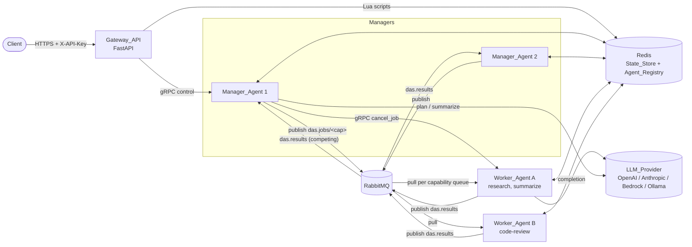
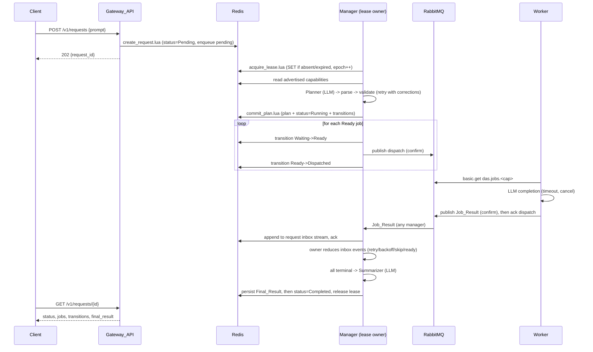

# Design Document: Distributed Agent System

## Overview

The Distributed Agent System (DAS) is a Python 3.12 asyncio platform made up of three process roles that run on separate hosts:

- **Gateway_API**: a FastAPI service that authenticates clients by API_Key, validates prompts, creates Requests in Redis, and serves status, cancellation, and agent listings.
- **Manager_Agent**: a stateless process. Any instance can claim a Request by Lease, plan it into a Job DAG with an LLM, dispatch Ready Jobs over RabbitMQ, apply Job_Results, retry or dead-letter failures, and summarize the outcome.
- **Worker_Agent**: consumes Jobs from per-Capability RabbitMQ queues, runs one LLM completion per Job, and publishes a Job_Result.

All durable state lives in Redis (State_Store and Agent_Registry). RabbitMQ carries Job dispatch and Job_Result Messages. gRPC carries control commands such as job cancellation and direct request-reply calls. Agent logic depends only on a `Transport` protocol and a `MessageCodec`, so adapters can be swapped by configuration.

### Design principles

1. **Pure core, thin I/O shell.** Planning validation, DAG scheduling, the Job state machine, retry/backoff math, final-result assembly, config resolution, redaction, and message encoding are pure functions or pure reducers. I/O adapters (Redis, RabbitMQ, gRPC, LLM SDKs) wrap them. This keeps most acceptance criteria testable with Hypothesis without infrastructure.
2. **Redis is the source of truth; queues are delivery.** A Manager can crash at any point and another Manager rebuilds everything from Redis. Every state transition goes through an atomic Lua script that checks lease ownership with a fencing epoch.
3. **At-least-once delivery, idempotent handling.** RabbitMQ may deliver a Job or Job_Result more than once. Results are keyed by `(job_id, attempt)` and the reducer discards duplicates and stale attempts.
4. **Clock authority.** Lease expiry and heartbeat staleness use Redis server time (`TIME`), so clock skew between hosts doesn't break ownership.

### Research findings that shaped the design

- **RabbitMQ quorum queues** track a per-message `delivery-count` and dead-letter a message once it is returned more times than the queue's `delivery-limit`. Since RabbitMQ 4.0 every quorum queue has a default delivery limit of 20 ([RabbitMQ 4.0 quorum queue features](https://www.rabbitmq.com/blog/2024/08/28/quorum-queues-in-4.0), [Dead Letter Exchanges](https://www.rabbitmq.com/docs/4.1/dlx)). DAS sets the limit explicitly through a policy derived from `max_attempts`, which implements Requirement 6.6 without custom redelivery counting.
- **Quorum queues don't support global (channel-wide) QoS**, so a per-channel prefetch can't cap total in-flight Jobs across several Capability queues ([Quorum Queues](https://blog.rabbitmq.com/docs/quorum-queues)). Workers therefore use a pull-mode consumer gated by a semaphore (see Worker_Agent) to enforce the concurrency limit exactly (Requirement 5.3).
- **Publisher confirms** (`aio-pika` `publisher_confirms=True`) give the "publish confirmed" signal required by Requirements 4.1, 4.8, and 5.5.
- **Redis Lua scripts** run atomically on a single Redis node. This gives the single-winner lease (2.2), the atomic plan+status write (3.9), and transition-log-in-same-update (13.7). v1 targets a single Redis primary; Redlock-style multi-node locking is out of scope.
- **Redis deployment scope**: DAS supports exactly one Redis primary. Redis Sentinel and Redis Cluster are out of scope: several Lua scripts touch more than one key in one call (for example `acquire_lease.lua` uses `das:req:<rid>`, `das:lease:<rid>`, `das:leases:expiry` and `das:requests:pending`), and the keys carry no hash tags, so they do not share a hash slot. Redis HA needs its own phase.
- **Hypothesis** is the property-based testing library. `fakeredis` with Lua support (`lupa`) runs the Lua scripts in-process for property tests of lease and transition logic.

Content was rephrased for compliance with licensing restrictions.

## Architecture

### Deployment view



### Request lifecycle



### Manager internals

A Manager runs these concurrent asyncio loops:

| Loop | Period | Responsibility |
|---|---|---|
| `ClaimLoop` | 1 s | Scan `das:requests:pending` and `das:leases:expiry` for claimable Requests; try `acquire_lease.lua`. Meets 2.1 (≤5 s) and 2.5 (≤10 s after expiry). |
| `LeaseKeeper` (per owned Request) | `lease_duration / 4` | `renew_lease.lua`. On rejection or on Redis unreachable past expiry, mark lease lost and cancel that Request's task (2.4, 2.7). |
| `ResultIngest` | push | Consume `das.results` (competing consumers across all Managers). Append each Job_Result to `das:req:{rid}:inbox` (Redis stream), then ack. |
| `DeadLetterIngest` | push | Consume `das.dlq.events`; translate delivery-limit dead-letters into `UnackedDeliveryExhausted` inbox events (6.6). |
| `RequestDriver` (per owned Request) | event + 250 ms tick | Read inbox events, timers, and registry snapshot; call the pure `RequestMachine.step`; execute resulting effects; commit via `apply_transition.lua`. |
| `RegistrySweeper` | `heartbeat_interval` | Mark stale agents Unavailable (idempotent; any Manager may run it) (11.2). |
| `Heartbeat` | `heartbeat_interval` | Publish own heartbeat (11.1). |

Any Manager can ingest a Job_Result, but only the lease owner applies it. This keeps the owner the single writer for Job transitions while letting results survive owner failover. The inbox is in Redis, so a new owner resumes by replaying unapplied inbox entries (cursor stored in `das:req:{rid}`).

### Capability routing decision

Requirement 5.2 says a Worker subscribes to exactly one queue per declared Capability. Requirement 4.5 says a Job may only go to a Worker that has every required Capability. With per-Capability queues, a Job requiring `{research, code-review}` can't simply go to either queue, because some consumers of `research` may lack `code-review`.

DAS resolves this with **routing-capability selection**:

1. For a Ready Job with required set `R`, the Manager computes, from the live registry snapshot, the candidate routing capabilities `C = { c ∈ R | every Available worker advertising c advertises all of R, and at least one does }`.
2. If `C` is non-empty, the Manager publishes to `das.jobs.<min(C)>` (deterministic choice). The dispatch Message carries the full `required_capabilities` list as a header and in the payload (4.1).
3. If `C` is empty for the whole capability wait period, the Job fails with `no capable worker` (4.6).
4. **Worker-side guard**: because the registry can change after publish (a new worker with a smaller capability set joins queue `c`), a Worker that pulls a Job whose `R` is not a subset of its own Capabilities returns it with `basic.nack(requeue=True)` before doing any work and pauses that queue for 1 s. This is a race-only fallback.

Single-capability Jobs, the common case, always route to their only capability queue.

## Components and Interfaces

### Package layout

```
das/
  config/        schema.py, loader.py, secrets.py           # Req 12, 10.7-10.8, 6.8
  models/        request.py, job.py, plan.py, results.py     # shared pydantic models
  plan/          codec.py, validate.py, dag.py               # Req 3.4-3.8, 4.3-4.4
  codec/         envelope.py, message_codec.py               # Req 9
  transport/     base.py, loader.py, rabbitmq.py, grpc_rpc.py, proto/das.proto   # Req 8, 15
  llm/           base.py, retry.py, errors.py, adapters/{openai,anthropic,bedrock,ollama}.py  # Req 10
  state/         store.py, lua/*.lua, keys.py                # Redis State_Store
  registry/      registry.py, availability.py                # Req 11
  manager/       machine.py, planner.py, summarizer.py, final_result.py,
                 backoff.py, routing.py, driver.py, claim.py, lease.py   # Req 2-4, 6, 7
  worker/        worker.py, executor.py, limiter.py          # Req 5
  gateway/       app.py, auth.py, validation.py              # Req 1, 11.4, 11.8, 13.9
  observability/ logging.py, redaction.py, context.py        # Req 12.7, 13
  health/        server.py                                   # Req 11.5
  cli.py                                                     # `das run --config path`
deploy/ docker/{gateway,manager,worker}.Dockerfile, docker-compose.yml, rabbitmq/definitions.json
tests/ unit/, property/, integration/
```

### Transport (Requirement 8, 15)

```python
# das/transport/base.py
class Outcome(enum.Enum):
    ACK = "ack"            # processed
    REQUEUE = "requeue"    # return to queue for redelivery
    REJECT = "reject"      # drop without requeue -> dead-letter (5.9, 9.5)

@dataclass(frozen=True)
class Delivery:
    message: Message                 # decoded by MessageCodec
    destination: str
    redelivered: bool
    delivery_count: int              # from x-delivery-count, 0 if unknown
    headers: Mapping[str, str]
    token: object                    # opaque, adapter-specific

Handler = Callable[[Delivery], Awaitable[None]]

class Transport(Protocol):
    name: ClassVar[str]
    async def start(self) -> None: ...
    async def close(self) -> None: ...
    async def publish(self, destination: str, message: Message,
                      headers: Mapping[str, str] | None = None) -> None: ...
    async def subscribe(self, destination: str, handler: Handler,
                        options: SubscribeOptions | None = None) -> Subscription: ...
    async def acknowledge(self, delivery: Delivery, outcome: Outcome = Outcome.ACK) -> None: ...
    async def request_reply(self, destination: str, message: Message,
                            timeout: float | None = None) -> Message: ...
```

- `publish` returns only after the broker confirms. It raises `TransportUnavailable` when disconnected (8.8) and `PublishNotConfirmed` on nack or confirm timeout.
- `request_reply` raises `RequestTimeout(destination)` after `request_reply_timeout` (default 30 s, 1-300) (8.7).
- `SubscribeOptions(max_in_flight: int | None, limiter: InFlightLimiter | None)` lets several subscriptions share one in-flight limit.
- Both adapters encode with the shared `MessageCodec` before handing bytes to the wire, so bytes are identical across transports (9.3).

**Loader** (`transport/loader.py`): adapters register under the Python entry-point group `das.transports` (`rabbitmq`, `grpc`). `load_transport(name)` raises `TransportNotInstalled(name)` (8.5, 15.3) when no entry point matches. When the class is missing any of the four operations, it raises `TransportIncomplete(name, missing=[...])` (15.5). The loader runs during startup before registry registration and before any subscribe or publish (8.4). v1 ships no `http` or `kafka` entry point.

**Reconnection** (8.6): a `ReconnectPolicy` (pure) yields delays `1, 2, 4, …` capped at `max_reconnect_interval` (default 30 s, 1-300). The adapter keeps a registry of active subscriptions and re-establishes all of them before unblocking delivery to handlers.

#### RabbitMQ adapter (`rabbitmq`)

Built on `aio-pika` with publisher confirms and persistent delivery mode.

| Exchange / queue | Type | Purpose |
|---|---|---|
| `das.jobs` | direct exchange | routing key = routing capability |
| `das.jobs.<capability>` | quorum queue, DLX=`das.dlx` | Job dispatch per Capability; declared by Workers and Managers (idempotent) |
| `das.results` | quorum queue | Job_Result Messages; competing consumers = all Managers |
| `das.dlx` | fanout exchange | dead-letter target |
| `das.dlq` | quorum queue | retained dead letters for operators (6.3) |
| `das.dlq.events` | quorum queue | copy consumed by Managers to react to delivery-limit dead-letters (6.6) |

The policy `das-jobs` (pattern `^das\.jobs\.`) sets `delivery-limit = max_attempts − 1` and `dead-letter-exchange = das.dlx`. A message is then dead-lettered instead of redelivered once it has been returned `max_attempts` times (6.6). A policy is used instead of queue arguments so operators can change it without redeclaring queues. The Manager applies it at startup through the management HTTP API. Integration tests verify the off-by-one mapping against a real broker.

Destination naming: `jobs/<capability>`, `results`, `dlq`, and `dlq-events` map to the names above. Worker consumption uses pull mode (`basic.get`) round-robin across its Capability queues while the shared limiter has free slots, polling every 200 ms when queues are empty. Consumption therefore resumes within 1 s of a slot freeing (5.3) and never more than `concurrency_limit` Jobs are unacknowledged.

#### gRPC adapter (`grpc`)

```proto
// das/transport/proto/das.proto
syntax = "proto3";
package das.v1;
message Frame { bytes envelope = 1; }   // MessageCodec bytes
message Ack { bool ok = 1; string error = 2; }
service AgentControl {
  rpc Send(Frame) returns (Ack);        // publish (one-way, acknowledged on handler completion)
  rpc Call(Frame) returns (Frame);      // request-reply
}
```

The destination is an agent ID, resolved to `grpc_host:grpc_port` through the Agent_Registry. `subscribe(destination=self_id)` registers handlers on the local `grpc.aio` server. On gRPC, `acknowledge` completes the pending `Send` with `Ack(ok=True)`. Control commands are `cancel_job` (Manager→Worker) and `cancel_request` (Gateway→owning Manager).

### MessageCodec (Requirement 9)

```python
class MessageCodec:
    SUPPORTED_VERSIONS: frozenset[int] = frozenset({1})
    def __init__(self, max_bytes: int = 1_048_576): ...
    def encode(self, message: Message) -> bytes          # raises MessageTooLarge
    def decode(self, data: bytes) -> Message             # raises ParseError(reason, field)
```

- The wire format is canonical JSON: UTF-8, `sort_keys=True`, `separators=(",", ":")`, `ensure_ascii=False`. Canonical form makes output deterministic and byte-identical across transports (9.3).
- The envelope has exactly `type`, `schema_version`, `message_id`, `correlation_id`, `timestamp`, `payload`. `extra="forbid"` on the envelope enforces the exact field set (9.1).
- The timestamp is ISO 8601 UTC with milliseconds (`2025-01-01T00:00:00.123Z`) and is truncated to ms on construction, so round-trip equality holds.
- `decode` checks the size limit first, then JSON, then the envelope, then `type`, then `schema_version`, then the payload against the per-type pydantic model. Any failure raises `ParseError(reason, field)` and never returns a partial object (9.4, 9.6).
- `encode` serializes, then checks length against `max_bytes` and raises without returning bytes (9.6).

### LLM_Provider (Requirement 10)

```python
@dataclass(frozen=True)
class ChatMessage:  role: Literal["system", "user", "assistant"]; content: str
@dataclass(frozen=True)
class ModelParams: model: str; temperature: float; max_output_tokens: int
@dataclass(frozen=True)
class TokenUsage:  input_tokens: int; output_tokens: int; total_tokens: int
@dataclass(frozen=True)
class Completion:  content: str; usage: TokenUsage

class ProviderAdapter(Protocol):
    provider: ClassVar[str]          # "openai" | "anthropic" | "bedrock" | "ollama"
    async def complete_once(self, system: str, messages: Sequence[ChatMessage],
                            params: ModelParams, timeout: float) -> Completion: ...
    async def ping(self) -> bool: ...  # health

class LLMProvider:                   # retry wrapper; the only type agent code sees
    def __init__(self, adapter: ProviderAdapter, params: ModelParams,
                 retry_count: int = 3, timeout: float = 60, sleep=asyncio.sleep): ...
    async def complete(self, system: str, messages: Sequence[ChatMessage]) -> Completion
```

- `LLMProvider.complete` validates inputs (1-100 messages, temperature 0.0-2.0, max tokens ≥ 1) and calls `complete_once` under `asyncio.timeout`. Adapters translate SDK exceptions to `TransientLLMError` (rate limit, connection failure or reset, 5xx or unavailable, timeout) or `PermanentLLMError` (auth, authz, invalid request, unknown model, context exceeded).
- Retry delay for wait `k` (1-based) is `min(2^(k-1), 30)` seconds, with up to `retry_count` retries (10.4). Permanent errors raise immediately (10.6). Exhaustion raises `LLMCallFailed(provider, model, reason, attempts)` with no content (10.5).
- Adapters:
  - `openai`: Chat Completions via the `openai` async SDK.
  - `anthropic`: Messages API via the `anthropic` async SDK.
  - `bedrock`: Converse API via `aioboto3` `bedrock-runtime`.
  - `ollama`: `/api/chat` via `httpx` with `stream=false`.
- Each agent builds exactly one `LLMProvider` from its Agent_Config and injects it into its Planner, Summarizer, or Executor (10.3). Tests inject a `FakeAdapter` directly in code. It isn't selectable by config name (10.7).

### State_Store (Redis)

`das/state/store.py` exposes typed async methods, each backed by a Lua script so that every multi-key change is atomic:

| Method | Script | Guarantees |
|---|---|---|
| `create_request(prompt)` | `create_request.lua` | `HSETNX`-style uniqueness on a UUIDv4 `request_id` (regenerate on collision); writes status Pending; `ZADD das:requests:pending` (1.1) |
| `acquire_lease(rid, manager_id, duration)` | `acquire_lease.lua` | succeeds only if no lease or lease expired (Redis `TIME`) and request non-terminal; increments `epoch`; returns `(epoch, expires_at)` or nil (2.2, 2.3) |
| `renew_lease(rid, manager_id, epoch, duration)` | `renew_lease.lua` | succeeds only if owner and epoch match and not expired; sets `expires_at = now + duration` (2.4) |
| `release_lease(rid, manager_id, epoch)` | `release_lease.lua` | deletes only if owned |
| `commit_plan(rid, lease, plan)` | `commit_plan.lua` | lease check; status Pending→Running; writes all Jobs as Waiting plus transitions in one script (3.9, 13.7) |
| `apply_transition(rid, lease, batch)` | `apply_transition.lua` | lease check; request status non-terminal; applies Job updates, Job_Result records, transition entries, timers, inbox cursor, request field updates atomically (13.7) |
| `record_result_inbox(rid, result)` | `XADD` | append-only; used by any Manager |
| `finalize(rid, lease, final_result, status)` | `finalize.lua` | lease check; writes Final_Result then status in one script; status Completed only when the Final_Result write succeeded (7.4) |
| `cancel_request(rid)` | `cancel_request.lua` | used by Gateway; if status Pending/Running: status→Cancelled, every non-terminal Job→Cancelled with transitions; else returns `TERMINAL` (1.6, 1.8) |
| `fail_request(rid, lease, error, final_result?)` | `finalize.lua` | Failed status with error (3.6, 3.10, 3.11, 7.3, 7.6) |

All scripts that a Manager calls take `(manager_id, epoch)` and return `LEASE_LOST` when ownership doesn't match. This fencing makes a Manager whose lease silently expired unable to write anything (2.7, 3.12). Scripts also return `REQUEST_TERMINAL` when the Request is Cancelled, which stops further dispatch (1.7).

### Agent_Registry (Requirement 11)

```python
class AgentRegistry:
    async def register(self, info: AgentInfo) -> None           # status Available (11.6)
    async def heartbeat(self, agent_id: str) -> None             # also flips Unavailable->Available (11.7)
    async def deregister(self, agent_id: str) -> None
    async def snapshot(self) -> RegistrySnapshot                 # agents + server time
    async def sweep(self, now: float) -> list[str]               # mark stale Unavailable (11.2)

def compute_status(last_heartbeat: float, interval: float, now: float) -> AgentStatus
def advertised_capabilities(agents: Iterable[AgentRecord]) -> frozenset[str]
def capable_routing_capabilities(required: frozenset[str], agents) -> frozenset[str]
```

`compute_status` returns Unavailable when `now − last_heartbeat ≥ 3 × interval`. The sweeper runs every interval, so the mark happens within one extra interval. `advertised_capabilities` is the union of Capabilities of Available Worker_Agents. Removing a dead worker therefore drops only Capabilities no other Available worker declares (11.2). The Planner reads this set (3.3) and routing reads `capable_routing_capabilities`.

### Planner (Requirement 3)

```python
class Planner:
    async def plan(self, prompt: str, capabilities: frozenset[str], cfg: PlannerConfig
                  ) -> PlanOutcome   # PlanAccepted(plan) | PlanRejected(failed_checks)
```

1. If `capabilities` is empty, return `NoCapabilities` without calling the LLM (3.10).
2. Build the planning prompt with the advertised Capability list, the Job_Plan JSON schema, and `max_jobs`.
3. Call the LLM, extract the JSON (strip code fences), then `parse_plan` and `validate_plan(plan, capabilities, max_jobs)`.
4. On failure, send a corrected-plan request listing each failed check. Allow at most `planning_retries + 1` attempts (3.5).
5. Return the plan, or the failed checks of the last attempt (3.6). An `LLMCallFailed` propagates and the Manager fails the Request with the provider, model, and reason (3.11).

`validate_plan` is pure and returns all failed checks (`CheckFailure` enum): `SCHEMA`, `DUPLICATE_JOB_ID`, `EMPTY_INSTRUCTION`, `INSTRUCTION_TOO_LONG`, `NO_CAPABILITIES`, `SELF_DEPENDENCY`, `UNKNOWN_DEPENDENCY`, `CYCLE`, `JOB_COUNT_OUT_OF_RANGE`, `UNADVERTISED_CAPABILITY` (3.2, 3.4).

`plan/codec.py` provides `print_plan(plan) -> str` (canonical JSON conforming to the schema, 3.7) and `parse_plan(text) -> JobPlan` (raises `PlanSchemaError`).

### DAG scheduler (`plan/dag.py`, Requirement 4.3-4.4)

```python
def topo_order(plan: JobPlan) -> list[str]               # raises CycleError
def ready_jobs(plan: JobPlan, states: Mapping[str, JobState]) -> set[str]
    # Waiting jobs whose dependencies are all Succeeded
def transitive_dependents(plan: JobPlan, job_id: str) -> set[str]
def all_terminal(states: Mapping[str, JobState]) -> bool
```

### RequestMachine (`manager/machine.py`)

The heart of the Manager is a pure reducer:

```python
def step(snapshot: RequestSnapshot, event: Event, ctx: StepContext) -> Decision
```

- `StepContext` holds `now`, the config (max_attempts, backoff, capability_wait), and the registry snapshot.
- `Decision` holds `updates: TransitionBatch` and `effects: list[Effect]`.
- `Event` is one of `PlanCommitted`, `JobResultReceived(result)`, `PublishConfirmed(job_id, attempt)`, `PublishFailed(job_id, attempt, n)`, `TimerFired(kind, job_id, attempt)`, `Tick`, `UnackedDeliveryExhausted(job_id)`, `CancelObserved`.
- `Effect` is one of `PublishDispatch(job_id, attempt, routing_cap, dependency_results)`, `PublishDeadLetter(job_id, attempts, last_error)`, `SendCancel(job_id)`, `ScheduleTimer(at, kind, job_id, attempt)`, `RunSummarizer`, `FinalizeFailed(final_result)`.

Rules encoded in `step`:

| Situation | Behavior | Req |
|---|---|---|
| Request status Cancelled | discard event, no effects | 1.7 |
| Job Waiting and all deps Succeeded | Waiting→Ready; record `ready_since`; if a routing capability exists emit `PublishDispatch` | 4.1, 4.3 |
| `PublishConfirmed` | Ready→Dispatched | 4.1 |
| `PublishFailed` n<4 | stay Ready, schedule retry publish | 4.8 |
| `PublishFailed` n=4 (1 + 3 retries) | Ready→Failed "dispatch failure" | 4.8 |
| Ready with no routing capability since `ready_since ≥ capability_wait` | Failed "no capable worker" | 4.6 |
| Result for `(job, attempt)` already recorded, or `attempt < job.attempt` | discard, no change | 6.5, 2.8 |
| Result Succeeded | record result, Dispatched→Succeeded | 5.5 |
| Result Failed/TimedOut, `attempt == job.attempt < max_attempts` | record, state→Failed/TimedOut (attempt N), `ScheduleTimer(now + backoff(N))`; on fire attempt+=1, publish | 6.1, 6.2 |
| Result Failed/TimedOut, `attempt == max_attempts` | Failed with last reason; `PublishDeadLetter` | 6.3 |
| Result Cancelled | Cancelled, no retry, no DLQ | 6.7 |
| `UnackedDeliveryExhausted` | Failed "repeated unacknowledged delivery" | 6.6 |
| Job enters Failed (terminal) | every transitive dependent → Skipped with reason naming the failed Job_ID | 4.4 |
| All Jobs terminal, ≥1 Succeeded | `RunSummarizer` | 7.1 |
| All Jobs terminal, 0 Succeeded | `FinalizeFailed(job report list)` | 7.3 |

`backoff(N) = min(base × 2^(N−1), max_backoff)` (6.2).

`resume(snapshot) -> list[Effect]` (2.6) re-emits `PublishDispatch` for Jobs in Ready or Dispatched with no recorded result for the current attempt. It also re-arms persisted timers. Jobs in a terminal state are never re-dispatched. Re-dispatching a Dispatched Job can duplicate a delivery, which result idempotency (6.5, 2.8) absorbs.

Dependency inputs for a dispatch are `{dep_id: results[dep_id].content}` for every dependency, so the count equals `len(depends_on)` (4.2). Retries reuse the same inputs (6.1).

### Summarizer and Final_Result (Requirement 7)

```python
class Summarizer:
    async def summarize(self, prompt: str, succeeded: Mapping[str, str]) -> Completion
def build_final_result(plan, jobs, results, summary: Completion | None,
                       error: str | None) -> FinalResult        # pure
```

- Summarizer input is the original prompt plus only Succeeded Job_Result contents (7.1).
- Each call has a 120 s timeout. The Summarizer makes up to 3 attempts. On failure, the Manager stores `build_final_result(..., summary=None, error="summarization failed: …")` and sets the Request to Failed (7.6).
- `build_final_result` emits one `JobReport` per Job (job_id, terminal state, worker_id or `None`, input and output tokens or 0) (7.5).
- It also emits one `FailureEntry` per Failed, Skipped, or Cancelled Job (7.2). Reasons come from the Job_Result error, or from `skipped: dependency <id> failed`, or from `cancelled: request cancelled`.
- Finalization writes go through `finalize.lua`. On Redis error the Manager retries 3 more times at 1 s intervals while still renewing. If all attempts fail it stops renewing so the lease lapses (7.7).

### Worker_Agent (Requirement 5)

```python
class Worker:
    async def run(self) -> None
class JobExecutor:
    async def execute(self, job: JobDispatch, cancel: asyncio.Event) -> JobResultPayload
class InFlightLimiter:     # semaphore with capacity = concurrency_limit
```

Startup order:

1. Load and validate config.
2. Load the transports.
3. Connect to Redis and RabbitMQ with startup retry (14.7).
4. Register in the Agent_Registry within 30 s, or exit non-zero (5.10).
5. Declare and subscribe one pull consumer per Capability (5.2).
6. Start the gRPC control server, heartbeat, and health server.

Per Job:

1. Decode the dispatch. On `ParseError` or a missing job_id or instruction, acknowledge with `REJECT` so it goes to the DLQ (5.9, 9.5).
2. Run the worker-side capability guard.
3. Run the LLM completion with the instruction plus labelled dependency results (5.4).
4. Enforce the timeout with `asyncio.timeout(job_timeout)` (default 300 s). Cancellation through `asyncio.Task.cancel()` stops the provider call promptly, well inside the 5 s bound (5.6, 5.7).
5. Publish the Job_Result (confirmed), then ACK the dispatch (5.5). If the result publish fails, the dispatch is not ACKed. The connection drop or shutdown requeues it, and the attempt count stays unchanged (6.4).

A `cancel_job` gRPC command cancels the matching running task. Unknown job IDs are ignored.

Graceful shutdown (11.3):

1. Stop pulling.
2. Wait for in-flight Jobs up to `shutdown_timeout`.
3. `REQUEUE` the unfinished ones.
4. Deregister and close transports.

### Gateway_API (Requirements 1, 11.4, 11.8, 13.9)

| Method & path | Success | Errors |
|---|---|---|
| `POST /v1/requests` `{prompt}` | 202 `{request_id}` | 401, 400 `{error: "empty_prompt"}` or `{error: "prompt_too_long", max_length}`, 503 |
| `GET /v1/requests/{id}` | 200 `{status, jobs:[{job_id,state}], transitions:[…], final_result?, error?}` | 401, 404, 503 |
| `POST /v1/requests/{id}/cancel` | 202 `{status:"Cancelled"}` | 401, 404, 409 `{error:"request_terminal"}`, 503 |
| `GET /v1/agents` | 200 `[{agent_id, role, host, capabilities, status, last_heartbeat}]` | 401 |
| `GET /healthz` | 200/503 health report | — |

- Authentication is a FastAPI dependency evaluated first. It compares the `X-API-Key` header against the configured keys with `hmac.compare_digest` and rejects with 401 before any State_Store access (1.3, 11.8).
- Prompt validation (`validate_prompt(prompt, max_len) -> PromptError | None`) is pure. Whitespace-only means `prompt.strip() == ""` using Python's Unicode whitespace definition (1.4).
- `final_result` is present only when status is Completed (1.2). Transitions come back in chronological order (13.9).
- Redis calls use a 2 s socket timeout and a 4.5 s overall `asyncio.timeout`, mapping failures to 503 `service_unavailable` (1.9). The `request_id` is only returned after `create_request.lua` returns success.
- After a successful cancel, the Gateway sends a best-effort `cancel_request` gRPC command to the lease owner, which then sends `cancel_job` to workers. Correctness doesn't depend on this call, because the state change already happened atomically in Redis and the owner's next script call returns `REQUEST_TERMINAL`.
- TLS termination is expected at a reverse proxy in production. Docker Compose exposes plain HTTP locally.

### Configuration (Requirement 12, 6.8, 10.7-10.8)

```python
def load_config(path: Path, env: Mapping[str, str]) -> AgentConfig   # raises ConfigError(errors=[...])
def resolve(file_values: dict, env: Mapping[str, str]) -> dict        # pure precedence merge
```

- The file is YAML. Environment variables use the `DAS__` prefix with `__` as the nesting separator, for example `DAS__LLM__MODEL`. Precedence is env, then file, then default (12.1).
- Validation uses pydantic v2 models that collect every error. `ConfigError` lists each field path and reason (12.2). File read or parse errors include the path and reason (12.3).
- Secret fields (`api_keys`, `llm.api_key`, `llm.aws_secret_access_key`, …) are `SecretStr` and accepted only from env or `secrets_file`. If the YAML contains one, `ConfigError` names the field but never the value (12.4, 12.5). A missing or unreadable secrets file is an error naming the reference (12.6).
- Cross-field validation:
  - `base_backoff ≤ max_backoff` (6.8).
  - Worker role requires 1-50 Capabilities (12.2, 14.4).
  - The provider must be one of the four names, the model must be present, and the provider's required credentials must exist (10.7). Ollama requires none and Bedrock may use the default AWS credential chain.
- Validation happens before any network connection. `cli.py` maps `ConfigError` to exit code 2.

### Observability (Requirement 13, 12.7)

- `structlog` renders single-line JSON with `timestamp` (UTC ISO 8601, ms), `level`, `agent_id`, `message` (13.1).
- `contextvars` bind `request_id` and `job_id`. Handlers bind the inbound Message's `correlation_id` as `request_id`, and the codec helper `new_message(...)` copies the bound `request_id` into outbound correlation IDs (13.2-13.5).
- A Message of a Request-scoped type with an empty correlation ID logs a warning with type and sender and continues processing (13.6).
- Processor chain: `drop_content_fields` removes keys in `{"prompt","content","instruction","final_result","api_key",…}` (13.10), then `Redactor` replaces every substring of length ≥ 8 that occurs in any registered secret with `[REDACTED]`. Secrets shorter than 8 characters are replaced as whole occurrences. The Redactor runs on the fully rendered line, which covers exception traces (12.7). The redactor repeats until no match remains.
- The same `apply_transition.lua` call that changes a Job state appends to `das:req:{rid}:transitions` (13.7). The list is deleted only with the Request (13.8).

### Health (Requirement 11.5)

Each agent runs a small Starlette app on `health_port` serving `GET /healthz`. It runs three checks concurrently, each with a 2 s timeout:

- Transport: connection open, plus a gRPC server serving.
- Redis: `PING`.
- LLM: `adapter.ping()`, a cached lightweight call or a model-list endpoint, cached 30 s to avoid cost.

A check that times out reports disconnected. `overall = healthy` only if all three are connected. The whole response is bounded at 3 s.

### Deployment (Requirement 14)

- There are three Dockerfiles (gateway, manager, worker) on `python:3.12-slim`, each running `das run --config /etc/das/config.yaml`. Role and Capabilities come only from config and env (14.3).
- `docker-compose.yml` defines these services:
  - `rabbitmq:4.1-management` with a definitions file for exchanges, queues, and policy.
  - `redis:7.4`.
  - `gateway`.
  - `manager` with `deploy.replicas: 2`.
  - `worker-research` with Capabilities `research, summarize`.
  - `worker-review` with Capability `code-review`.
  - `ollama` (optional profile) (14.1).
- Healthchecks plus `depends_on: condition: service_healthy` bring the stack up within 120 s on a warm host (14.2).
- All addresses (`rabbitmq.url`, `redis.url`, `grpc.advertise_host/port`) come from config. Code contains no `localhost` or service-name defaults; required addresses have no default and must be supplied (14.8).
- Startup dependency retry: `startup_retry_interval` (default 2 s) up to `startup_timeout` (default 60 s), then exit non-zero naming the dependency (14.7).
- Scaling up registers within 2 heartbeat intervals because registration happens before the first heartbeat (14.5). Scaling down sends SIGTERM, which triggers graceful shutdown (14.6). Compose `stop_grace_period` is set above `shutdown_timeout`.

## Data Models

All models are pydantic v2, `frozen=True`, `extra="forbid"`.

```python
class RequestStatus(StrEnum): PENDING="Pending"; RUNNING="Running"; COMPLETED="Completed"; FAILED="Failed"; CANCELLED="Cancelled"
TERMINAL_REQUEST = {COMPLETED, FAILED, CANCELLED}

class JobState(StrEnum): WAITING="Waiting"; READY="Ready"; DISPATCHED="Dispatched"; SUCCEEDED="Succeeded"
                         FAILED="Failed"; TIMED_OUT="TimedOut"; SKIPPED="Skipped"; CANCELLED="Cancelled"
TERMINAL_JOB = {SUCCEEDED, FAILED, SKIPPED, CANCELLED}

class PlannedJob(BaseModel):
    job_id: str = Field(pattern=r"^[A-Za-z0-9_-]{1,64}$")
    instruction: str = Field(min_length=1, max_length=8000)
    capabilities: list[str] = Field(min_length=1)          # compared as a set
    depends_on: list[str] = []                             # compared as a set

class JobPlan(BaseModel):
    jobs: list[PlannedJob]                                 # equivalence: same ids, per-id same instruction/cap set/dep set

class JobRecord(BaseModel):
    job: PlannedJob
    state: JobState
    attempt: int = 0               # 0 = never dispatched; first dispatch = 1
    ready_since: float | None
    publish_failures: int = 0
    worker_id: str | None
    reason: str | None             # last error / skip / cancel reason

class JobResultPayload(BaseModel):
    request_id: str; job_id: str; attempt: int = Field(ge=1); worker_id: str
    status: Literal["Succeeded","Failed","TimedOut","Cancelled"]
    content: str; error: str | None
    usage: TokenUsage; duration_ms: int = Field(ge=0)

class JobDispatchPayload(BaseModel):
    request_id: str; job_id: str; attempt: int; instruction: str
    required_capabilities: list[str]
    dependency_results: dict[str, str]                     # dep job_id -> content

class ControlPayload(BaseModel):
    command: Literal["cancel_job","cancel_request"]; request_id: str; job_id: str | None

class HeartbeatPayload(BaseModel):
    agent_id: str; role: Literal["manager","worker","gateway"]; capabilities: list[str]

class Envelope(BaseModel):
    type: Literal["job_dispatch","job_result","heartbeat","control"]
    schema_version: PositiveInt
    message_id: str = Field(min_length=1, max_length=64)
    correlation_id: str                                    # "" allowed for heartbeat/control
    timestamp: datetime                                    # UTC, ms precision
    payload: dict

class TransitionEntry(BaseModel):
    job_id: str; from_state: JobState | None; to_state: JobState
    attempt: int; worker_id: str | None; at: datetime      # ms precision

class Lease(BaseModel): request_id: str; owner: str; epoch: int; expires_at: float

class AgentRecord(BaseModel):
    agent_id: str; role: str; host: str; grpc_endpoint: str | None
    capabilities: frozenset[str]; concurrency_limit: int | None
    status: Literal["Available","Unavailable"]; last_heartbeat: float

class JobReport(BaseModel):
    job_id: str; state: JobState; worker_id: str | None; input_tokens: int; output_tokens: int
class FailureEntry(BaseModel): job_id: str; state: JobState; reason: str
class FinalResult(BaseModel):
    summary: str | None
    jobs: list[JobReport]; failures: list[FailureEntry]
    summarizer_usage: TokenUsage; error: str | None
```

### Redis key layout

| Key | Type | Content |
|---|---|---|
| `das:req:{rid}` | hash | `status`, `prompt`, `created_at`, `error`, `final_result` (JSON), `inbox_cursor` |
| `das:req:{rid}:jobs` | hash | `job_id` → `JobRecord` JSON |
| `das:req:{rid}:results` | hash | `{job_id}:{attempt}` → `JobResultPayload` JSON |
| `das:req:{rid}:inbox` | stream | ingested Job_Results and DLQ events |
| `das:req:{rid}:timers` | zset | `{kind}:{job_id}:{attempt}` scored by due time |
| `das:req:{rid}:transitions` | list | `TransitionEntry` JSON, append-only |
| `das:lease:{rid}` | hash | `owner`, `epoch`, `expires_at` |
| `das:leases:expiry` | zset | `rid` scored by `expires_at` |
| `das:requests:pending` | zset | Pending `rid` scored by creation time |
| `das:agent:{id}` | hash | `AgentRecord` fields |
| `das:agents` | zset | `agent_id` scored by `last_heartbeat` |

### Agent_Config (YAML, abbreviated)

```yaml
role: manager                     # gateway | manager | worker
agent_id: manager-1               # default: role-hostname-uuid4[:8]
host: 10.0.0.5
transports: { jobs: rabbitmq, control: grpc }
rabbitmq: { url: amqp://rabbit.internal:5672/, management_url: http://rabbit.internal:15672 }
redis: { url: redis://redis.internal:6379/0 }
grpc: { bind: 0.0.0.0:50051, advertise_host: 10.0.0.5, advertise_port: 50051 }
llm: { provider: anthropic, model: claude-sonnet-4, temperature: 0.2, max_output_tokens: 4096,
       timeout: 60, retry_count: 3 }
limits: { max_prompt_length: 32000, max_jobs: 10, planning_retries: 2, lease_duration: 30,
          max_attempts: 3, base_backoff: 2, max_backoff: 60, capability_wait: 60,
          job_timeout: 300, max_message_bytes: 1048576, heartbeat_interval: 5,
          shutdown_timeout: 30, request_reply_timeout: 30, max_reconnect_interval: 30,
          startup_timeout: 60, startup_retry_interval: 2 }
worker: { capabilities: [research, summarize], concurrency_limit: 4 }
health_port: 8081
secrets_file: /run/secrets/das.env  # API keys and LLM credentials only here or in env
```

## Correctness Properties

*A property is a characteristic or behavior that should hold true across all valid executions of a system-essentially, a formal statement about what the system should do. Properties serve as the bridge between human-readable specifications and machine-verifiable correctness guarantees.*

During reflection, overlapping criteria were merged:

- Plan printer conformance (3.7) is folded into the plan round trip.
- Codec parse (9.2), envelope shape (9.1), and transport byte-identity (9.3) are folded into the codec round trip.
- Duplicate-success handling (2.8) is folded into result idempotency.
- Lease-loss discard (3.12) is folded into lease fencing.
- Planning prompt content (3.3) is folded into the planning-attempt property.
- Manager-side reject (9.5) is folded into the malformed-message property.
- Reactivation (11.7) is folded into the registry availability model.

Timing bounds (500 ms, 2 s, 5 s, 10 s, 120 s), broker redelivery behavior, and deployment criteria are covered by integration, example, and smoke tests instead (see Testing Strategy).

### Property 1: Job_Plan round trip

*For any* valid `JobPlan`, `print_plan` produces JSON that validates against the Job_Plan JSON schema, and `print_plan(parse_plan(print_plan(p)))` is equivalent to `print_plan(p)`. Equivalence means the same Job_ID set and, per Job_ID, the same instruction, Capability set, and dependency set.

**Validates: Requirements 3.7, 3.8**

### Property 2: Plan validator matches reference oracle

*For any* candidate plan, advertised Capability set, and `max_jobs` in 1..100, `validate_plan` returns exactly the set of failed checks computed by a simple reference oracle. The candidate plan is generated as a valid plan and then optionally mutated with duplicate ids, empty or over-long instructions, empty Capability lists, self-dependencies, unknown dependencies, injected cycles, unadvertised Capabilities, or an out-of-range Job count. The plan is valid if and only if that set is empty.

**Validates: Requirements 3.1, 3.2, 3.4**

### Property 3: Bounded planning attempts with corrections

*For any* planning retry count `r` in 0..5, any non-empty advertised Capability set, and any sequence of LLM outputs:

- The Planner makes `min(k, r+1)` LLM calls, where `k` is the 1-based index of the first valid output (∞ if none).
- Every planning prompt lists every advertised Capability.
- Every corrected-plan request names each check the previous output failed.
- When no valid output appears within `r+1` calls, the outcome reports the failed checks of the last attempt.

**Validates: Requirements 3.3, 3.5, 3.6**

### Property 4: Message codec round trip and canonical encoding

*For any* valid `Message` of every type (job_dispatch, job_result, heartbeat, control):

- `decode(encode(m)) == m` across every envelope and payload field.
- `encode(decode(encode(m))) == encode(m)` byte-for-byte.
- The top-level JSON keys of `encode(m)` are exactly `{type, schema_version, message_id, correlation_id, timestamp, payload}`.
- The bytes handed to the wire by the RabbitMQ and gRPC adapters equal `encode(m)`.

**Validates: Requirements 9.1, 9.2, 9.3, 9.7**

### Property 5: Codec rejects malformed input atomically

*For any* byte string that is not a valid encoded Message, `decode` raises `ParseError` with a reason and offending field and never returns a Message object. Generated inputs include random bytes, valid encodings with a required field removed, an unknown type, an unsupported schema_version, or a payload field of the wrong type.

**Validates: Requirements 9.4**

### Property 6: Message size limit

*For any* Message and any limit `L`, `encode` returns bytes if and only if the canonical serialization is at most `L` bytes, and otherwise raises `MessageTooLarge` without returning bytes. *For any* byte string longer than `L`, `decode` raises a size-limit `ParseError`.

**Validates: Requirements 9.6**

### Property 7: Prompt validation

*For any* string `s` and configured maximum `n` in 1..1,000,000, `validate_prompt(s, n)` returns:

- `empty_prompt` if `s.strip() == ""`.
- Otherwise `prompt_too_long` carrying `n` if `len(s) > n`.
- Otherwise no error.

The Gateway creates a Request only when no error is returned.

**Validates: Requirements 1.4**

### Property 8: Rejected calls are non-mutating

*For any* State_Store contents and any submit, query, cancel, or agent-listing call that either carries a missing or non-configured API_Key (status 401) or targets a Request_ID absent from the store (status 404), the State_Store contents after the call equal those before. A 401 response contains no request or agent data.

**Validates: Requirements 1.3, 1.5, 11.8**

### Property 9: Submission creates unique Pending Requests

*For any* sequence of valid prompts submitted with a valid API_Key, every returned Request_ID is distinct, and each maps in the State_Store to a Request with status Pending and the submitted prompt.

**Validates: Requirements 1.1**

### Property 10: Query response shape

*For any* stored Request (any status, any Job set, any transitions), the query response contains the Request status, one `(job_id, state)` entry per Job (empty list when no plan exists), and the transition entries in chronological order. It contains `final_result` if and only if the status is Completed.

**Validates: Requirements 1.2, 13.9**

### Property 11: Cancellation semantics

*For any* Request with any Job state map:

- If the status is Pending or Running, `cancel_request` sets the status to Cancelled, sets every Job not in {Succeeded, Failed, Skipped, Cancelled} to Cancelled, and leaves terminal Jobs unchanged.
- If the status is Completed, Failed, or Cancelled, it returns `TERMINAL` and leaves the Request, Jobs, and Final_Result unchanged.

**Validates: Requirements 1.6, 1.8**

### Property 12: Cancelled Requests are inert

*For any* snapshot whose Request status is Cancelled and any event (including Job_Results of any status), `RequestMachine.step` produces no Job updates, no stored results, and no effects.

**Validates: Requirements 1.7**

### Property 13: Lease mutual exclusion and fencing

*For any* number of Manager_Agents (2..10) and any interleaved sequence of acquire, renew, release, guarded-write, and clock-advance operations executed against the Lua scripts:

- At every point at most one Manager holds an unexpired Lease on a Request.
- Each successful renew sets `expires_at = now + duration`.
- Every guarded write by a Manager whose `(owner, epoch)` does not match the current unexpired Lease returns `LEASE_LOST` and leaves the Request, Job, and Lease state unchanged.

**Validates: Requirements 2.2, 2.4, 2.7, 3.12**

### Property 14: Resume re-dispatches exactly the unfinished in-flight Jobs

*For any* persisted Request snapshot, `resume(snapshot)` emits `PublishDispatch` exactly for Jobs in Ready or Dispatched state with no Job_Result recorded for their current attempt. It emits none for Jobs in Succeeded, Failed, Skipped, Cancelled, or Waiting state. Each emitted dispatch carries the persisted Succeeded Job_Result contents of its dependencies.

**Validates: Requirements 2.6**

### Property 15: Dispatch readiness and dependency inputs

*For any* Job_Plan DAG and Job state map, after `step` processes a `Tick`:

- A Job is published only if it was Waiting and all its dependencies are Succeeded.
- Each such Job gets exactly one `PublishDispatch` and moves to Ready (not Dispatched).
- Every Job with a non-Succeeded dependency remains Waiting with no dispatch.
- Each dispatch's `dependency_results` has exactly the Job's dependency Job_IDs as keys, mapped to their stored contents.
- A Job moves Ready→Dispatched only on `PublishConfirmed` for its current attempt.

**Validates: Requirements 4.1, 4.2, 4.3**

### Property 16: Failure propagation skips exactly the transitive dependents

*For any* DAG and any Job that transitions to terminal Failed, the set of Jobs newly marked Skipped equals the non-terminal members of `transitive_dependents(plan, job)`. No Skipped Job receives a dispatch, and every Job outside that set keeps its prior state.

**Validates: Requirements 4.4**

### Property 17: Routing-capability selection is sound

*For any* registry snapshot and required Capability set `R`, every capability `c` returned by `capable_routing_capabilities(R, agents)`:

- belongs to `R`,
- is advertised by at least one Available Worker,
- is such that every Available Worker advertising `c` advertises all of `R`.

The selected destination is `jobs/min(C)`.

**Validates: Requirements 4.5**

### Property 18: Capability wait timeout

*For any* sequence of ticks with timestamps and registry snapshots applied to a Ready Job, the Job becomes Failed with reason `no capable worker` and no dispatch if and only if no routing capability existed at any tick in an interval of length ≥ `capability_wait` since `ready_since`.

**Validates: Requirements 4.6**

### Property 19: Publish retry bound

*For any* sequence of publish outcomes for a Ready Job, the Job stays Ready while it has fewer than 4 consecutive publish failures and becomes Failed with a dispatch-failure reason exactly at the 4th consecutive failure (1 attempt + 3 retries). It becomes Dispatched only after a confirmed publish.

**Validates: Requirements 4.8**

### Property 20: Attempt progression, retry, and dead-lettering

*For any* `max_attempts` in 1..10 and any sequence of current-attempt Job_Results with status in {Succeeded, Failed, TimedOut, Cancelled}:

- A Failed or TimedOut result at attempt `N < max_attempts` records that state and schedules exactly one re-dispatch at attempt `N+1`, with identical Job_ID, instruction, Capabilities, and dependency results.
- A Failed or TimedOut result at `N = max_attempts` sets Failed and emits exactly one `PublishDeadLetter` carrying Request_ID, Job_ID, `N`, and the last error.
- A Cancelled result sets Cancelled with no re-dispatch and no dead-letter.
- A Succeeded result sets Succeeded.

**Validates: Requirements 6.1, 6.3, 6.7**

### Property 21: Backoff schedule

*For any* base delay `b` in [0.1, 60], max delay `m` in [1, 600] with `b ≤ m`, and failed attempt `N ≥ 1`, the scheduled re-dispatch time minus the result time is at least `min(b × 2^(N−1), m)` and at most that value plus the driver tick (250 ms).

**Validates: Requirements 6.2**

### Property 22: Result handling is idempotent

*For any* snapshot and any Job_Result that already has a stored result for its `(job_id, attempt)` or carries an attempt lower than the Job's current attempt, `step` leaves Job state, attempt count, and stored results unchanged. In particular the first Succeeded result of a Job is never replaced. Applying any result sequence with duplicates inserted yields the same final snapshot as the sequence without them.

**Validates: Requirements 2.8, 6.5**

### Property 23: Summarization trigger and inputs

*For any* Job_Plan whose Jobs are all terminal:

- `step` emits `RunSummarizer` if and only if at least one Job is Succeeded.
- The Summarizer input is the original prompt plus exactly the contents of the Succeeded Job_Results.
- When no Job is Succeeded, the decision is `FinalizeFailed` with a Final_Result listing every Job's Job_ID, terminal state, and reason.

**Validates: Requirements 7.1, 7.3**

### Property 24: Final_Result completeness

*For any* plan, terminal Job records, Job_Results, and summarizer usage, `build_final_result` returns:

- One `JobReport` per Job, with correct state, the producing worker or `None`, and token counts from the Job_Result or 0.
- One `FailureEntry` for each Job in Failed, Skipped, or Cancelled state, and no other entries. Each entry's reason is the Job_Result error, the failed dependency's Job_ID, or the cancellation.
- The summarizer's token usage.

**Validates: Requirements 7.2, 7.5**

### Property 25: Transition log matches state changes

*For any* sequence of decisions committed through `apply_transition.lua`, including sequences in which the Lease moves between Managers, the transitions list contains exactly one entry per Job state change. Each entry has the correct previous state, new state, attempt, and worker_id. Entries are in non-decreasing timestamp order and none is lost.

**Validates: Requirements 13.7, 13.8**

### Property 26: Worker subscriptions match Capabilities

*For any* Capability set of size 1..50, a started Worker subscribes to exactly the destinations `{jobs/c | c ∈ Capabilities}`.

**Validates: Requirements 5.2**

### Property 27: Worker concurrency limit

*For any* concurrency limit `k` in 1..10 and any set of queued Jobs with arbitrary simulated durations, the number of Jobs the Worker holds unacknowledged at any instant never exceeds `k`. When fewer than `k` are executing and Jobs are queued, a new Job is taken within one poll interval.

**Validates: Requirements 5.3**

### Property 28: Worker execution contract

*For any* valid Job dispatch and any LLM outcome (success, error, or timeout):

- The Worker makes exactly one completion call whose messages contain the instruction and every dependency result content.
- It publishes a Job_Result containing Job_ID, attempt, Worker_ID, status, content, token usage, and duration.
- It acknowledges the dispatch only after the Job_Result publish is confirmed, and doesn't acknowledge it when that publish fails.

**Validates: Requirements 5.4, 5.5**

### Property 29: Malformed messages are rejected without side effects

*For any* byte payload that fails decoding or lacks a Job_ID or instruction, the receiving agent acknowledges with `REJECT` (no requeue), leaves State_Store contents unchanged, and processes the next valid Message normally.

**Validates: Requirements 5.9, 9.5**

### Property 30: LLM retry policy

*For any* `retry_count` in 0..10 and any sequence of adapter outcomes (success, transient error, permanent error):

- `LLMProvider.complete` stops on the first success or permanent error, or after `retry_count + 1` calls.
- The waits between calls are `min(2^(k−1), 30)` seconds for k = 1, 2, ….
- Permanent errors cause no retry.
- Failures surface as an error carrying provider, model, reason, and attempt count, with no content returned.

**Validates: Requirements 10.4, 10.5, 10.6**

### Property 31: Transport reconnect schedule

*For any* maximum interval `M` in 1..300, the reconnect policy yields delays `min(2^(k−1), M)` for k = 1, 2, …. After a simulated reconnect, the fake transport re-establishes every previously active subscription before delivering any Message.

**Validates: Requirements 8.6**

### Property 32: Transport loader errors

*For any* adapter name not registered under `das.transports`, `load_transport` raises an error whose message contains that name. *For any* registered adapter class missing a non-empty subset of {publish, subscribe, acknowledge, request_reply}, it raises an error naming the adapter and exactly that subset.

**Validates: Requirements 8.5, 15.5**

### Property 33: Registry availability model

*For any* set of agents and sequence of heartbeats, registrations, and clock advances, after each sweep:

- An agent is Unavailable if and only if `now − last_heartbeat ≥ 3 × interval`.
- An agent that heartbeats again is Available.
- The advertised Capability set equals the union of Capabilities of Available Worker_Agents. A Capability disappears only when no Available Worker declares it.

**Validates: Requirements 11.2, 11.7**

### Property 34: Agent listing completeness

*For any* registry contents, the authenticated agent-listing response contains exactly one entry per registered agent, including Unavailable ones. Each entry carries agent_id, role, host, Capabilities, status, and a second-precision UTC last heartbeat.

**Validates: Requirements 11.4**

### Property 35: Configuration precedence

*For any* field and any combination of presence or absence of an environment value, a file value, and a default, the resolved value is the environment value if present, else the file value if present, else the default.

**Validates: Requirements 12.1**

### Property 36: Configuration validation reports every bad field

*For any* valid configuration with a random subset of fields removed or set out of range, `load_config` raises `ConfigError` listing exactly those field paths with a reason each. Fields include required fields, ranges for retry and backoff settings, `base_backoff > max_backoff`, LLM retry count and timeout, unknown provider, missing model, and missing credentials. It raises before any connection attempt.

**Validates: Requirements 12.2, 6.8, 10.7, 10.8**

### Property 37: Credentials in config files are never echoed

*For any* credential value placed in a secret field of the configuration file, startup fails with an error naming the field, and the error text contains no substring of the value of length ≥ 8 (or the full value if shorter).

**Validates: Requirements 12.5**

### Property 38: Log redaction

*For any* set of registered secrets and any log event (message text, fields, exception text), the rendered log line contains no substring of length ≥ 8 of any secret. It also doesn't contain the full value of any secret shorter than 8 characters, wherever that value appeared in the input.

**Validates: Requirements 12.7**

### Property 39: Structured log format and context

*For any* log message text (including newlines and Unicode) and any bound context:

- The rendered entry is a single line that parses as JSON containing `timestamp` (UTC ISO 8601 with ms), `level`, `agent_id`, and `message`.
- It contains `request_id` when a Request is bound, and both `job_id` and `request_id` when a Job is bound.
- It contains none of the values of content or credential fields.

**Validates: Requirements 13.1, 13.2, 13.3, 13.10**

### Property 40: Correlation ID propagation

*For any* received Message with correlation ID `c`, every outbound Message produced while handling it has `correlation_id == c`, and every log entry emitted during handling has `request_id == c`. *For any* Request, every Job dispatch, Job_Result, and control Message produced for it carries that Request_ID as correlation ID.

**Validates: Requirements 13.4, 13.5**

## Error Handling

| Failure | Detection | Response | Req |
|---|---|---|---|
| Missing/invalid API key | auth dependency | 401, no store access | 1.3, 11.8 |
| Invalid prompt | `validate_prompt` | 400 with constraint | 1.4 |
| Redis down in Gateway | timeout/ConnectionError | 503 within 5 s; no `request_id` | 1.9 |
| Cancel on terminal | `cancel_request.lua` returns `TERMINAL` | 409 | 1.8 |
| Lease renewal rejected / Redis unreachable past expiry | `LeaseKeeper` | cancel Request task; drop in-flight Planner/Summarizer output; no writes | 2.7 |
| Guarded write after lost lease | Lua returns `LEASE_LOST` | abort Request task | 2.7, 3.12 |
| Write on cancelled Request | Lua returns `REQUEST_TERMINAL` | stop driving Request; send `cancel_job` to workers | 1.7 |
| Invalid LLM plan | `validate_plan` | corrected-plan retries, then Failed with checks | 3.5, 3.6 |
| No capabilities | registry snapshot empty | Failed, no LLM call | 3.10 |
| LLM transient error | adapter mapping | provider-level backoff retry | 10.4 |
| LLM permanent / exhausted | `LLMCallFailed` | Planner → Request Failed; Worker → Job_Result Failed; Summarizer → retry ×3 then Failed | 3.11, 5.8, 7.6 |
| Publish not confirmed | `PublishNotConfirmed` / `TransportUnavailable` | keep Ready, retry ×3, then Failed | 4.8 |
| No capable worker | routing selection empty for wait period | Job Failed | 4.6 |
| Job timeout / cancel | `asyncio.timeout` / control command | Job_Result TimedOut / Cancelled | 5.6, 5.7 |
| Malformed message | `ParseError` | `REJECT` → DLQ; continue | 5.9, 9.5 |
| Retries exhausted | reducer | Failed + DLQ record | 6.3 |
| Repeated unacked delivery | quorum queue delivery-limit → `das.dlq.events` | Job Failed "repeated unacknowledged delivery" | 6.6 |
| Final_Result persist fails | Redis error | retry 3× at 1 s; then stop renewing lease | 7.7 |
| Transport drop | adapter callbacks | reconnect with capped backoff; restore subscriptions; publish raises unavailable meanwhile | 8.6, 8.8 |
| Request-reply timeout | `asyncio.timeout` | `RequestTimeout(destination)` | 8.7 |
| Invalid/missing config, secrets in file | `ConfigError` | exit code 2 before any connection; error lists fields, never values | 12.2-12.6, 6.8, 10.7, 10.8 |
| Transport not installed / incomplete | loader | exit non-zero naming adapter/missing ops; no registration | 8.5, 15.5 |
| Dependency unreachable at start | startup retry loop | exit non-zero naming dependency after timeout | 14.7 |
| Registration fails 30 s | worker startup | exit non-zero, no subscriptions | 5.10 |

Exceptions are typed (`das.errors`), so the CLI maps them to exit codes consistently:

| Exit code | Cause |
|---|---|
| 2 | config error |
| 3 | transport loader error |
| 4 | dependency unreachable |
| 5 | registration failure |

Every log of an exception passes through the Redactor.

## Testing Strategy

### Tooling

- `pytest`, `pytest-asyncio`, and **Hypothesis** for property tests.
- `fakeredis[lua]` to execute the real Lua scripts in-process.
- `testcontainers` (RabbitMQ 4.1, Redis 7.4) for integration tests.
- `respx` for mocking the adapters' HTTP calls.
- `import-linter` to forbid `aio_pika`, `grpc`, and `redis` imports from `das.manager` and `das.worker` logic modules (15.4).
- All dependencies are pinned to exact versions in `pyproject.toml` and the `uv.lock` lockfile.

### Property-based tests

- Each correctness property above is implemented by exactly one Hypothesis test in `tests/property/`.
- Each runs `@settings(max_examples=100)` at minimum. CI uses a `ci` profile with 200 examples, and `derandomize` is enabled for reproducibility in CI.
- Each test carries a tag comment in the format `# Feature: distributed-agent-system, Property {n}: {property title}`.
- Shared strategies live in `tests/strategies.py`:
  - `job_plans(max_jobs)` builds random DAGs by generating a topological order and edges only to earlier nodes.
  - `invalid_plan_mutations`, `messages()` (all four types, ms-truncated timestamps), `job_results`, and `registry_snapshots`.
  - `config_dicts` and `secrets` (length 1-128, including characters that appear in the redaction marker).
- Stateful properties use `hypothesis.stateful.RuleBasedStateMachine` against fakeredis. These are Property 13 (leases), Property 25 (transitions), and Property 33 (registry).
- Time is injected through a `Clock` protocol and fake sleep, so backoff, capability wait, and staleness properties run instantly.

### Unit tests (example-based)

Unit tests cover the criteria classified as EXAMPLE:

- Startup ordering (2.1, 5.1, 8.4, 11.6) with mocks.
- Gateway 503 behavior (1.9).
- The `commit_plan` atomic write (3.9), with and without a lease.
- Planner zero-capability and provider-error paths (3.10, 3.11).
- Worker timeout, cancel, and LLM-error results (5.6-5.8).
- Summarizer retry and persist retry (7.4, 7.6, 7.7).
- Request-reply timeout and publish-while-down (8.7, 8.8).
- Health truth table and dependency-timeout (11.5).
- Graceful shutdown sequence (11.3).
- Missing config file and secrets file (12.3, 12.6).
- Missing correlation ID warning (13.6).
- Dummy `http` and `kafka` entry-point adapters loading without code changes (15.1, 15.2).
- Each Provider_Adapter's request mapping and error classification against recorded responses (10.1, 10.2, 10.3).

### Integration tests (testcontainers / Docker Compose)

Integration tests run 1-3 representative examples each:

- End-to-end prompt → Final_Result with a fake LLM adapter injected at build time, using real RabbitMQ and Redis.
- Submit, query, and cancel latency bounds (1.1, 1.2, 1.6).
- Manager kill and takeover within 10 s (2.5).
- Worker connection drop and redelivery with an unchanged attempt (4.7, 6.4, 8.9).
- Delivery-limit dead-lettering, verifying the `max_attempts − 1` mapping (6.6).
- Capability-queue routing on the broker (4.5, 8.2, 8.3).
- Reconnect and subscription restore (8.6).
- Compose stack readiness within 120 s, scale up and down (14.2, 14.5, 14.6), and dependency-unreachable exit (14.7).

### Smoke and static checks

- Adapter signature equality via `inspect.signature` (8.1).
- Compose file assertions on service counts and distinct Capability sets (14.1, 14.3).
- No `localhost` or Compose service names in `das/` (14.8).
- No `http` or `kafka` entry points in v1 (15.3).
- Import-linter contracts (15.4).

### Why PBT fits here

Most of the system's correctness lives in pure logic: plan parsing and validation, DAG scheduling, the Job state machine, retry and backoff math, codec, config, and redaction. These have large input spaces and universal invariants. The I/O layers (RabbitMQ, gRPC, LLM SDKs, Docker) don't, so they are covered by integration and smoke tests instead of PBT.
